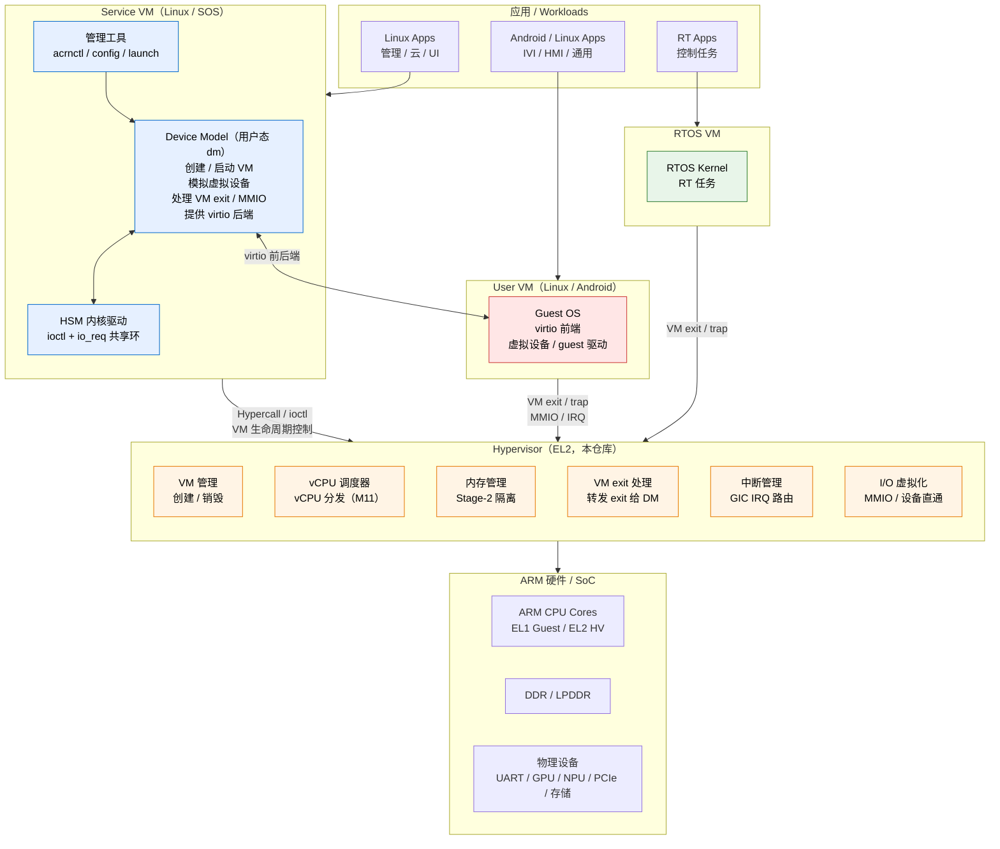
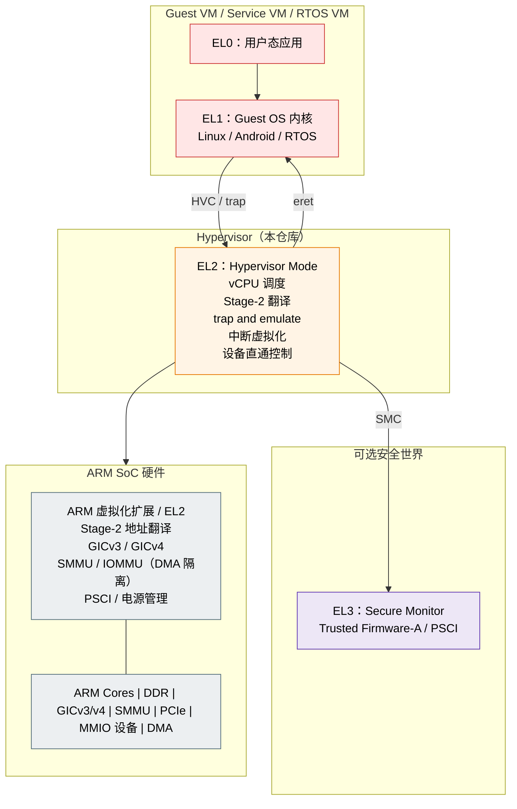

# CLAUDE.md

Guidance for Claude Code (claude.ai/code) in this repository.

Architecture docs must use Mermaid: sequence, class and module-relationship diagrams.

## Ponytail：最小完整改动

参考 [Ponytail 的 AGENTS.md](https://github.com/DietrichGebert/ponytail/blob/b088b2df6e08d4306c6a3c3d575fe38c2d2d2989/AGENTS.md)
（[MIT](https://github.com/DietrichGebert/ponytail/blob/b088b2df6e08d4306c6a3c3d575fe38c2d2d2989/LICENSE)），按本工程特点整合以下常驻工作原则。
适用于编码、修复、重构和评审；**本工程的架构边界、已接受的 ADR、硬件正确性和验证要求优先，不能以精简为由削弱。**

### 动手前确定影响范围

- 先读任务和相关代码，列出必须同步修改的调用方、测试、fixtures、配置和导出接口；检查是否会破坏现有调用、丢失数据或暴露数据。
- 修复 bug 前先查找受影响函数的所有调用方，沿实际执行路径定位根因，再在共同的实现处修复。

### 按顺序选择最小可行方案

1. 确认需求确实需要；范围模糊时先做满足核心需求的最小版本，说明未纳入的额外功能。
2. 优先复用仓库已有的实现、接口和模式，遵守其调用约定与分层。
3. 再考虑标准库或平台能力，但必须适用于本工程的 freestanding/EL2 环境，不能假定存在 libc 或操作系统服务。
4. 再考虑已经引入的依赖，不为几行逻辑增加一个新依赖。
5. 能用一行清楚表达就用一行；不能则写最少且可读的完整实现，不做代码压缩游戏。

### 完整性与收尾

- 改动保持在任务范围内，但必须补齐被它影响的调用方、测试和配置；不添加无人要求的抽象、包装、转换、选项或“以后可能用到”的代码。
- 保留现有架构与数据表示；规模相当的方案优先选择边界条件正确的那个。注释解释代码本身不能表达的原因，保持简短。
- 移动、合并或精简代码时保留原有校验与错误处理；信任边界、安全、可访问性、防止数据丢失的处理、硬件所需的校准/屏障/状态管理和用户明确要求均不能删减。
- 新增非平凡逻辑（分支、循环、解析、安全或状态更新等）应留下一个能验证行为的小测试或自检；它不能替代构建、回归和 QEMU 验收。
- 有已知限制的临时简化，用 `ponytail:` 注释写明适用上限和重新设计的触发条件，避免“以后再说”没有边界。
- 回复结尾用一两行说明未做或未验证的部分，以及用户需要知道的风险；未实际运行的检查不能写成已通过。

## 本地 Superpowers skills

若 `.claude/skills/using-superpowers/SKILL.md` 存在，会话开始先用 `Skill` 加载
`using-superpowers`。本工程使用本地 skills，不使用 Claude 插件；上游文档里的
`superpowers:<name>` 对应本地 `<name>`，不要调用插件命名空间。安装与更新见
[操作说明](docs/reference/superpowers.md)；本工程的架构与验证约束优先。

## Project

A research Type-1 ARM64 hypervisor on QEMU `virt` (AArch64), later RK3588. Inspired by
ACRN, Xvisor and bao; the directory layout mirrors ACRN's `hypervisor/`.

**M10 is done**: two Linux VMs, two vCPUs each, statically pinned 1:1 to pCPUs (2+2 on 4),
EL2-owned console and shell. **Next: M11 (vCPU scheduler)**; the long-term target is the
full ACRN model (Service VM + userspace Device Model). Roadmap: [Milestone Roadmap](#milestone-roadmap).
For M11 also read the
[arch-boundary alignment](docs/superpowers/specs/2026-10-04-m11-arch-boundary-alignment.md).

**Design principle:** small, fast iterations; break work into the smallest practical,
clearly defined units; high cohesion, low coupling. Each milestone gets a spec in
`docs/superpowers/specs/` and a plan in `docs/superpowers/plans/`.

## Where knowledge lives

Would it still hold on another machine, for another person?
- **Yes** → the repo: lessons in `docs/debug/`, decisions in `docs/adr/`, standing rules here (`AGENTS.md` is a symlink to this file).
- **No** (local paths, personal workflow) → private memory under `~/.claude/`. No in-repo `memory/`.
- **New docs are written in Chinese** (identifiers and technical terms stay English); never keep the
  same content in two languages. Rules: [docs/README.md](docs/README.md).

## Architecture

Current modules, objects and boot/console sequences:
[current-architecture.md](docs/reference/arm/current-architecture.md).
[target-architecture.md](docs/reference/arm/target-architecture.md) is the future ACRN model, not implemented.

### Target architecture (ACRN model, M12–M15 — **not implemented**)

Where the roadmap ends: a Service VM running a userspace Device Model for the User VMs, over
this hypervisor. Today there is no scheduler, Service VM, HSM or userspace DM. The diagrams
are the same two as in [target-architecture.md](docs/reference/arm/target-architecture.md)
(which also has the reading notes); if you change one, change both.

**System view** — VMs side by side, privilege and responsibility layered top to bottom:

**Privilege levels** — ARM's exception levels; virtualization lives at EL2:

## Milestone Roadmap

The arch-boundary refactor is complete; M11 scheduling is not. When starting M11,
read the [alignment note](docs/superpowers/specs/2026-10-04-m11-arch-boundary-alignment.md)
together with the original scheduler design rather than restoring its old paths.

| Milestone | Status | Goal |
|---|---|---|
| M0 — Hello EL2 | **done** | Enter EL2, print banner |
| M1 — Bare-metal guest | **done** | Stage-2 MMU, minimal vCPU |
| M2 — PSCI | **done** | PSCI VERSION/FEATURES/CPU_OFF/SYSTEM_OFF over HVC (no GIC) |
| M3 — vGIC software injection | **done** | HVC → `vgic_inject_sw` → guest EL1 IRQ handler (no physical HW) |
| M4 — Physical timer + GIC + HW-forwarding | **done** | timer PPI → EL2 → `vgic_inject_hw` → guest (ADR-0001) |
| M5 — Linux alive (no interrupts) | **done** | Load `Image` + DTB, arm64 boot protocol, PL011 passthrough earlycon; stalls at first GIC MMIO |
| M6 — MMIO trap framework | **done** | Stage-2 data-abort decode + MMIO trap-and-emulate dispatch |
| M7 — vGICv3 emulation | **done** | GICD/GICR(cpu0) trap-and-emulate on the M6 bus; timer-PPI injection |
| M8 — Boot to shell | **done (boot-verified 2026-06-19)** | initramfs load + DTB initrd nodes → interactive busybox shell prompt (headline M5 goal: UP Linux boots to a busybox shell). Confirmed on a real QEMU run: Linux 6.12.93 reaches `~ #` and runs `ls`/`echo`/`uname` over the ttyAMA0 PL011 passthrough |
| M9 — SMP | **done (boot-verified 2026-06-27; reverified 2026-07-13)** | 2-vCPU Linux, PSCI `CPU_ON`, per-pCPU vCPU, SGI virtualization, static 1:1 pinning (no scheduler) |
| M10 — Multi-VM foundation | **done (gate-verified 2026-07-20)** | VM objectification (`g_vm` → `vm[NR_VMS]`): per-VM Stage-2/VMID, per-VM vGIC, static 2+2 CPU partitioning on 4 pCPUs. Memory: QEMU `-m 4G`, VM1 RAM backed at PA `0xC0000000`; both VMs see the identical guest address map (RAM IPA `0x40000000` — the IPA≠PA Stage-2 mechanism is live since M5), so one DTB template and one load-address scheme serve both VMs. Console: EL2 owns the physical PL011 exclusively (revoked the M5 passthrough), both VMs get trap-and-emulate vuarts (`hypervisor/dm/vuart.c`), Ctrl-T switches RX focus (TX is focus-independent). VM-scoped PSCI power-down: `SYSTEM_OFF` in one VM parks only that VM's pCPUs. Landed as three slices, each independently spec- and quality-reviewed, plus a final whole-milestone review; see [[docs/adr/0014-multi-vm-static-partition-el2-console]]. Automated regression: `test-qemu-dual` with shared guests in `tests/svm/`. Known gaps carried into M11+: no automated test for PSCI-off isolation (verified manually only) — the Ctrl-T/`vm_console` focus gap was closed 2026-07-25 by `tests/run_shell_test.sh`; console focus left on a since-shut-down VM is a silent no-op, not fed back to the user (now at least visible as `halted` in `vm_list`); the pre-M10 single-VM overview remains a historical snapshot; current diagrams are in `docs/reference/arm/current-architecture.md` |
| M11 — vCPU scheduler | planned (moved up from M14, 2026-07-19) | Full context switch (incl. FP/SIMD state — lifts the `-mgeneral-regs-only` no-save assumption), time slicing, vCPU count > pCPU count. Deliverable: M10's 2 VMs × 2 vCPUs time-sliced on 2 pCPUs (the other 2 pCPUs left idle for later Service VM work); both guests reach shells and concurrent FP workloads in both VMs run uncorrupted |
| M12 — Hypercall ABI + VM lifecycle | planned | HVC hypercall namespace (distinct from PSCI), VM create/start/pause/destroy, Service VM privilege concept. Deliverable: Service VM controls User VM start/stop via hypercalls |
| M13 — HSM kernel driver + io_req ring | planned | Custom Linux kernel module in the Service VM (modeled on `acrn_hsm`): ioctl interface, io_req shared-memory ring, forwarding User VM MMIO exits to Service VM userspace. Deliverable: a userspace program receives one User VM MMIO access and completes it. Highest-risk milestone — kept minimal on purpose (no virtio) |
| M14 — Device Model + virtio backends | planned | Userspace `dm` program: VM load/start, virtio-mmio console and blk backends. Deliverable: User VM launched by DM, rootfs on a virtio-blk image |
| M15 — RK3588 port | planned | Runtime FDT parsing, real UART/GIC/storage, board bring-up; reproduce the full chain on hardware |
| Deferred | — | SMMU/DMA isolation and the device-passthrough framework: not needed while all User VM devices are DM-emulated on QEMU; schedule when RK3588 passthrough demands it |

### Milestone renumbering (2026-08-10)

The roadmap was flattened to consecutive integers `M0`–`M15`. The old scheme had
decimal milestones (`M1.5`, `M2.5`, `M3.0`–`M3.5`) and a gap where `M4` was never
used, which made ordering ambiguous. **Historical documents were deliberately not
rewritten** — `docs/superpowers/{specs,plans}/`, `docs/adr/` and `docs/debug/`
are records of what happened at the time, and their filenames are referenced from
git history and already-pushed branches. Use this table when reading them:

| Old | New | Milestone |
|---|---|---|
| M0 | M0 | Hello EL2 |
| M1 | M1 | Bare-metal guest |
| M1.5 | **M2** | PSCI |
| M2 | **M3** | vGIC software injection |
| M2.5 | **M4** | Physical timer + GIC + HW-forwarding |
| M3.0 | **M5** | Linux alive (no interrupts) |
| M3.1 | **M6** | MMIO trap framework |
| M3.2 | **M7** | vGICv3 emulation |
| M3.4 | **M8** | Boot to shell |
| M3.5 | **M9** | SMP |
| M5 | **M10** | Multi-VM foundation |
| M6 | **M11** | vCPU scheduler |
| M7 | **M12** | Hypercall ABI + VM lifecycle |
| M8 | **M13** | HSM kernel driver + io_req ring |
| M9 | **M14** | Device Model + virtio backends |
| M10 | **M15** | RK3588 port |

There was never an `M3.3`, and the old `M4` (once "RK3588 port") was retired when
the port moved to the end of the roadmap; neither has a new-scheme equivalent.
Filenames such as `2026-06-23-m3.5-smp-design.md` keep their old numbering.

### ACRN-model strategy (decided 2026-07-14, revised 2026-07-19)

The end state is the full ACRN architecture: a privileged Service VM running a
userspace Device Model that serves virtio backends to User VMs. Standing
decisions shaping the roadmap ordering:

1. **QEMU-first**: the entire ACRN-model core chain (multi-VM → hypercall →
   HSM → DM) is developed and verified on QEMU `virt`; the RK3588 port comes last.
2. **Scheduler right after multi-VM** (revised 2026-07-19; was "scheduler
   last"): the primary project goal is learning EL2 core technology, and the
   scheduler is the densest remaining piece — it forces per-vCPU state
   (FP/SIMD, system registers, vGIC LR save/restore) to be complete. Doing it
   at M11, before the hypercall→HSM→DM chain, means M12–M14 build on a finished
   state-switching foundation instead of accumulating "no-save" assumptions.
   M10 itself still keeps 1:1 vCPU:pCPU pinning (ACRN "partitioned" mode).
3. **No interim in-hypervisor virtio backends**: virtio backends are written
   once, in the userspace DM (M14). Until then User VMs use vuart console +
   initramfs (no disk). Avoids writing/maintaining the backend logic twice.
4. **FDT parsing deferred to M15**: QEMU milestones keep static board config
   (ADR-0008) and prebuilt guest DTB templates.
5. **EL2 owns the console from M10 on** (2026-07-19): the M5 PL011 passthrough
   is revoked; the physical UART belongs to EL2 and every VM sees a
   trap-and-emulate vuart, with an escape key switching input focus. This is
   the only design that gives every VM an interactive shell over one physical
   UART, and it pre-builds the Service VM console path.
6. **One guest address map for all VMs** (2026-07-19): every VM sees RAM at
   IPA `0x40000000` regardless of the backing PA. This is not new mechanism —
   `vm_config` already separates `mem_base` (IPA) from `ram_pa`, and VM0 has
   mapped IPA `0x40000000` → PA `0x80000000` since M5 — so VM1 is just a
   second config with `ram_pa = 0xC0000000`. One DTB template, one set of
   load-offset constants, and the guest-visible machine is identical across
   VMs. (An identity-mapped VM1 was considered and rejected: it would need a
   second DTB template and a second address-constant set for zero gain.)

## Reference source trees (in `../`)

`../acrn-hypervisor` (x86; primary structural inspiration), `../xvisor` (ARM-first; Stage-2 and vCPU
design), `../bao-hypervisor`. Consult the smallest relevant file before designing a subsystem (Stage-2,
vGIC, PSCI, virtio…). Specs: [ARM ARM](https://developer.arm.com/documentation/ddi0487/latest),
[GIC](https://developer.arm.com/documentation/ihi0069/latest),
[pKVM](https://source.android.com/docs/core/virtualization).
