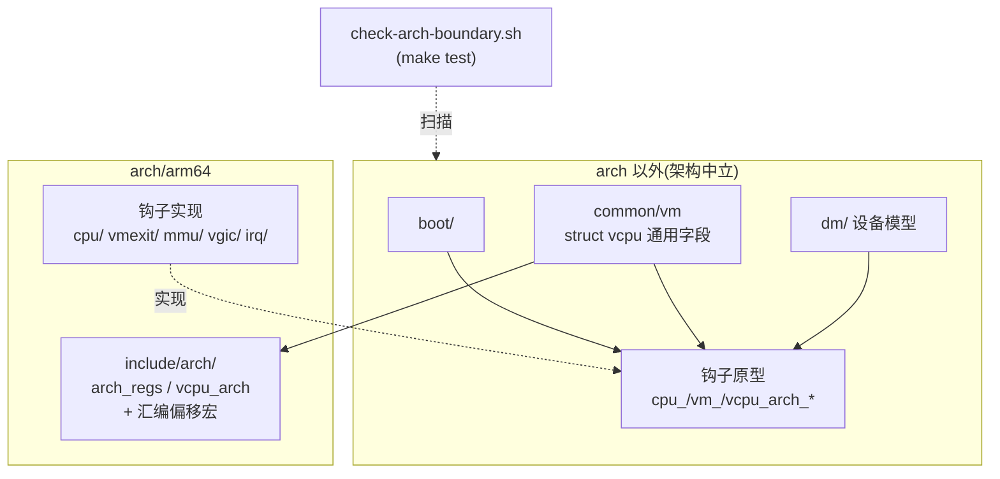

# arch/ 以外的代码只能通过 `*_arch_*` 钩子访问架构层

> **Status:** Accepted. **Milestone:** M11 前置重构(arch-boundary)。修订
> [[0003-asm-c-vcpu-offset-coupling]] 中"偏移宏放在哪个头文件"这一点。
> **2026-10-04:** 迁移按 spec 范围完成,检查零容忍通过。**多架构可移植性尚未
> 证明**:仓库里只有 arm64 一个 arch,没有第二个架构编译过通用代码;剩余的语义
> 耦合见文末"已知语义耦合"。
> **2026-10-18:** 加入 `arch/x86` 链接检查 stub(`make test-x86-stub`,已并入
> `make test`)。通用代码不改一行就能用 x86_64 gcc 编译,并能和 x86 的 stub 钩子
> 链接成功。证明的程度是**能编译、能链接**,**没有证明能运行**:stub 钩子都是空实现,
> 也没有 x86 启动入口。
> **2026-10-18(同日):** 公共头文件收拢到 `include/`,见文末"公共头文件规则"。

这个 hypervisor 的目标是多架构:现在是 ARM64(QEMU `virt`,之后 RK3588),将来
要能加入 x86 等架构。目录仿照 ACRN 分成 `arch/` 和 `common/`,但到 M10 为止这个
划分只停留在名字上:`common/` 里放着 ARM 专有的 PSCI;VM 模块直接写 `vmpidr_el2`,
直接调用 Stage-2 和 vGIC;`struct vcpu` 直接包含 EL2/ICH 字段;启动入口和 vuart
直接读 `BOARD_*`、调用 `gic_*`/`vgic_*`。于是加入第二个架构时,几乎每个"通用"文件
都要改。而且 M11 会大幅扩充 `struct vcpu`,拖得越久代价越大。更关键的是,没有任何
机制能阻止新的架构代码继续流进 `common/`。

**Decision:** 采用 bao-hypervisor 的 core/arch 划分,并用构建检查强制执行:

1. `hypervisor/arch/` **以外**的代码(不只 `common/`,也包括启动入口、设备模型、
   调试、库和通用头文件)**禁止**:内联汇编、`.S` 文件、系统寄存器名(`*_ELn`、
   `ICH_*`、`ICC_*`)、PSCI 符号、直接调用 `vgic_*`/`stage2_*`/`gic_*`/`vtimer_*`、
   `BOARD_*` 常量和 `board.h`。唯一例外是静态 VM 配置表 `common/vm/vm_configs.c`,
   它本身就是板级配置(ADR-0008);声明它的 `vm_config.h` 不引入 `board.h`。
2. 访问架构层只有两种途径:`<对象>_arch_<动词>` 钩子(`cpu_`、`vm_`、`vcpu_`),
   以及 `<arch/xxx.h>` 命名空间头文件(由构建系统按 `ARCH` 解析;`ARCH` 是环境/命令行变量,和 Linux 一样;板子由 `make <board>_defconfig` 写出的 `.config` 决定,其 `CONFIG_ARCH_*` 必须与 `ARCH` 一致,否则报错)。
3. 钩子原型由**通用头文件**声明,每个 arch 都必须实现,**不提供 weak 默认实现**,
   缺实现在链接时就报错。钩子**按需增长**:由真实调用点引入,不预先设计完整 HAL。
4. 通用结构体嵌入 arch 结构体(`struct vcpu` ⊃ `struct arch_regs` + `struct
   vcpu_arch`)。`struct vm_arch` 同样按需引入:`struct vm` 目前没有 arch 私有
   字段(per-VM 的 Stage-2/vGIC 状态在各自文件的 static 数组里),第一个这样的
   字段出现时再嵌入。汇编偏移宏跟着 arch 结构体
   **移到 arch 头文件**。这一点修订了 ADR-0003:"结构体和偏移宏放在同一头文件、
   由 `check-offsets` 校验"的约定不变,变的只是位置,从 `include/vm.h` 移到了 arch。
5. `scripts/check-arch-boundary.sh` 在 `make test` 中执行这些规则,**零容忍**。
   它分两步:先对去掉注释和字符串的源码做 grep;再预处理 arch 以外的每个 `.c`,
   凡是(哪怕间接)引入了 `arch/<name>/include/arch/` 以外的 arch 头文件就失败。
   迁移期间曾用一份只减不增的白名单(`scripts/arch-boundary.allow`)度量进度,
   迁移完成时清空并删除。
6. **设备相关不等于架构相关**:模拟的设备(vuart = PL011)留在 `dm/`,物理驱动放在
   `drivers/`;它们只需要切断和 vGIC、`BOARD_*` 的直接耦合。

## Considered Options

- **bao 风格:中性钩子 + `<arch/>` 头文件 + 构建期棘轮检查。** 选用。理由:x86
  移植只需新增 `arch/x86/`,通用代码不用动;而且规则由 `make test` 强制,不依赖
  review 记忆。
- **只把 PSCI 移出 `common/`,允许 `common/` 继续调用 `stage2_*`/`vgic_*`。** 否决。
  这样加 x86 时 VM 模块照样得改,只是换了个地方越界。
- **现在就建一个 `arch/x86` stub 构建来证明 `common/` 能编译。** 2026-10-04 时暂不采用:
  每加一个钩子都要同步维护 stub,还需要 x86 工具链。**2026-10-18 改为采用**:宿主机
  自带的 `x86_64-linux-gnu-gcc` 就够用;维护成本只是每个钩子一个空函数;换来的是 M11
  每次新增钩子都会被链接检查立刻覆盖,不用等钩子稳定以后再补。
- **一次性设计完整 HAL(包括 M11 要用的 save/restore)。** 否决。接口形状应该由真实
  调用点决定,现在猜大概率会猜错。
- **`arch_<对象>_<动词>`(ACRN/Linux 风格)命名。** 否决。和选定的参考实现 bao 保持
  一致。
- **weak 默认钩子(bao 的 `vm_arch_allow_mmio_access` 用法)。** 否决。它会把"忘了
  实现"推迟到运行时才发现。

## Consequences

- 加入新架构的工作量是"实现一组已命名的钩子,再加上 `arch/<new>/include/arch/`",
  通用代码保持不变。
- 物理 GIC / vGIC 的拆分规则(CLAUDE.md)仍然有效,它位于本边界之内。
- 检查能发现**写法**上的越界和**头文件**层面的间接依赖,发现不了**语义**上的耦合,
  比如通用代码假设 IPA 按 1 GB 对齐。语义耦合仍然要靠 review。
- `CPU_OFF` 杀掉整个 VM 的已知缺陷在迁移中保持原样。电源策略(`vm->off`、kick
  其它 pCPU)随 guest PSCI 模拟进入 arch,把它抽成通用 API 由 M11 负责。
- M11 调度器新增的运行状态放进通用 `struct vcpu`,EL1 系统寄存器块放进
  `struct vcpu_arch`。
- 历史 spec、plan、ADR 中引用的旧路径(`common/psci/` 等)不做修改。

## 已知语义耦合

2026-10-04 复查迁移结果时,在 arch 以外找到的、检查脚本抓不到的耦合。每项都已
定性,新架构移植时从这张表开始看:

| 位置 | 耦合 | 定性 |
|---|---|---|
| `include/percpu.h` | `cur_vcpu` 必须是第一个字段、`PERCPU_SIZE` 固定:arch 汇编直接按偏移读通用结构 | **接受**。这是"arch 汇编读通用结构"的契约本身,由 `_Static_assert` 钉住;新 arch 的入口汇编遵守同一契约即可 |
| `include/vm_config.h` | ~~`dtb_ipa` 对应 arm64 Linux 启动协议~~ | **已解决(2026-10-18)**。字段改名为中性的 `bootinfo_ipa`,注释里注明 arm64 Linux 在这里放 DTB(x0) |
| `include/vm_config.h` | `vuart_base`/`vuart_irq` 默认 vuart 是 PL011 | **接受**。设备相关不等于架构相关(Decision 第 6 条) |
| `struct vm.off` | 通用字段,只有 arm64 guest PSCI(`vmexit/vpsci.c`)写它;读它的是 arm64 `irq/irq_handler.c`(kick 后停车)和通用的 `dm/hv_shell.c` | **交给 M11**:被每 vCPU 运行状态取代(M11 S2) |
| `VCPUS_PER_VM`、`secondary_main` | 静态 1:1 绑定,由 pCPU id 推出 (VM, vCPU) | **交给 M11**:调度器引入后映射不再是结构性的 |

原先第一项还包括 `NR_CPUS` 写死在通用头文件里,已在同日改为由各板 `board.mk`
提供(`-DCONFIG_NR_CPUS=N`)。

持续验证的办法:M11 新增的每个钩子都要回答"x86/RISC-V 能否实现",记在
`docs/superpowers/specs/2026-10-04-m11-arch-boundary-alignment.md` 的钩子可移植性表里。另外,`make test-x86-stub` 在链接阶段把关:新钩子如果没有在 `arch/x86/stub/hooks.c` 里补上 stub,就会链接失败。

## 公共头文件规则(2026-10-18)

边界检查只看 arch 与非 arch 之间的写法,看不到**模块之间**靠搜索路径泄漏的依赖:
原先全局带着 `-Ihypervisor/common/vm -Ihypervisor/dm`,于是 `include/vm.h` 能 include
`dm/vuart.h`,arch 代码也能直接 include `dm/console.h`。现在的规则:

1. **只有一个公共头文件目录 `hypervisor/include/`。** 被其它模块引用的头文件(`vm_config.h`、
   `console.h`、`hv_shell.h`、`vuart.h`、`mmio.h` 等)都放在这里,用 `<...>` 引用;
   `-I` 里不再有 `common/vm` 和 `dm`。模块私有的头文件只能用 `"..."` 从本目录引用,
   别的目录够不到,**由编译器强制**,不靠 review。
2. **设备模型的状态归设备模型。** `struct vuart` 及其 FIFO 常量移进 `dm/vuart.c`,
   `vuart.h` 只剩 API;`struct vm` 不再嵌入它(per-VM 状态用 static 数组 + `vm->id`)。
3. **架构专有的 ABI 常量放进 arch。** `hypercall.h`(`SMCCC_NOT_SUPPORTED`、`HVC_VENDOR_BASE`、
   `HC_GUEST_DONE`)只有 arm64 的 `vmexit.c` 使用,移到 `arch/arm64/include/arch/hypercall.h`。
4. 通用层调用设备模型的组合点保留在 `vm_init()`(`vuart_bus_init()`):它是装配代码,
   不是反向依赖。

**明确留给 M11、不在这次解耦范围内:** `struct vm.off` 的语义(`CPU_OFF` 杀整个 VM)和
`VCPUS_PER_VM` / `secondary_main` 的静态 1:1 映射,它们要等每 vCPU 运行状态引入后才能拆;
`percpu.h` 的 `cur_vcpu` 首字段契约是被接受的设计,不是待解的耦合。
