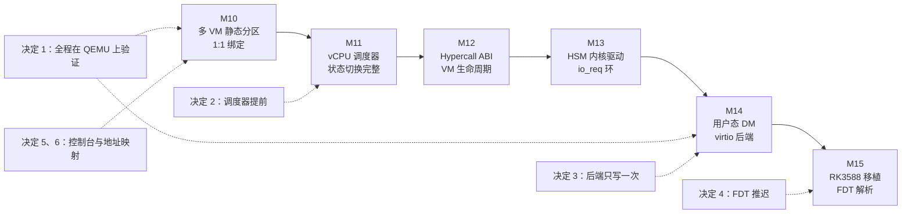

# 路线图按 ACRN 模型排序:QEMU 优先、调度器紧随多 VM、virtio 后端只写一次

> **Status:** Accepted. **Milestone:** M10–M15(路线图排序)。决定于 2026-07-14,
> 2026-07-19 修订(调度器由 M14 提前到 M11);2026-10-19 从 `CLAUDE.md` 迁入本 ADR。
> 其中第 5、6 条的实现见 [[0014-multi-vm-static-partition-el2-console]]。

项目的终点形态是完整的 ACRN 架构:一个有特权的 Service VM,在用户态运行 Device Model,
为 User VM 提供 virtio 后端。这条链上的每一步(多 VM → hypercall → HSM 内核驱动 →
用户态 DM)都依赖前一步,而 M15 的 RK3588 真机移植又要把整条链在硬件上复现。哪些先做、
哪些推迟、哪些绝不做两遍,会决定后面每个里程碑能不能建立在稳固的基础上,所以需要把这些
排序决定固定下来,避免后续里程碑各自重新讨论。

**Decision:**

1. **QEMU 优先。** ACRN 模型的整条核心链(多 VM → hypercall → HSM → DM)都在 QEMU `virt`
   上开发和验证,RK3588 移植放到最后(M15)。
2. **调度器紧跟在多 VM 之后(M11)。** 2026-07-19 修订,原方案是"调度器放最后"。项目的
   首要目标是学习 EL2 核心技术,调度器是剩下最密集的一块,它逼着每个 vCPU 的状态
   (FP/SIMD、系统寄存器、vGIC LR 的保存与恢复)都做完整。放在 hypercall → HSM → DM 之前,
   M12–M14 就建立在一个已经完成的状态切换基础上,不会不断累积"没有保存"的假设。M10 本身
   仍保持 vCPU 与 pCPU 1:1 绑定(ACRN 的"partitioned"模式)。
3. **不写过渡期的 hypervisor 内 virtio 后端。** virtio 后端只在用户态 DM(M14)里写一次。
   在此之前 User VM 用 vuart 控制台加 initramfs,没有磁盘。这样避免同一套后端逻辑写两遍、
   维护两遍。
4. **FDT 解析推迟到 M15。** QEMU 阶段的里程碑沿用静态板级配置([[0008-static-board-config-vs-fdt]])
   和预先编好的 guest DTB 模板。
5. **从 M10 起 EL2 独占控制台。** 撤销 M5 的 PL011 直通:物理 UART 归 EL2,每个 VM 看到
   的是 trap-and-emulate 的 vuart,用转义键切换输入焦点。这是在一个物理 UART 上让每个 VM
   都有交互式 shell 的唯一做法,也为 Service VM 的控制台路径预先铺好路。实现见 ADR-0014。
6. **所有 VM 共用同一份 guest 地址映射。** 不论后端 PA 是多少,每个 VM 都在 IPA
   `0x40000000` 看到 RAM。这不是新机制:`vm_config` 早就把 `mem_base`(IPA)和 `ram_pa`
   分开,VM0 自 M5 起就把 IPA `0x40000000` 映射到 PA `0x80000000`,所以 VM1 只是第二份配置,
   `ram_pa = 0xC0000000`。一份 DTB 模板、一套加载偏移常量,guest 看到的机器在各 VM 之间
   完全相同。

## Considered Options

- **调度器放最后(2026-07-14 的原方案)。** 2026-07-19 否决:调度器要求每个 vCPU 的状态都能
  完整保存与恢复,拖到最后意味着 M12–M14 一路在"状态不保存"的假设上堆代码,最后再返工。
- **先在 hypervisor 里写一个过渡的 virtio 后端,M14 再迁到用户态 DM。** 否决:同一套后端要
  写两遍、维护两遍,而过渡版本最终会被丢弃。
- **先做 RK3588 真机,再回头补 QEMU 验证。** 否决:真机调试周期长、可观测性差,核心链路在
  QEMU 上验证快得多;真机最后用来复现整条链。
- **VM1 用恒等映射(IPA = PA)。** 否决:需要第二份 DTB 模板和第二套地址常量,没有任何收益。
- **EL2 与某个 guest 协作共享 PL011(直通)。** 否决:无法让两个 VM 同时有交互式 shell。

## Consequences

- M11 必须去掉"不保存 FP/SIMD"的假设,因此会解除 `-mgeneral-regs-only` 的限制,这是它最大的
  一块工作量。
- 在 M14 之前,User VM 没有磁盘,只有 vuart 和 initramfs;任何需要块设备的测试都要等 DM。
- 静态板级配置([[0008-static-board-config-vs-fdt]])的有效期到 M15;真机移植时要重新评估。
- SMMU/DMA 隔离和设备直通框架不在这条路线上:只要 User VM 的设备全由 DM 模拟,就不需要;
  等 RK3588 的直通需求出现再排期。
- 这些是**排序决定**,里程碑本身的目标和验收见 `CLAUDE.md` 的路线图表和各里程碑的 spec;
  与之冲突的新排序要写一篇新 ADR 并把本篇标为 `Superseded`。
