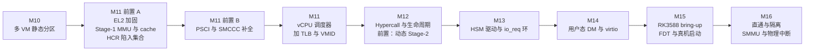

# 先给 EL2 加固再做调度器,并把设备直通单独排成 M16

> **Status:** Accepted. **Milestone:** M11 前置 A/B,M11–M16(路线图重排)。
> 修订 [[0016-acrn-model-roadmap-decisions]] 的第 2 条与"SMMU/直通推迟"一项;
> 其余决定仍然有效。决定于 2026-10-20。

arch 边界重构完成后,对照 xvisor、bao 的 ARM64 实现盘点了现有实现的缺口。其中有几项
**不在 ADR-0016 的路线里**,却是学透 EL2 和在 RK3588 上跑业务都绕不开的(以下都已在
`hypervisor/arch/` 下用 grep 核实):

- **EL2 自己没有开 Stage-1 MMU 和 cache。** `arch/` 下没有对 `SCTLR_EL2`、`TTBR0_EL2` 的
  写入,所以 hypervisor 的内存是 Device 类型。自旋锁用的 `ldxr/stxr` 在 QEMU 上能跑,
  真机上不保证可靠;`-mstrict-align` 也是因此才必须;性能也差。
- **`HCR_EL2` 只开了 `VM/FMO/IMO/AMO/RW`,没有陷入敏感操作。** 没设 `TSC`,真机上 guest 的
  `smc` 会直达 EL3(TF-A),可以绕过 PSCI 仿真;`TWI/TWE`、ID 寄存器过滤、PMU/debug
  (`MDCR_EL2`)也没管。
- **PSCI 只实现了 6 个函数**(`VERSION`、`CPU_ON`、`CPU_OFF`、`SYSTEM_OFF`、`SYSTEM_RESET`、
  `FEATURES`),缺 `CPU_SUSPEND`、`AFFINITY_INFO`、`MIGRATE_INFO_TYPE`、`SYSTEM_RESET2`,
  也没有 SMCCC 的版本和特性探测。
- **没有任何 TLB/cache 维护**(全仓库没有 `tlbi`、`dc`、`ic`),Stage-2 是静态的
  (1 GB 块加一个 2 MB 的洞),hypervisor 没有分配器。
- **直通与隔离还没有排期。** ADR-0016 把 SMMU 和设备直通框架"推迟到 RK3588 直通需要时",
  但"跑业务"恰好要把网卡、存储直通给 VM,那时 SMMU 就是必需的。

这些缺口的共同点是:越晚补,依赖旧前提的代码越多。尤其是 EL2 的内存类型,会影响此后写的每一把
锁、每一个共享结构。

**Decision:**

1. **在 M11 之前加两个"前置"阶段**(沿用 ADR-0015 的"M11 前置重构"叫法,不整体平移
   M11 之后的编号):
   - **M11 前置 A:EL2 加固。** ① EL2 开 Stage-1 MMU 和 cache,hypervisor 内存改为 Normal
     类型(先只开 MMU 的身份映射,再开 cache,分两个切片);② `HCR_EL2` 加陷入集合:
     `TSC`(SMC)、`TWI/TWE`、ID 寄存器过滤、PMU/debug 的 `MDCR_EL2`。
   - **M11 前置 B:PSCI/SMCCC 补全。** 补上上述缺失的 PSCI 函数和 SMCCC 版本、特性探测。
     它与 M11 要重写的电源状态(`CPU_OFF` 缺陷)相关,先把接口面定下来。
2. **M11 调度器的范围扩大**,在原有的完整上下文切换(含 FP/SIMD)、时间片、vCPU 数量
   大于 pCPU 数量之外,加上:TLB 与 VMID 维护(这是仓库里第一次出现 `tlbi`)、虚拟 timer 的
   保存与恢复、按 `ICH_VTR_EL2` 探测 LR 数量。原因是两个 VM 第一次共用一个核。
3. **M12 增加前置切片:页分配器与动态 Stage-2**(4 KB 粒度、`map/unmap`、权限控制),
   创建和销毁 VM、共享内存都依赖它。
4. **M15 只做真机 bring-up**:FDT 解析、真机 UART/GIC、从 TF-A 启动,验收是真机上启动单个
   Linux VM。把"能启动"和"能跑业务"拆开,第一次上板只面对启动问题。
5. **新增 M16:直通与隔离。** 物理 SPI 路由给 guest(含 EOI 处理)、设备 MMIO 直通、SMMU
   做 DMA 隔离、vGIC 补齐(maintenance 中断,按需 ITS/LPI)。这取代 ADR-0016 里"SMMU 和直通
   推迟、不排期"的说法。
6. **其余沿用 ADR-0016:** QEMU 优先、调度器紧随多 VM(现在是紧随这两个前置阶段)、
   virtio 后端只写一次、FDT 推迟到 M15、EL2 独占控制台、统一 guest 地址映射。

## Considered Options

- **维持 ADR-0016 的顺序,把加固穿插在后面。** 否决:EL2 内存类型和陷入集合是此后所有代码的
  前提,拖到调度器甚至 RK3588 之后,要返工的锁、共享结构和测试都更多;SMC 直达 EL3 还是
  一个安全缺口。
- **把加固做成 M11 的一部分。** 否决:M11 本身已经是最大的一块(完整上下文切换),加上开
  MMU 这种"出错就启动即挂"的改动,失败时很难判断是哪个引起的。
- **整体重新编号(加固为新的 M11,其余顺延)。** 否决:`M11` 在 spec、ADR-0015、对齐说明和
  `CLAUDE.md` 里到处是"调度器",平移编号会再造一次 2026-08-10 那样的新旧对照问题。
- **把直通并入 M15 真机移植。** 否决:一次同时面对板级启动和设备直通两类问题,故障面太大。
- **保持 SMMU 不排期。** 否决:直通设备的 DMA 会绕过 Stage-2,没有 SMMU 就没有隔离。

## Consequences

- **一部分验收在 QEMU 里做不到。** QEMU 不会在 Device 内存上让 `ldxr/stxr` 出错,所以 M11 前置 A
  在 QEMU 里只能验证"开了 MMU 与 cache 之后不崩、全部现有测试仍然通过",验证不了"真机上更可靠"。
  按仓库规则这部分要标成静态验证,留到 M15 上板确认。`TSC` 陷入可以用 SVM 用例在 QEMU 里验证。
- **M11 前置 A 是风险最大的一步**:开 MMU 要为 hypervisor 自己的代码、数据、栈、设备建页表,
  出错就是启动即挂。因此拆成"只开 MMU"和"再开 cache"两个切片。
- **EL2 开 Stage-1 之后**,`-mstrict-align` 不再是硬性要求,可以重新评估;栈保护页等防护也
  才有了实现基础。
- ADR-0016 的状态保持 `Accepted`,在其状态行加了指向本篇的说明;它的第 2 条以本篇为准。
- 不在这次排期里的选做项:bao 的缓存着色、静态 IPC、xvisor 的多种调度算法与负载均衡、
  SVE/MTE 暴露。它们对学习有价值但不挡路,放在 M16 之后。
- `CLAUDE.md` 与 `README.md` 的路线图表已同步;各前置阶段开工前各自写 spec。
