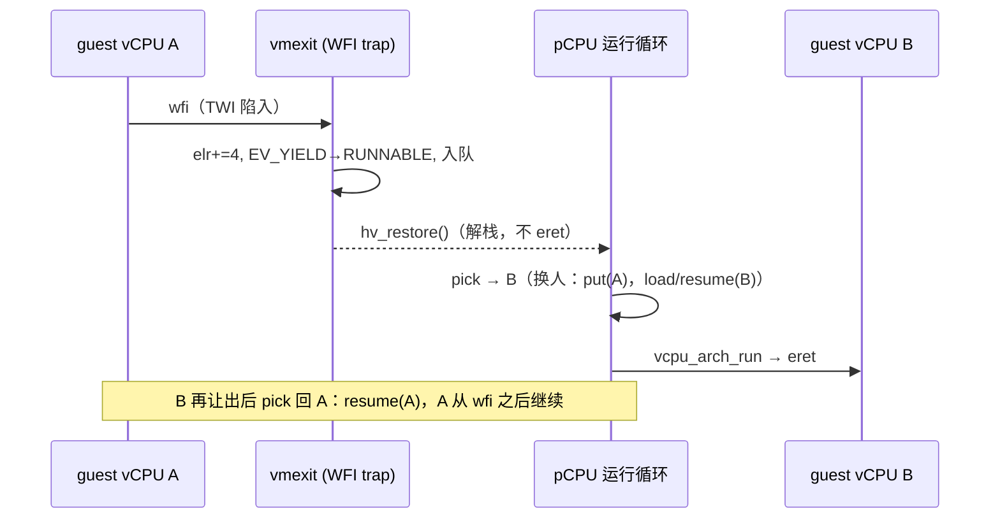

# 协作式让出先于抢占：调度即运行循环，不做 C 栈切换

> **Status:** Accepted. **Milestone:** M11 片 B1（2026-10-31）。

## 背景

M11 需要让多个 vCPU 共享一个 pCPU。业界有两条路：立刻做抢占式时间片调度，或先做
协作式让出（guest 的 WFI 即让出点）。08-10 设计的 Q7 已倾向后者；loop 关卡①（B1，
2026-10-31）正式裁定并落实现。

## Decision

1. **调度器就是运行循环**：每 pCPU 的循环 `pick → load/resume → run`；调度状态
   （RR 队列）与运行循环合一，不引入独立调度器线程/上下文。pick 语义 = 出队，
   yield 语义 = 重新入队——RR 由两个原语复合而成。
2. **让出 = 状态转移 + 解栈复入，不做 C 栈切换**：WFI 陷入路径推进 ELR、置
   RUNNABLE、入队，然后 `hv_restore()` 解栈回本 pCPU 的运行循环（复用 CPU_OFF/
   GUEST_DONE 先例与 per-pCPU `g_hv_ctx`）。被让出的 vCPU 与候选者在同一循环里
   汇合，**不存在 hypervisor 侧的协程栈切换**。
3. **put 只在真实换下时发生**：pick 返回他人且前任仍 RUNNABLE 才 `vcpu_arch_put`；
   自重拾（独占队列的 yield 往返）零 ICH 往返——1:1 配置与旧放行逐指令等价。
4. **B1 的保存集 = vGIC 影子**（同 pCPU、无远端发布者的共享 profile 内）；EL1 全量
   put/load 属 B2（ADR-0019 将随其落地）。

## Considered Options

- **长跳转式 `switch_to`（xvisor/bao 风格的 C 栈切换）**。否决：B1 的切换点天然
  全部经过运行循环（三类解栈出口已存在），栈切换会引入第二套保存机制与不可重入
  风险，收益为零；~~spec §4 的"`switch_to` 唯一入口"措辞由 B2/ADR-0019 再裁~~
  **已裁（2026-10-31，ADR-0019 第 7 条）**：该措辞宣布被 put/load/resume 三元组取代。
- **立即抢占（EL2 定时器时间片）**。否决（08-10 Q7 维持）：协作式先验证切换正确性
  与 vGIC/vtimer 协议，抢占是 D 片在其上的单变量追加。
- **WFI 直接放行（M10 行为）**。否决：共享 pCPU 下放行 = 让 WFI 的 vCPU 独占自旋，
  第二个 vCPU 永不运行。

## Consequences

- 切换的承重点收敛在两处：异常入口/出口汇编的完整 GPR 帧（本就存在），与
  `g_hv_ctx` 的 callee-saved 保存（解栈与再入对称）。
- ~~**待决（B2 再裁）**：B2 的 block/wake（WFI→BLOCKED + 注入唤醒）可能吸收/取代
  `VCPU_EV_YIELD` 边~~ **已裁（2026-10-31，ADR-0019 第 6 条）**：YIELD 边保留——
  有竞争让出（YIELD）与独处阻塞（BLOCK）互补并存，未吸收。
- 已知边界（随实现记录在 vm_configs.c 与 devlog）：共享 profile 的用例不得用
  vGIC、不得编程 CNTV、保持 DAIF 掩蔽；B2 协议落地前禁止共享跑 Linux。
- 不带状态变化的解栈（GUEST_DONE 停车）不经过 pick（RUNNING 直入快路径；timer 出口本就 eret 直回 guest、不经运行循环）——这是 gate-① R1 形状的一个实现
  期修正（RUNNING 的 vCPU 不在队列），已在 B1 plan 修订与日报记录。
