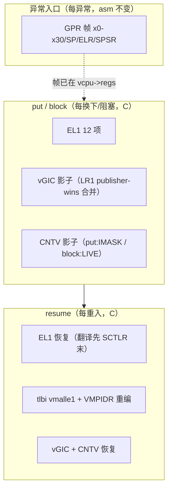

# 两层状态划分：汇编每异常存 GPR 帧，C 每切换存 EL1/vGIC/vtimer

> **Status:** Accepted. **Milestone:** M11 片 B2（2026-10-31）。

## 背景

M11 的上下文切换需要回答"哪些状态在异常入口保存、哪些在调度点保存"。08-10 设计的
决策 9/10 定了形状（汇编不扩、EL1 批量在 C）；ADR-0018（B1）落了协作让出与 GPR 级；
本 ADR 补齐 EL1 全量、vGIC 运行期协议与身份寄存器，并裁定 ADR-0018 留下的两个待决。

## Decision

1. **两层划分（终形）**：异常入口汇编保存且仅保存 GPR 帧（x0–x30、SP_EL1、ELR_EL2、
   SPSR_EL2）——每次异常都发生，`vmexit_asm.S` 不变；`vcpu_arch_put`/`vcpu_arch_block`
   保存 EL1 批量集 + vGIC 影子 + CNTV 影子——只在真实换下/阻塞时发生；`resume` 对称
   恢复 + `tlbi vmalle1` + **重编 `VMPIDR_EL2`**（TID3 转发活寄存器，身份必须随载入者）。
2. **EL1 清单（12 项，Q9 推导+半清单实证+bao/xvisor 对照）**：SCTLR、TTBR0/1、TCR、
   MAIR、VBAR、CPACR、TPIDR_EL1、TPIDRRO_EL0、CONTEXTIDR、ESR_EL1、FAR_EL1。恢复序 =
   翻译寄存器先、SCTLR 末（今日惰性，片 C 跨 VM 时承重）。半清单实验 4/4 组对称失败
   见 `docs/debug/m11-b2-el1-halflist.md`。
3. **vGIC 运行期协议 = publisher-wins**（§8.1/D13）：`vgic_save` 在 `spi_lock` 内合并——
   `spi_shadow_pending` 置位即远端发布更新，保影子弃活读；否则活读。B1 的"无发布者"
   限定解除。
4. **block 与 put 的 vtimer 分叉**：put/rot = save-then-IMASK（xvisor 先例：过期期限在
   resume 解掩时电平 PPI 重升）；block = 存影子但 timer 保持 LIVE（阻塞者唯一自身唤醒源）。
5. **快路径不变式集（关卡② B1 账单 5 复审结论）**：静态亲和；cur_vcpu 恒为本 pCPU 亲和
   vCPU；RUNNING 永不入队；无迁移；wake 仅自 BLOCKED。任何松动须重审 `sched_loop`。
6. **ADR-0018 待决一落定**：`VCPU_EV_YIELD` 边**保留**——有竞争让出与独处阻塞互补
   （B2 实现三分后并存，非吸收）。
7. **ADR-0018 待决二落定**：spec §4"`switch_to` 唯一公开入口"措辞**宣布被
   put/load/resume 三元组取代**——无 switch_to 符号存在，调度即 `sched_loop` 循环。

## Considered Options

- **惰性 EL1（CPTR/陷阱法按需保存）**。否决：QEMU 陷阱路径无差异收益，真机才见分晓；
  半清单实证全量清单后正确性先立住，惰性留给 RK3588 性能优化（触发条件：实测切换开销）。
- **全动态 LR 数（ICH_VTR 驱动变长数组）**。否决：freestanding 无动态分配，struct 钉死
  4 + 探测契约（<4 BUG、>4 封顶记录）等价覆盖正确性面。
- **block 也 IMASK（统一 put/block 语义）**。否决：锁死阻塞者唯一唤醒源（关卡① R2）。

## Consequences

- **已知缺口三件**（触发条件各钉）：AMAIR_EL1（首个消费者）；PAC 密钥 APIA/APIB/APGA
  （**片 C 共享 Linux 前必须补**——Linux 用 PAuth）；CNTKCTL_EL1（随 EL2 背景定时器
  重设计合并处理）。
- **共享 pCPU 自 timer 唤醒缺口**：阻塞 vCPU 的 pCPU 后来跑了他者时，其 PPI 误投
  cur_vcpu——EL2 背景定时器（KVM/bao 式 deadline 模拟）的触发条件 = 首个依赖自身
  timer 的共享阻塞场景。
- **共享 profile 跨 vCPU SGI 缺口**：`sgi_pending[]` 按 pCPU 键控，共享时误投当前
  vCPU；per-vCPU LR 投递的触发 = 首个 intra-VM 共享 SGI 消费者（片 C 的 2×2-on-2 每
  VM 仍 1:1，不受影响）。
- tlbi vmalle1 为保守全刷；免失效（ASID/VMID tag）条件 = RK3588 实测成本 + §8.3。
- 1:1 profile 下 put/resume/EL1 路径**从不执行**（无切换）——ctxsw 是唯一覆盖面，
  手工 Linux gate 在 B2 期间仅为回归网；共享跑 Linux 留待片 C 拓扑翻转后。
