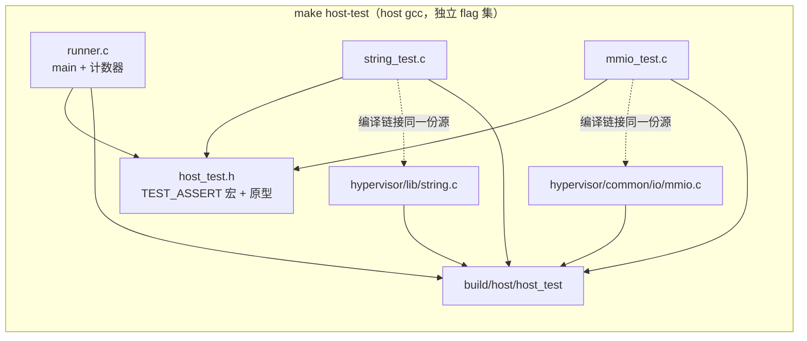

# Host 单测 harness（`make host-test`）

> **日期**: 2026-10-30（Day 2 特性开发文档）。**状态**: 已合入 develop（`b2af223`）。
> 过程与关卡记录见[当日日报](../reports/2026-10-30-day2.md)；设计与裁决见
> [spec](../superpowers/specs/2026-10-30-host-unit-test-harness-design.md)。

## 这是什么

仓库新增**第二级验证层**：在开发机上用 host gcc 直接编译**同一份** hypervisor 纯逻辑
源文件并运行单元测试，秒级反馈；与既有 QEMU gate（`make test`，分钟级，硬件验收，
ADR-0009）互补，不并入、不替代。M11 起的纯逻辑模块（runqueue、状态机、ABI 常量）将以
严格 RED→GREEN commit 纪律在此层开发。

## 怎么用

```sh
make host-test        # 编译 + 运行，普通 shell 即可（无需交叉工具链、无需 .config）
```

输出：全绿 `PASS (25 assertions)`、exit 0；任一断言失败打印 `FAIL <文件>:<行>: <表达式>`
并以非零退出。产物在 `build/host/`（`make clean` 覆盖）。

**给新模块加测试**（M11 起的标准动作）：

1. 测试文件 `tests/host/<模块>_test.c`，include 被测模块头 + `"host_test.h"`，用
   `TEST_ASSERT(cond)` 断言；
2. `host_test.h` 加 `void test_<模块>(void);` 原型；`runner.c` 的 `main` 加一行调用；
3. Makefile：`HOST_TEST_SRCS` 追加测试文件与被测源文件；**若被测模块有公共头，同步加进
   链接规则的依赖行**（关卡② 教训：漏加 = 头文件改动后重跑旧二进制的假绿）。
4. 约束：被测模块必须 **arch-neutral**（无 ARM64 内联汇编、`arch/` 头、
   percpu/spinlock/printk）——host gcc 编译不了这些，需要 shim 时先过架构师。

## 怎么工作



- **无注册表**：`main` 显式调用每个 `test_*`（模块少时最简）。
- **flag 集钉死**（照抄不重议）：`-Wall -Wextra -Werror -O2 -g -fno-builtin
  -U_FORTIFY_SOURCE -std=c11 -Ihypervisor/include`。两条非常规 flag 缺一即坏：
  `-fno-builtin`——host gcc `-O2` 会把 string.c 的 memset 循环变成对自身的调用；
  `-U_FORTIFY_SOURCE`——Ubuntu 默认 fortify 会把调用重定向到 glibc `__memset_chk`
  （测的是 libc 不是被测代码，假绿；此 flag 只能靠 Makefile 文本钉，行为测不出来）。
- **Makefile 集成**：`host-test` 在 Makefile:27 goal filter 白名单里（普通 shell 解析期
  不查 .config/交叉链）；`HOST_CC := cc` 复用 check-offsets 先例；`HOST_TEST_CFLAGS`
  独立赋值，不沾含 arch-cflags 的交叉 CFLAGS。
- **固件零影响**：交叉链接输入（hv-objs 显式清单）不动，elf/bin hash 逐字节不变
  （当日三次独立构建确认 `2ff3140a…`）。

## 首批被测模块与断言

| 模块 | 断言数 | 覆盖 |
|---|---|---|
| `lib/string.c`（memset） | 6 | n=0 不写一字节、n>0 恰好填 n 字节两侧不碰、返回值==dst（哨兵组同时行为性钉住 `-fno-builtin`） |
| `common/io/mmio.c`（MMIO 总线） | 19 | 空总线 dispatch=-1、`[base, base+len)` 半开区间四边界、offset/size/is_write/data 原样到达 handler、handler 非零返回传播为 -1、8 槽上限第 9 次注册拒绝不覆盖 |

## 验证证据（合并后最终态）

- `make host-test`：`PASS (25 assertions)` exit 0（普通与 `env -i` 裸环境均过；二次运行
  no-op；touch 产品头文件必触发重编）。
- RED 路径：故意破坏断言 → `FAIL tests/host/string_test.c:<行>: <表达式>` + 非零退出。
- 完整 `make test`：4 静态检查 + 7 QEMU 场景全 PASS，exit 0。
- 固件 bit 级不变：见上。

## 已知边界（v1 记录在案）

- mmio.c 静态总线无 reset 接口——第二个测试文件共用该状态时再定约定（spec 已记）。
- 覆盖缺口（范围外备查）：memset c=0/c>255 截断、mmio size=8/1 与读路径、len=0、
  重叠次序、非 1 错误码。
- `make all host-test` 组合调用会跳过 need-config 检查（与既有 `make clean all` 同形态）。
