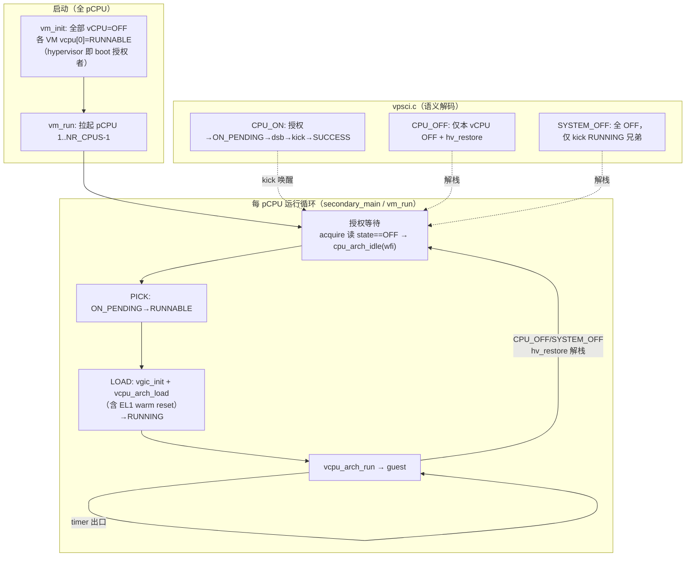

# M11 片 A — vCPU 生命周期与 PSCI 语义

> **日期**: 2026-10-31（Day 3 特性开发文档）。**状态**: 已合入 develop（见合并提交；
> 分支 `feature/m11-a-lifecycle-psci`，1b5535e..2a1bbd2 共 10 提交（另修复后合并））。
> 过程与关卡记录见[当日日报](../reports/2026-10-31-day3.md)；spec/plan 见
> [M11 合并版 spec](../superpowers/specs/2026-10-30-m11-vcpu-scheduler-design.md) 与
> [片 A plan](../superpowers/plans/2026-10-31-m11-slice-a-lifecycle-psci.md)。

## 这是什么

hypervisor 从"VM 级开关 + 结构性 1:1 绑定"升级为**每 vCPU 运行状态机**：`enum vcpu_state`
（OFF/ON_PENDING/RUNNABLE/RUNNING/BLOCKED）进通用 `struct vcpu`，PSCI 五函数按 vCPU 语义重写
（接口面不变，前置 B 冻结不破），`vm.off` 删除，全 pCPU 启动 + idle。行为仍等价 1:1 绑定
（共享亲和是合法**数据**但**不执行**——片 B 调度器接手），为调度器铺好全部轨道。

## 怎么用（可观察面）

- **guest CPU_ON**：授权寄存器 → `ON_PENDING`（EL2 printk 确定可见）→ kick 已在线的目标
  pCPU → 立即返 SUCCESS（KVM 先例）。Linux cpu hotplug `echo 0/1 > cpu1/online` 双向可用。
- **CPU_OFF 只停本 vCPU**（旧实现停整 VM）；停机 pCPU 回到授权等待，可被再次 CPU_ON。
- **SYSTEM_OFF/RESET(2)** 扫全 VM vCPU 置 OFF，只 kick 正在 guest 内运行的兄弟
  （对已 park 的 pCPU 发 kick = pending-掩码 IRQ → wfi 立即返回 → 永久忙转，已修）。
- **CPU_SUSPEND**：retention（BLOCK→wfi→WAKE→LOAD 内联，eret 回 guest 时必须是 RUNNING，
  否则下次 timer 出口会 vgic_init 清活 guest——关卡①抓的真 bug）。
- **AFFINITY_INFO**：按状态返回 ON/OFF/ON_PENDING(2)。
- **EL2 shell `vm_list`**：STATE 列由 vCPU 状态推导（任一非 OFF = on；全 OFF = halted）。

## 怎么工作

关键机制：

- **状态机纯逻辑模块** `common/vm/vcpu_state.c`（arch-neutral，进 host 单测；本仓库首个
  严格 RED→GREEN commit 对：`46d2e14` RED 仅测试+头，`bdd7b37` GREEN 最小实现）。
- **亲和表** `vm_config.vcpu_pcpu[]` 取代 `pcpu_base+idx` 推导；越界启动期校验取代编译期
  断言（1:N 数据合法）；`vcpu_for_pcpu()` 是片 A 的"最小 pick"（最低字典序），片 B 换调度器。
- **hv_restore 解栈**复用 HC_GUEST_DONE 先例（per-pCPU `g_hv_ctx`），CPU_OFF 后 pCPU 不再
  `cpu_arch_halt`——可再 ON 是 Linux hotplug 往返的前提。
- **接收侧读序**：OFF 等待用 `__atomic_load_n(ACQUIRE)`（common 层禁 asm——arch-boundary
  检查当天就抓住了我在 vm.c 里写的 dmb 内联）。
- **re-ON warm reset**（热修 `2561dfe`，手工 gate 抓到的真崩溃）：本 hypervisor 不陷入/保存
  EL1 sysreg，CPU_OFF 停靠后 pCPU 的 SCTLR_EL1.M 残留为 1；re-ON 以 PSCI 物理入口 eret 即
  IABT level-0（崩溃 pc == CPU_ON 入参物理地址，零条 guest 指令执行过）。修复 =
  `vcpu_arch_load` 在目标 pCPU 上 SCTLR_EL1=0 + `tlbi vmalle1` + `ic iallu`，CPU_ON 授权
  全量热启寄存器文件。已知残留：FP/SIMD/PMU/vtimer 不在复位集（Linux 容忍；首个非 Linux
  guest 或 RK3588 再访）。

## 验证证据（合并前，含测试专家独立复跑）

- `make test`：4 静态 + 7 QEMU 场景全 PASS（clean build）；`make host-test`：85 断言；
  `make test-qemu-ctxsw`：受控红 8/8 行 ALL PASS（独立目标，未进聚合）。
- psci 用例 +7 断言：CPU_ON SUCCESS / vCPU1 alive / 二次 ON==ALREADY_ON / vCPU1 自 CPU_OFF /
  AFFINITY==OFF / **vCPU0 存活**（旧整 VM 停车语义必挂此行）/ ON_PENDING printk。
- **手工双 VM Linux gate 12/12**：双 shell、cpu1 offline（`psci: CPU1 killed`、online=0、
  vCPU0 存活）、**cpu1 re-online**（`CPU1: Booted secondary processor`、online 回 0-1、
  shell 存活）、vm_list 字节级行、VM1 SYSTEM_OFF 隔离、终态 halted。
- `check_offsets_target`：`vcpu.state == 0x16C` 钉死（真 struct 交叉编译断言）。

## 已知边界（记录在案，片 B 接手）

- 共享亲和（如 ctxsw profile 的 `{0,0}`）：pCPU 只跑最低字典序 vCPU，其余 ON_PENDING 挂起
  ——`ctxsw` 受控红即其可观测形态；`sgi_pending[]` 按 pCPU 键控的串扰已知。
- CPU_SUSPEND 的 `(void)` 转换与 SYSTEM_OFF 扫除的竞态窗口、循环 fall-through：当前 guest
  群不可达，片 B 调度器在 guest 进入前即时复查状态（测试专家 NOTE，登记复查点）。
- 覆盖缺口：AFFINITY_INFO==2 无自动断言（可 3 行加进 ctxsw）、re-ON warm reset 仅手工 gate
  保护、无 vcpu_for_pcpu 并列抉择的 host 测试。
- Makefile 无头依赖跟踪：改头文件后必须 `make clean`（本片踩过一次陈旧对象假红）。
