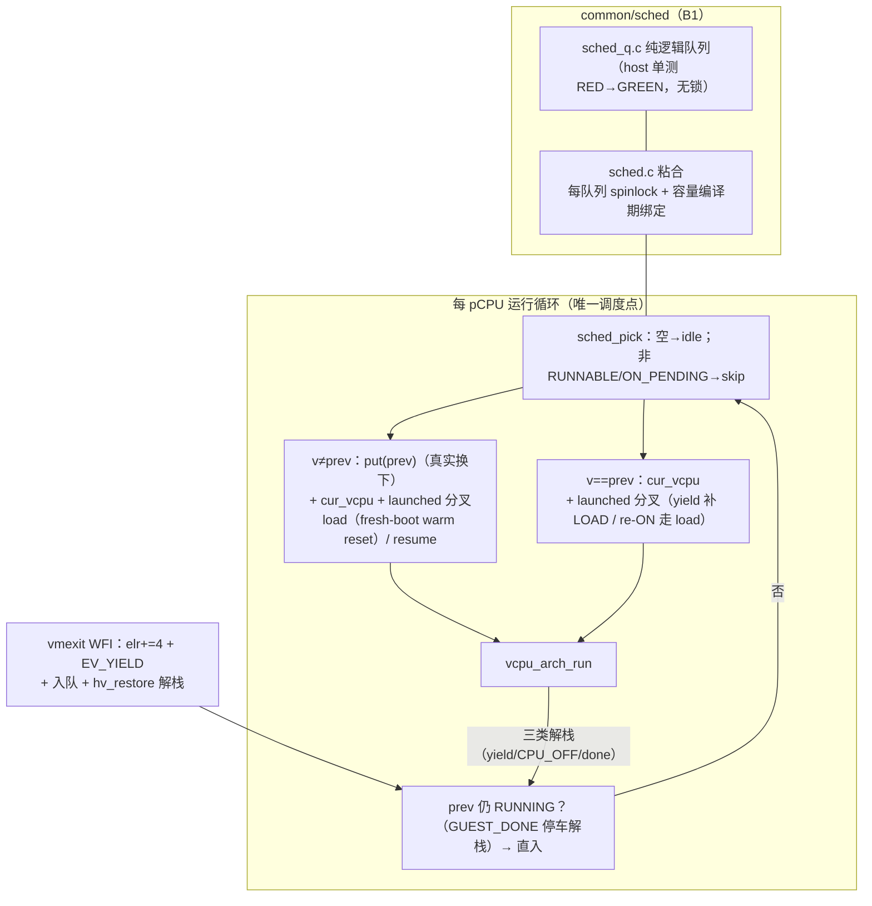

# M11 片 B1 — 调度器与 WFI 协作让出

> **日期**: 2026-10-31（Day 4 特性开发文档）。**状态**: 已合入 develop（`df6129e`，
> --no-ff，分支 a3f5ba1..5880eae + 文档修复）。
> 过程见[当日日报](../reports/2026-10-31-day4.md)；spec §5-B / ADR-0018 /
> [B1 plan](../superpowers/plans/2026-10-31-m11-slice-b1-scheduler.md)。

## 这是什么

hypervisor 有了**调度器**：每 pCPU 一个 RR 运行队列（`common/sched/`），WFI 成为
协作让出点，共享亲和的多个 vCPU（`svm_ctxsw` profile）在一个 pCPU 上真实轮转。
B1 范围 = GPR/ELR 级切换正确性；EL1 全量与 vGIC/vtimer 运行期协议是 B2。

## 怎么用（可观察面）

- **共享 pCPU 的 guest**：任一 vCPU `wfi` 即让出，pCPU 轮转到队列下一个；
  `make test` 的第 8 个场景 `ctxsw` 即其可执行化（r0/v1 交替 8 轮 + x19-x28 canary
  跨切换保全）。
- **1:1 配置完全不受影响**：独占队列退化为单元素，让出后 pick 回自己直入
  （指令级与片 A 等价，零 vGIC 往返）；Linux cpu hotplug 往返照常（手工 gate 12/12）。

## 怎么工作

要点：

- **让出 = 状态转移 + 解栈复入**（ADR-0018）：不做 C 栈切换；三个解栈出口
  （yield/CPU_OFF/GUEST_DONE）在同一循环汇合。RUNNING 的 vCPU 不在队列
  （pick 即出队，yield 才回队）——不带状态变化的解栈走直入快路径。
- **put 只在真实换下**：`v≠prev` 且前任 RUNNABLE 才 `vcpu_arch_put`（B1 = vGIC 影子
  save）；自重拾零 ICH 触碰。`launched` 标志分叉 fresh-boot（load：清白 + EL1 warm
  reset）与 resume（仅 vgic_restore）——**两条路都按 launched 分叉**（re-ON 回到
  同一 vCPU 指针时也要 warm reset，Day 4 手工 gate 的实证 catch）。
- **入队序**：CPU_ON 状态发布（ON_PENDING）→ 入队 → dsb + kick（OFF 态入队会被
  owner 的 skip 规则 pick-丢弃——关卡①形状的实证修正）。
- **并发**：每队列 spinlock（跨 pCPU CPU_ON 入队 vs 对端出队）；状态读 acquire
  配对发布方 regs→dmb→state→dsb→kick。
- ctxsw canary 必须 **register-asm 局部变量**：clobber-only asm 写入对 gcc 不可见，
  最外层帧的 x19-x23 会被编译器征用（首版恰好烂在这五枚）。

## 验证证据

- `make test`：**8 场景**（ctxsw 进聚合）+ 4 静态全 PASS；`make host-test` 165 断言
  （sched_q 队列矩阵 + EV_YIELD 边）。
- 测试专家独立验收 GREEN：clean 全套 + 手工 gate 12/12 + 裸串口捕获 r0/v1 严格交替
  8 轮 + 五个构造性失败探针全部被代码阻断。
- 关卡② APPROVE_WITH_FIXES（注释/文档级已落）：R5 边界补 EL1-sysreg 与 MPIDR 身份
  两条；流程裁定 = 两次 commit-before-verify 记档即可，不设 hook。

## 已知边界 / B2 账单（关卡②具名）

1. **循环形状双份维护**（vm.c ≡ secondary.c ~40 行）——B2 触碰循环做 block/wake 时
   上提公共代码。
2. **VMPIDR_EL2 不在 resume 协议**（TID3 转发活寄存器，resume 后读到的是最后
   fresh-load 的身份）——B2 的 put/resume 协议必须收编 EL2 身份寄存器。
3. CPU_SUSPEND 的 EL2 原地 wfi 停整个共享 pCPU——随 block/wake 一并改造（ADR-0018
   待决：EV_YIELD 边可能被吸收）。
4. vuart RX 远端发布 vs put 活读（spec §8.1/D13 publisher-wins 合并）。
5. 快路径不变式（静态亲和/cur_vcpu 即亲和者/RUNNING 永不入队/无迁移）任何改动复审。
6. re-ON 自动化覆盖（psci 用例加 vCPU1 OFF→ON 往返）；手工 gate 保持关卡②必跑。
