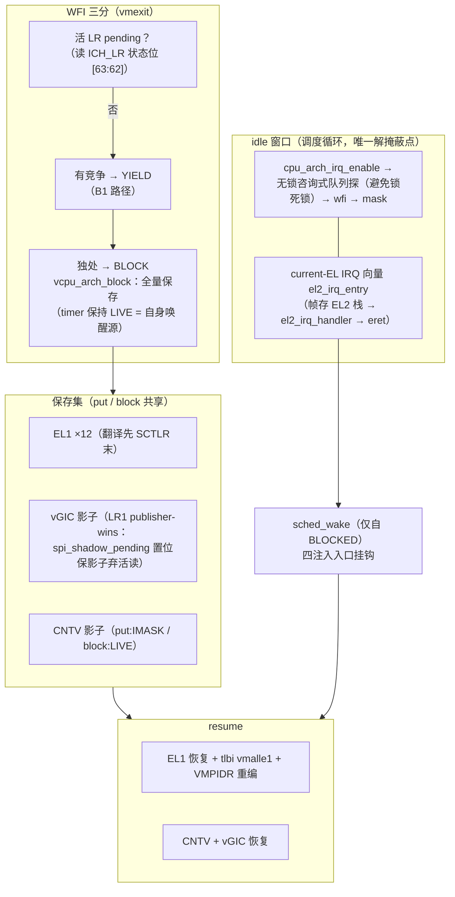

# M11 片 B2 — EL1 全量、vGIC/vtimer 运行期协议、block/wake

> **日期**: 2026-10-31（Day 5 特性开发文档）。**状态**: 已合入 develop（`73cb031`，
> --no-ff，分支 7fabc01..b622d1c 共 15 提交）。
> 过程见[当日日报](../reports/2026-10-31-day5.md)；spec §5-B / ADR-0018/0019 /
> [B2 plan](../superpowers/plans/2026-10-31-m11-slice-b2-el1-vgic-vtimer.md) /
> [半清单实验](../debug/m11-b2-el1-halflist.md)。

## 这是什么

共享 pCPU 的切换从 GPR 级升到**完整上下文**：EL1 系统寄存器 12 项批量保存/恢复、
vGIC 影子的运行期协议（publisher-wins）、per-vCPU 虚拟定时器、WFI 的三分语义
（pending 直续 / 有竞争让出 / 独处阻塞 + 注入唤醒）。为使这一切可测，本片还落了
**current-EL EL2 中断向量**——计划外但必要：EL2 C 代码传统上掩蔽中断运行，阻塞
vCPU 的唤醒中断从未被真正"取走"过。

## 怎么用（可观察面）

- **共享 pCPU 上的完整 guest**：`ctxsw` 场景现在断言 x19-x28 canary、六枚 EL1
  canary（惰性寄存器全值 + MMU-off 安全 stamp）、双 timer 各归其主、MPIDR 身份——
  一切跨 8 轮真实轮转存活。
- **阻塞唤醒**：guest `wfi` 独处即阻塞（pCPU 睡眠），任何注入路径（timer PPI /
  SGI / vuart SPI）经 `sched_wake` 唤醒；psci 用例的 SGI 段端到端验证。
- **CPU_SUSPEND**：retention 语义经阻塞路径实现（不再原地 wfi 停整个 pCPU）。
- **re-ON**：psci 用例自动验证 CPU_OFF→CPU_ON 往返（此前仅手工 gate 覆盖）。

## 怎么工作



关键点：

- **current-EL 向量**：EL2 C 掩蔽运行是仓库契约；阻塞唤醒要求中断被取走。向量入口
  帧存于 EL2 栈，`spsel #1` 钉死 SP 选择；idle 窗口是全仓唯一解掩蔽点，窗口内
  **无锁**（咨询式队列探测），handler 经 `percpu.idle_window` 来源旗标避免误 park。
- **两级"绿≠对"实证**：TCG 从不在临界区内投递中断——关卡②抓到的 idle 窗口锁死锁
  与 N1 残余窗口，测试套件永远看不见，只有契约推理能。
- **半清单实验（Q9）**：故意只存 2/12 项 → ctxsw 盖章 4/4 组失败 → 记档 → 补全。
  bao/xvisor 对照产出三个带触发条件的已知缺口（AMAIR / PAC 密钥 / CNTKCTL）。

## 验证证据（合并前最终态）

```
$ make test（clean）    → 8× ALL PASS + 4 静态，exit 0
$ make host-test        → PASS (165 assertions)
$ make test-qemu-ctxsw  → ALL PASS（28 行含 EL1/timer/MPIDR 断言）
$ sh /tmp/m11a-gate.sh  → 12/12 GATE DONE（重试一次 = 已知 banner 交织 flake）
```

关卡链：① APPROVE_WITH_CHANGES（R1-R6 + 三项机制裁决）→ 测试专家 GREEN 零阻塞
（N1-N7 全处理）→ ② APPROVE_WITH_FIXES（Critical×1 + Important×3 全落 + 复验）。

## 已知缺口（ADR-0019 全录，各带触发条件）

idle 窗口残余微秒竞态（skip-flag 方案在案）；CPU_OFF 不存 timer（armed+过期配方）；
CPU_SUSPEND 恒走 block（plan 偏离已记）；CPU_ON 不刷 timer 影子；AMAIR/PAC/CNTKCTL
不入清单（**PAC 共享 Linux 前必须补**）；共享自 timer 唤醒；共享跨 vCPU SGI。

## 片 C 账单（关卡②具名）

VTTBR/VMID 切换 + 与 resume 路径 tlbi 的序审计；FP/SIMD 急切保存（~528B，独立
编译单元）；PAC 密钥（强制）；拓扑翻转 2×2-on-2（仅 Linux 演示）；per-vCPU console
串行化（flake 债已触发）；抢占 tick 落在 Critical-1 修复之上（D 片受益）。
