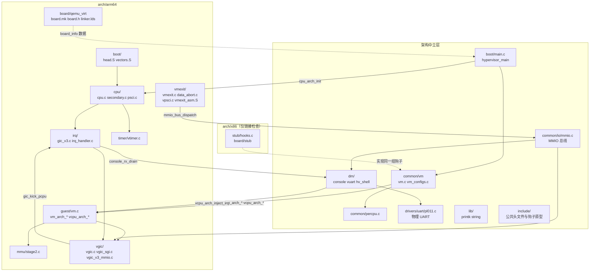
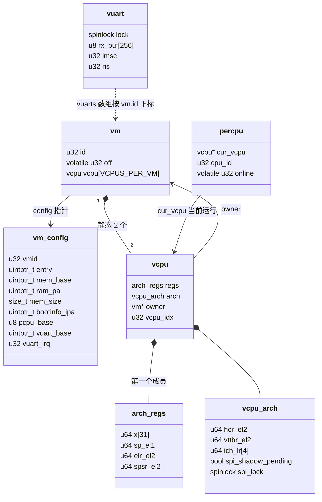
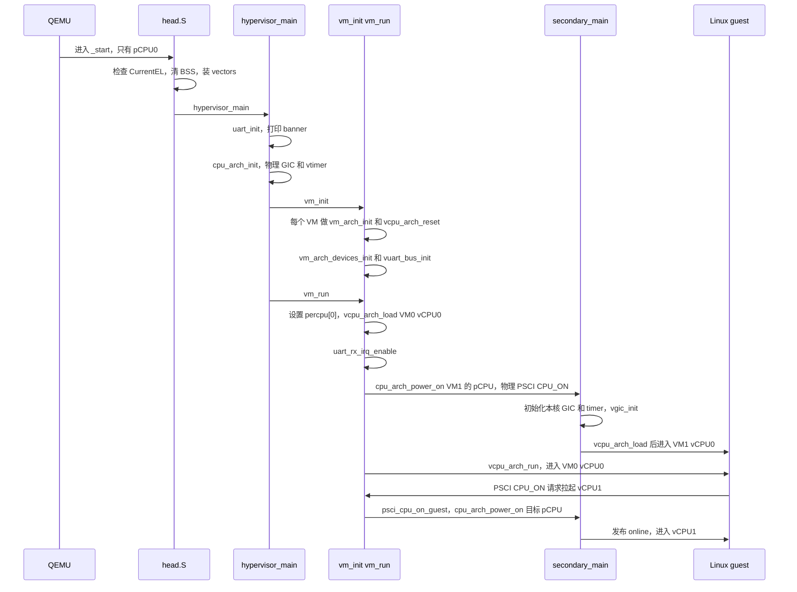
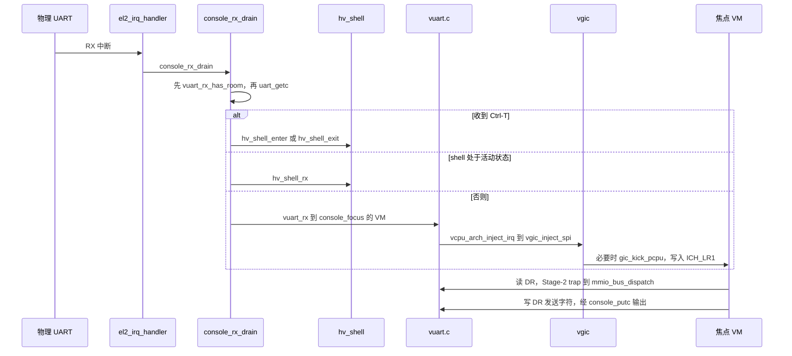

# 当前架构 / Current Architecture（M10，静态双 VM）

> **本文是当前实现的入口。** 描述已经落地并在 QEMU 中验证过的东西：两个 Linux VM，
> 每个 VM 两个 vCPU，静态 1:1 绑定到各自的 pCPU（4 核 = 2+2），EL2 拥有物理控制台和调试
> shell；以及 arch 边界重构（ADR-0015）之后的模块划分。
>
> **不包含：** M11 vCPU 调度器、ACRN 模型（Service VM + 用户态 Device Model，见
> [目标架构](target-architecture.md)）、任何能运行的第二架构。`arch/x86/` 目前只是一个
> 链接检查 stub（`make test-x86-stub`），证明通用代码能编译和链接，**不能运行**。
>
> 历史快照 [架构鸟瞰](2026-06-21-architecture-zoom-out.md) 是 M3 时代的单 VM 视图，
> 不反映现状。设计决定见 [ADR-0014](../../adr/0014-multi-vm-static-partition-el2-console.md)、
> [ADR-0015](../../adr/0015-arch-boundary-core-vs-arch.md)。

## 1. 模块关系

代码分成**架构中立层**和 **`arch/`**。中立层只通过 `*_arch_*` 钩子和 `<arch/xxx.h>` 访问
架构（`make test` 里的 `check-arch-boundary.sh` 强制，零容忍）。公共头文件只有一个目录
`hypervisor/include/`，`-I` 里没有 `dm/` 和 `common/vm/`，所以模块私有头文件别处够不到。

**依赖方向的几条规则**（违反就会被检查脚本或编译器拦下，或在 review 中被拒）：

| 规则 | 说明 |
|---|---|
| 中立层不碰架构 | 不允许内联汇编、系统寄存器名、PSCI、`gic_*` `vgic_*` `stage2_*`、`BOARD_*`（`vm_configs.c` 除外） |
| 物理 GIC 与 vGIC 分开 | `irq/gic_v3.c` 不能知道 VM、vCPU 或 vGIC；`vgic/` 只通过 `gic_ppi_set_enable()` 和 `gic_kick_pcpu()` 调用它 |
| `irq_handler.c` 只做分发 | ack、判断、注入、EOI；设备逻辑（控制台 RX 仲裁）在 `dm/console.c` |
| 电源策略属于 PSCI | 下电时踢同 VM 其它 pCPU 是 `vpsci.c` 的事，不是 vGIC 的事 |
| 设备状态归设备模型 | `struct vuart` 私有于 `dm/vuart.c`，`struct vm` 不嵌入它 |

## 2. 对象与所有权

`struct vm` 和 `struct vcpu` 在通用头 `include/vm.h` 里定义；架构相关的字段放进嵌入的
`struct arch_regs` / `struct vcpu_arch`（`arch/arm64/include/arch/vm.h`），汇编偏移宏也在那里，
由 `tests/check_offsets*.c` 钉住。per-VM 的 Stage-2 页表、vGIC 影子状态、vuart 设备状态
都不在 `struct vm` 里，而是各自文件里按 `vm->id` 下标的 static 数组。

几个要点：

- **`percpu.cur_vcpu` 必须是 `struct percpu` 的第一个字段，`PERCPU_SIZE` 固定**：arm64 汇编通过
  `TPIDR_EL2` 读到 `&percpu[id]`，再按偏移取当前 vCPU。这是"arch 汇编读通用结构"的契约，
  `_Static_assert` 钉住（ADR-0015"已知语义耦合"表里接受保留）。
- **静态绑定**：VM *n* 的 vCPU *i* 运行在 pCPU `pcpu_base + i`，`secondary_main` 直接由
  pCPU id 推出 (VM, vCPU)。M11 引入调度器后这个映射不再是结构性的。
- **板级数据**：pCPU 数量只有一个来源，`board.mk` 里的 `board-nr-cpus`，同时提供给编译
  （`-DCONFIG_NR_CPUS`）和 QEMU 的 `-smp`；运行期板级数据通过 `include/board_info.h`
  （`board_name`、`board_uart_base`）进入通用代码。

## 3. 启动时序

pCPU0 是唯一的启动核；其它核由 PSCI `CPU_ON` 拉起，落在 `secondary_entry`。VM0 的 vCPU0
跑在 pCPU0；VM1 的 vCPU0 由 hypervisor 自己发物理 `CPU_ON`；每个 VM 的 vCPU1 由 guest 内核
通过 PSCI 拉起。

之后绝大多数同步异常在 `el1_sync_handler` 里处理完直接 `eret` 回 guest，不回到 C 的
`vm_run` 循环；只有 timer IRQ 这一类退出才返回 `vcpu_arch_run` 的调用者。

## 4. 退出与中断分发

**同步异常**（`vmexit.c` 的 `handle_exit`，按 ESR 的 EC 字段）：

| EC | 含义 | 处理 |
|---|---|---|
| `0x16` | guest 的 HVC | PSCI（SMCCC 服务号 `0x84`/`0xC4`）交给 `psci_handle`；调试 hypercall `HC_GUEST_DONE` 结束 SVM 测试；其它返回 `SMCCC_NOT_SUPPORTED` |
| `0x18` | 系统寄存器 trap | `ICC_SGI*` 写入交给 `vgic_sgi_trap`（IPI）；`ICC_PMR/CTLR/RPR` 映射到 `ICH_VMCR_EL2` |
| `0x24` | 数据异常（Stage-2 缺页） | `mmio_handle_data_abort` 解码 ISS，调用中立层 `mmio_bus_dispatch` |
| 其它 | 未预期 | 打印并 `cpu_arch_halt` |

**物理 IRQ**（`irq_handler.c` 的 `el2_irq_handler`，只分发）：

| INTID | 来源 | 处理 |
|---|---|---|
| kick SGI | 跨核踢醒 | 如果本 VM 已下电则停核；否则 `vgic_sgi_drain` 取出待投递的 IPI，`vgic_reload_spi_lr` 重载 SPI 影子 |
| 27 | 虚拟 timer PPI | guest 使能了虚拟中断时硬件转发（`vgic_inject_hw`），否则软件注入并临时屏蔽 |
| PL011 SPI | 物理 UART RX | `console_rx_drain()`，设备逻辑不在这里 |

## 5. 控制台时序

EL2 独占物理 PL011。guest 的 PL011 窗口在 Stage-2 里是无效项，所以每次访问都会 trap 到
`vuart`；物理 RX 由 EL2 自己的 IRQ 取走，经 `console_rx_drain()` 仲裁后交给 EL2 shell 或
当前焦点 VM 的 vuart。

要点：先检查接收方是否有空位，再从物理 FIFO 读字节（读是破坏性的，QEMU 的 PL011 模型靠
FIFO 有空位做背压）；Ctrl-T 在仲裁层被拦截，不会送达任何一方；TX 不仲裁，每个 VM 的输出
都直接到物理 UART，与 `printk` 共用同一把锁。

## 6. 跨核电源管理

`PSCI_CPU_OFF`、`SYSTEM_OFF`、`SYSTEM_RESET` 都走 `vpsci.c` 的 `psci_power_down()`：设置
`vm->off`，用 `gic_kick_pcpu()` 踢同 VM 的其它 pCPU，被踢的核在 `el2_irq_handler` 的 kick
分支里看到 `off` 后停核。这一段是下面"已知缺陷"的根源。

## 7. 钩子清单（ADR-0015）

| 头文件 | 钩子 |
|---|---|
| `include/cpu.h` | `cpu_arch_init` `cpu_arch_halt` `cpu_arch_power_on` |
| `include/percpu.h` | `cpu_arch_this_percpu` `cpu_arch_set_this_percpu`（内联，在 `<arch/percpu.h>`） |
| `include/spinlock.h` | `atomic_arch_fetch_inc_u32` `cpu_arch_relax`（内联，在 `<arch/spinlock.h>`） |
| `include/vm.h` | `vm_arch_init` `vm_arch_devices_init` `vcpu_arch_reset` `vcpu_arch_load` `vcpu_arch_run` `vcpu_arch_inject_irq` |

没有 weak 默认实现：缺钩子在链接时就失败，`arch/x86/stub/hooks.c` 就是靠这一点做第二道
检查的。新增钩子时要同时补 x86 stub，并在
[M11 对齐说明](../../superpowers/specs/2026-10-04-m11-arch-boundary-alignment.md) 的可移植性表里加一行。

## 8. 尚未实现与已知缺陷

- **M11 vCPU 调度器没有实现。** 目前 vCPU 与 pCPU 是静态 1:1，没有 vCPU 上下文切换，也没有
  FP/SIMD 状态保存（因此全程 `-mgeneral-regs-only`）。
- **`CPU_OFF` 会杀掉整个 VM**：它与 `SYSTEM_OFF` 共用 `psci_power_down()`，设置的是 per-VM 的
  `vm->off`，没有 per-vCPU 状态。`vm_list` 里显示为 `halted`。M11 会重写这部分状态管理。
- **`vm_console <n>` 接受已停机的 VM**：焦点切过去后没有任何反应（M10 已知缺口）。
- **x86 只有链接检查。** 没有启动入口，所有钩子都是空实现；真正的可移植性需要第二个能运行
  的架构来证明。
- **ACRN 模型**（Service VM、用户态 Device Model、virtio 后端）属于 M12–M15，见
  [目标架构](target-architecture.md)。
