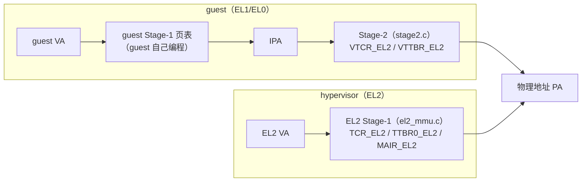
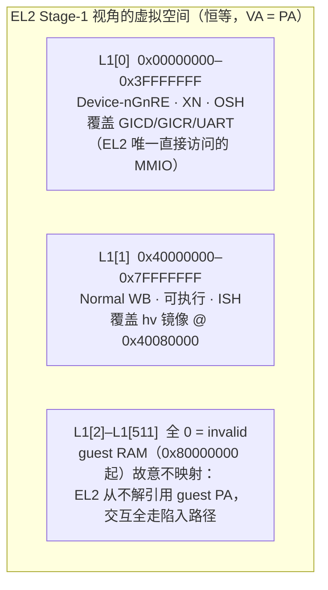
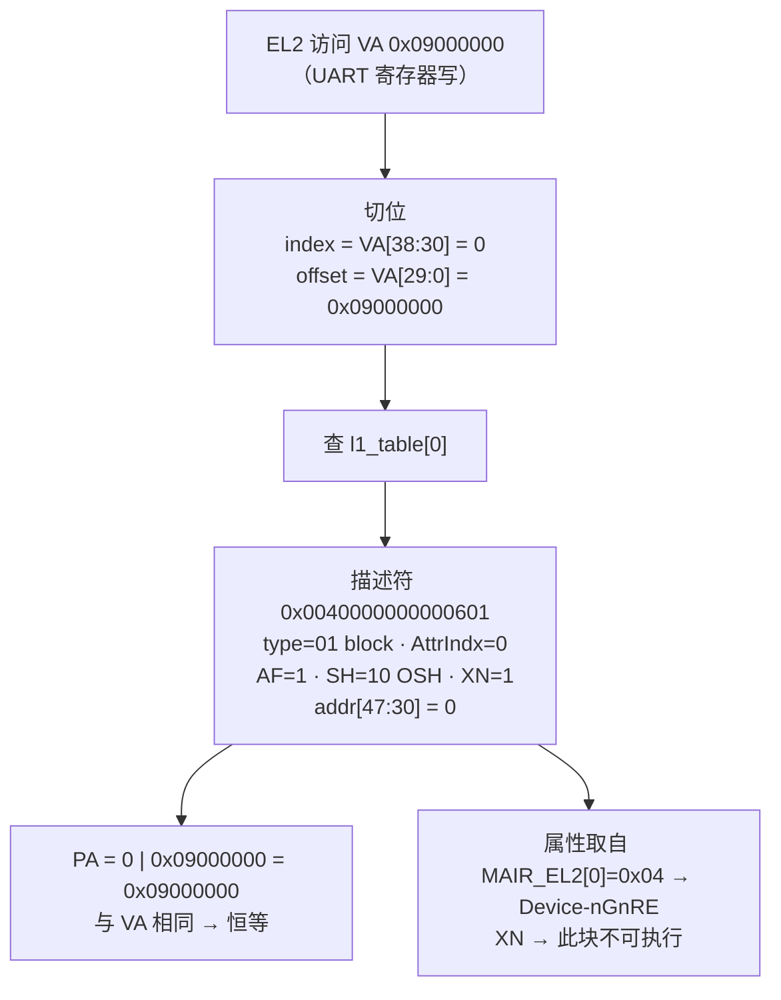
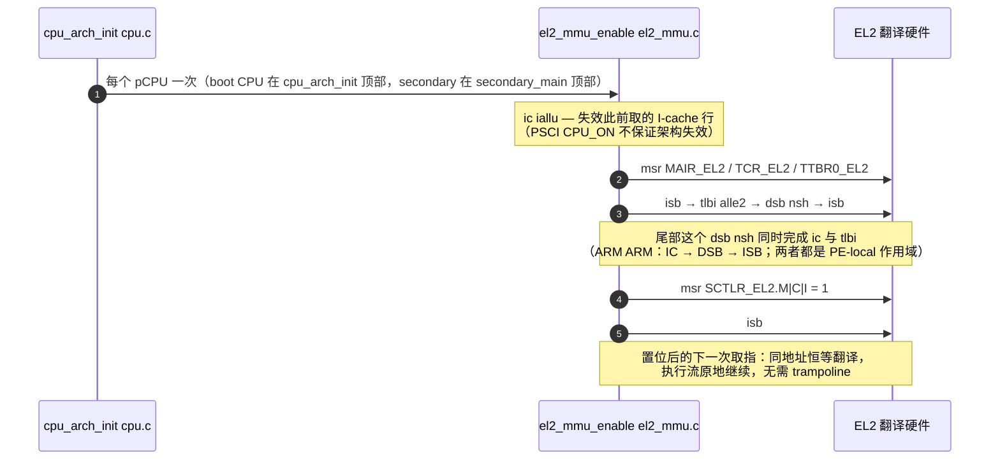
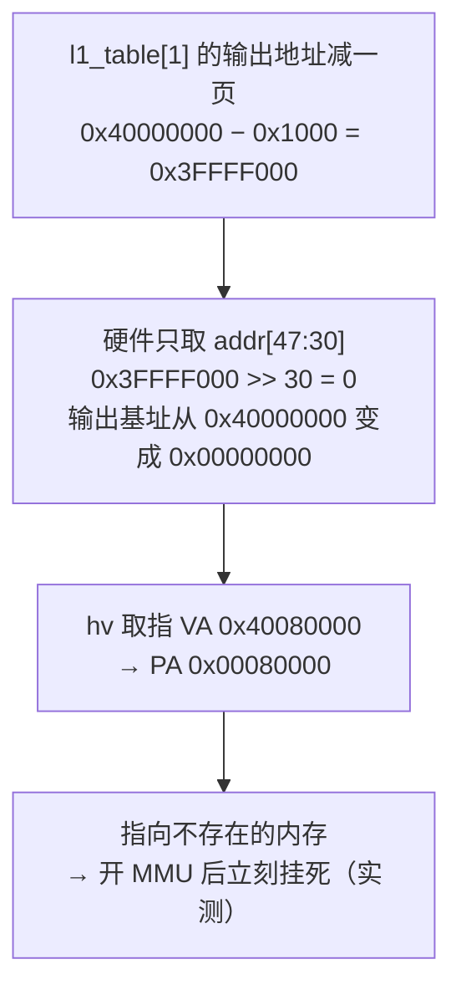

# EL2 Stage-1 恒等映射

本文对应 M11 前置 A 切片 1/2（提交 `4c9e1dd`、`a5b29aa`）。源码
`hypervisor/arch/arm64/mmu/el2_mmu.c`，由 `cpu/cpu.c`（boot CPU）与
`cpu/secondary.c`（每个 secondary）调用；设计见
[spec](../../superpowers/specs/2026-10-22-m11-pre-a-el2-hardening-design.md)、
决策见 [ADR-0017](../../adr/0017-el2-hardening-before-scheduler-and-passthrough-milestone.md)。
Stage-2（guest 用）的对照文档：[stage2.md](stage2.md)。

常见疑问：

1. EL2 为什么需要自己的 Stage-1？它和 Stage-2 是什么关系？
2. `l1_table[0]` 写的那串数据为什么就表示"恒等映射"？
3. 开 MMU 的瞬间执行流为什么不用跳转？

---

## 1. 作用：hypervisor 自己的翻译体系

ARM64 里每个异常级有自己的翻译体系（translation regime）。guest 与 hypervisor
走的是**两套互不相干的路径**，EL2 的访问**不经过 Stage-2**：



切片 1 之前 EL2 从未配置过自己的翻译体系（`SCTLR_EL2.M=0`），所有 EL2 访存
未翻译、按 Device 处理——hypervisor 镜像明明在 DRAM 里，却享受不到 Normal
内存的待遇。后果：

- **cache 开不了**：Device 内存不可缓存，`SCTLR_EL2.C/I` 置位也无意义
  （切片 2 必须排在切片 1 之后的全部原因）；
- **真机性能崩坏**：每条访存直捅内存（QEMU TCG 不模拟 cache，暴露不出来）；
- **exclusive 访问不可靠**：`ldxr/stxr`（自旋锁在用）要求可缓存 Normal 内存
  才有一致性保证（真机验证推迟到 M15）；
- **没有权限控制**：做不了 W^X / RO 段（ADR-0017 明确推迟）。

EL2 Stage-1 的 payload 是**属性和权限**，不是地址变换——这正是恒等映射成立的
前提：地址不动，只改访问的语义。

## 2. 映射内容：三块 L1 表项

`T0SZ=25` → 39 位 VA → L1 表 512 项、每项管 1 GB，4 KB 对齐静态数组，全
pCPU 共享一张：



L1[2]+ 留 invalid 是设计而不是疏漏：MMIO 模拟是寄存器级、vuart 是
trap-and-emulate、hypercall 纯寄存器传参，EL2 没有任何直接访问 guest 物理内存
的路径。哪天需要，就该显式加表项，而不是靠"未翻译=直通"混过去。

## 3. 查表机制：下标是输入地址，字段是输出地址

描述符里**没有任何一位写着"输入地址"**。硬件查表：

```
index    = VA[38:30]           ← 1 GB 序号当数组下标
entry    = l1_table[index]
PA_base  = entry.bits[47:30]   ← 输出地址高位
PA       = PA_base | VA[29:0]  ← 块内偏移原样透传
```

**恒等映射 = 第 i 槽里写的地址字段恰好等于 i << 30。** 输入基址由下标隐含、
输出基址由字段显式给出，两个数数值相同，所以 VA=PA。以 UART 访问走一遍：



地址没变，但这次访问带上了 Device、不可执行、Outer Shareable 的语义。

### 描述符逐位解码

`l1_table[0] = 0 | S1_BLOCK | S1_ATTRIDX(0) | S1_AF | S1_SH_OSH | S1_XN`
= **`0x0040000000000601`**；`l1_table[1] = 0x40000000 | ...` =
**`0x40000705`**。按 VMSAv8-64 L1 block 描述符位域：

| 位域 | L1[0] 的值 | L1[1] 的值 | 含义 |
| --- | --- | --- | --- |
| `[1:0]` | `01` | `01` | block 描述符（`00`=invalid，`11`=指向下一级表） |
| `[4:2]` | `000` | `001` | AttrIndx → 查 `MAIR_EL2`：0=0x04 Device-nGnRE，1=0xFF Normal WB |
| `[7:6]` | 未设 | 未设 | AP，未设 = 读写（EL2 体系单特权级，对齐 bao `PTE_AP_RW_PRIV==0`） |
| `[9:8]` | `10` | `11` | SH：Outer / Inner Shareable |
| `[10]` | `1` | `1` | AF（不置则访问即 fault） |
| `[47:30]` | **`0`** | **`1`** | **输出地址高位**：PA base = 0x00000000 / 0x40000000 |
| `[54]` | `1` | 0 | XN，不可执行 |

两个"输出地址"操作数（`0x00000000`、`0x40000000`）恰好等于各自下标隐含的
输入基址（`0<<30`、`1<<30`）——恒等就是这么来的。

## 4. 使能顺序：恒等 = 开关 MMU 零仪式

执行到置 `SCTLR_EL2.M=1` 那条指令的**下一个取指**就要走翻译。翻译结果若与
原地址不同，PC 会瞬间指向别处——那就得像 Linux 高端映射那样先造一段两种视图
重合的 trampoline，开完再跳走。恒等映射把这个麻烦整个消掉：置位指令的下一跳
落在同一地址，执行流原地继续，只是从"未翻译"变成"翻译后"。



顺序不变量：**所有维护操作（`ic iallu`、`tlbi alle2`）必须位于尾部 `dsb nsh`
之前**——它同时完成两者，把 `ic iallu` 挪到 dsb 之后就悄悄破坏了 IC 的完成
保证（源码注释里钉住了这条）。

## 5. 反证：恒等是承重的

切片 1 gate 的一次性故障注入（验证后撤销，未提交）：



如果"反正 VA=PA，查不查表无所谓"，这一页偏差不会致命。反过来说：**恒等映射
的每一项都必须和真实物理布局严格对齐，错一项就是开机即挂**——这也是它失败
模式良性的原因（页表错误在第一时间爆，不是潜伏的数据损坏）。

## 6. 与 Stage-2 的对照

| | EL2 Stage-1（本文） | Stage-2（[stage2.md](stage2.md)） |
| --- | --- | --- |
| 服务对象 | hypervisor 自己（EL2） | guest（EL1/EL0） |
| 控制寄存器 | `TCR_EL2` / `TTBR0_EL2` / `MAIR_EL2` / `SCTLR_EL2` | `VTCR_EL2` / `VTTBR_EL2` |
| 表 | 一张共享 `l1_table[512]` | 每_vm `l1[512]` + `l2_dev[512]` |
| 地址变换 | 恒等（VA=PA），只改属性 | IPA→PA 重定位（guest 内存搬到真实 PA） |
| TCR RES1 | bit23 **和** bit31 | 仅 bit31（两者不同，勿互抄） |
| 未覆盖区间 | fault（设计使然） | 未映射 IPA 同样 fault（隔离） |

> non-VHE（`HCR_EL2.E2H=0`）格式。VHE 模式下 EL2 借用 EL1 的翻译寄存器，
> 布局不同——本仓库不使用。
