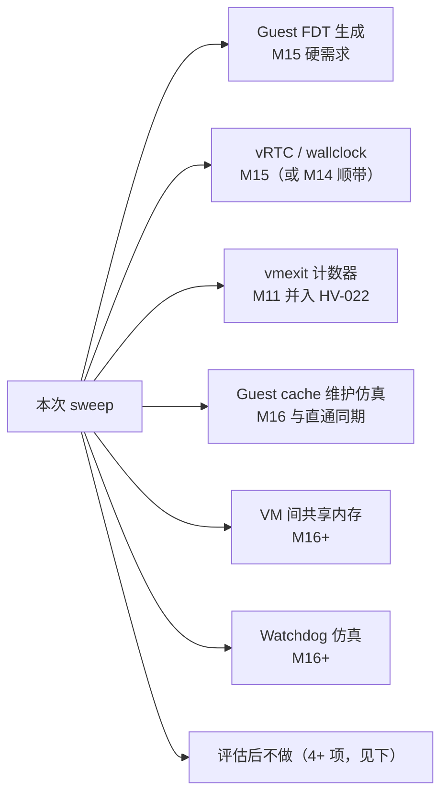

# ARM64 功能 gap 盘点（2026-10-30，nasa-glm-loop gap sweep 产物）

> **性质:** 有界 sweep（时间盒当日），对照 `../xvisor`、`../bao-hypervisor`、
> `../acrn-hypervisor`；基线 = 三层功能清单（Linear P-H-3，HV/DM/HSM/XL 60 条子 issue）
> ∪ 路线图（ADR-0016/0017，M11–M16）。所有引用路径已抽查属实。
> **不重复列** ADR-0017 已明确不排期的项：bao 缓存着色、静态 IPC、xvisor 多调度算法/
> 负载均衡、SVE/MTE 暴露。

## 结论一览

## 可排期 gap（已建 Linear backlog）

| # | 能力 | 参考实现 | 说明 | 归属 |
|---|---|---|---|---|
| 1 | **Guest FDT 生成/改写** | xvisor `core/vmm_devtree.c`、`vmm_guest_aspace.c` | guest DTB 需从 host DTB 裁剪派生。清单里 XL-001 只管配置格式、DM-002 只管 boot protocol，"生成 guest DTB"无人认领。**M15 硬需求**（RK3588 必须从 host DTB 派生）；M12 定 DM-002 时先留接口归属 | M15 · [H-168] |
| 2 | **vRTC/wallclock** | xvisor `emulators/rtc/pl031.c`、`core/vmm_wallclock.c` | QEMU virt 有 PL031；现靠 vtimer，缺 wallclock 影响启动期日志时序与 NTP 前行为。量小 | M15 · [H-169]（或 M14 在 DM 顺带） |
| 3 | **vmexit/调度延迟计数** | xvisor `core/vmm_profiler.c`（仅取其计数思想） | HV-022 只统计中断/注入路径；M11 两个 VM 第一次共用一核，需要 per-vCPU vmexit 原因计数器才能调试调度。**只做轻量计数器，不做完整 profiler** | M11 · [H-167] |
| 4 | **Guest cache 维护指令仿真**（DC/IC by IPA→PA） | xvisor `arch/arm/cpu/arm64/cpu_vcpu_emulate.c` | QEMU 全一致可不做；真机非一致外设直通时 guest 的 cache op 必须翻译 IPA。触发条件：非一致 DMA | M16 · [H-170] |
| 5 | **VM 间共享内存** | xvisor `core/vmm_shmem.c`；acrn `devicemodel/hw/pci/ivshmem.c` | 多 VM 数据面共享；清单无任何 inter-VM 通信项。ACRN 模型下正解是 DM 里的 ivshmem 型设备，非 EL2 静态预留（与"bao 静态 IPC 不排期"一致） | M16+ · [H-171] |
| 6 | **Watchdog 仿真** | xvisor `emulators/watchdog/sp805.c`；acrn `dm/hw/pci/wdt_i6300esb.c` | RT/功能安全 VM 的看门狗；RT VM 需求出现再做 | M16+ · [H-172] |

> 注：原计划把这些挂为 P-H-1 路线图父 issue（H-27/H-31/H-33）的子项，但该项目已归档、
> API 拒绝引用，故建为 team 下独立 issue（`[gap-2026-10-30]` 前缀可检索）。需要归位时
> 由用户取消归档后重新挂父项。

## 评估后不做（记录理由，防止重复评估）

| 能力 | 参考位置 | 不做的理由 |
|---|---|---|
| 跨 VM I/O 转发（backend VM，bao HC_IPC/HC_REMIO） | bao `src/core/remio.c` | ACRN 模型后端在用户态 DM（M13/M14 已覆盖）；仅当未来做 headless 双 VM 直连时重评 |
| virtio-gpu / virtio-input | xvisor `core/vio/vmm_vdisplay.c`、`vmm_vinput.c` | 目标负载无头；RK3588 GPU 属 M16+ 直通范畴 |
| 完整 vmexit profiler | xvisor `core/vmm_profiler.c` | 轻量计数器（gap #3）够用；完整剖析框架与 freestanding 最小化冲突 |
| EL2 内核服务（workqueue/线程/notifier/chardev/VFS） | xvisor `core/vmm_workqueue.c`、`vmm_threads.c`、`libs/vfs` 等 | freestanding 最小化 + ACRN 模型把复杂度放用户态；M13 HSM 出现真实后台需求再单议；EL2 VFS 与 DM-002（DM 加载镜像）职责重复 |

## ACRN 借鉴点（非 gap，M12–M14 设计时参考）

- `hypervisor/common/hypercall.c` 的 ABI 形态：首条 `get_api_version`、per-VM handle
  贯穿、`gpa_to_hpa`（DM mmap guest RAM 的前提，应并入 HSM-004/DM-001）。
- `setup_sbuf` 共享环：HV 日志/统计导出到用户态，可复用 M13 io_req 环的同源机制。
- `add_vdev/remove_vdev` 动态挂设备：对应 DM-010 注册表。
- `devicemodel/` 按 `hw/pci/*` + `core/vmmapi` 分层，与 DM-001/006 切法一致。

## 未覆盖区域（下次 sweep 或对应里程碑开工前补）

- xvisor：`libs/`（netstack/crypto/scsi/kallsyms/wboxtest）仅目录级；`drivers/`（iommu/
  pci/firmware/virtio）仅目录级；vgic、vmm_cache、stage2 细节未读。
- bao：`src/platform/`（无 RK3588 板可对照）；`src/core/mmu/`、`mpu/`；VMID/ASID 分配
  仅确认存在，未逐行读。
- acrn：`hypervisor/dm/`（io_req ring 具体格式）、`devicemodel/core/vmmapi.c`、HSM 内核
  模块源码未读——**M13 动工前值得补一次**。
- Linear P-H-3 子 issue 正文未读（HV-020/021/026/028 的描述可能已覆盖本表个别项）。
