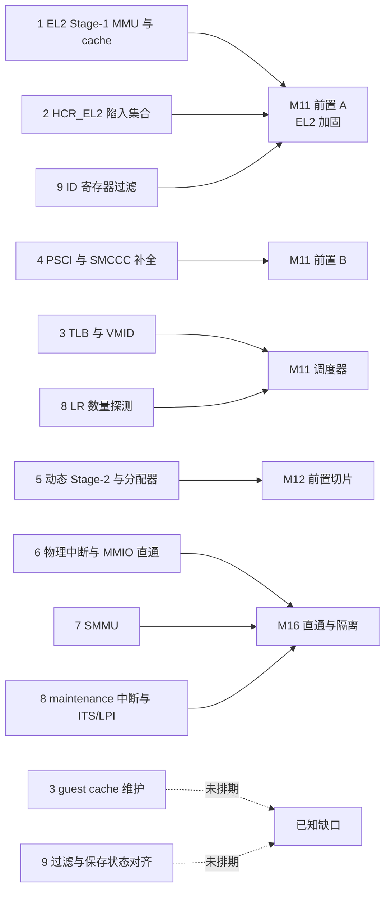

# ARM64 缺口盘点:对照 xvisor 与 bao

> **这是什么：** 把当前 ARM64 实现和 `../xvisor`、
> `../bao-hypervisor`（本机仓库上一级目录下的参考源码树，不在本仓库内）逐项对照后，
> 列出还缺哪些功能、各自排在哪个里程碑。**决定本身**（为什么这样排序）在
> [ADR-0017](../../adr/0017-el2-hardening-before-scheduler-and-passthrough-milestone.md)，
> 本文只补证据、对照和覆盖情况。
>
> **目标有两个，缺一不可：** 学透 EL2 核心技术，同时要能在 RK3588 上跑业务。
>
> **方法与可信度：**
> - 本仓库一侧的缺口，是在 `hypervisor/arch/` 下用 grep 核实的（证据见下表）。
> - xvisor、bao 一侧**只看了目录结构和文件名**，没有逐文件读实现；表里点名的文件是
>   “去哪里读”的入口，不是对其实现的结论。
> - 盘点日期 2026-10-20；本文随实现演进更新，不带日期。

## 1. 缺口总表

“已排”一栏对应 ADR-0017 和 [Linear 路线图](https://linear.app/jamestam/project/hypervisor-3b151b91cb63)。

| # | 缺口 | 本仓库现状（已核实） | 为什么要紧 | 参考入口 | 已排 |
|---|---|---|---|---|---|
| 1 | **EL2 自己没开 Stage-1 MMU 和 cache** | `arch/` 下没有对 `SCTLR_EL2`、`TTBR0_EL2` 的写入 | hypervisor 内存是 Device 类型。自旋锁的 `ldxr/stxr` 在 QEMU 上能跑，**真机上不保证可靠**；`-mstrict-align` 也因此必须；性能差 | xvisor：`arch/arm/cpu/common/mmu_lpae.c`、`arch/arm/cpu/arm64/cpu_proc.S`；bao：`src/core/mem.c`、`src/arch/armv8/armv8-a/pagetables.S` | M11 前置 A |
| 2 | **`HCR_EL2` 没有陷入敏感操作** | 只设 `VM/FMO/IMO/AMO/RW`（`guest/vm.c`）；`vmexit.c` 里对 SMC 没有处理 | 没设 `TSC`，真机上 guest 的 `smc` **直达 EL3**（TF-A），可绕过 PSCI 仿真；`TWI/TWE`、ID 寄存器、PMU/debug（`MDCR_EL2`）也没管 | xvisor：`cpu_vcpu_helper.c` 里 `HCR_TSW/TSC/TWE/TWI` 的设置、`cpu_vcpu_sysregs.c`、`cpu_vcpu_coproc.c` | M11 前置 A |
| 3 | **没有 TLB 和 cache 维护** | 全仓库没有一条 `tlbi`、`dc`、`ic` | 静态页表碰巧能跑；M11 在同一个核上切换 VM、以及任何 Stage-2 改动，都需要 `tlbi` 和 VMID 管理 | xvisor：`cpu_inline_asm.h`；bao：`src/arch/armv8/armv8-a/inc/arch/tlb.h` | M11（TLB 与 VMID）；**guest cache 维护未排**，见 §3 |
| 4 | **PSCI 只实现 6 个函数** | `VERSION`、`CPU_ON`、`CPU_OFF`、`SYSTEM_OFF`、`SYSTEM_RESET`、`FEATURES`（`arch/psci.h`） | 缺 `CPU_SUSPEND`、`AFFINITY_INFO`、`MIGRATE_INFO_TYPE`、`SYSTEM_RESET2` 和 SMCCC 版本/特性探测；Linux 6.x 会探测 | xvisor：`arch/arm/cpu/common/emulate_psci.c`；bao：`src/arch/armv8/psci.c`、`armv8-a/psci.c` | M11 前置 B |
| 5 | **Stage-2 是静态的，hypervisor 没有分配器** | 1 GB 块加一个 2 MB 的洞（`mmu/stage2.c`）；无 `malloc`/页分配器 | 动态创建销毁 VM、共享内存、设备 MMIO 映射都需要 4 KB 粒度、`map/unmap`、权限控制 | xvisor：`core/vmm_guest_aspace.c`、`core/vmm_host_ram.c`；bao：`src/core/mem.c`、`armv8-a/page_table.c` | M12 前置切片 |
| 6 | **物理中断和 MMIO 直通** | 只有 vuart 的软件 SPI 注入 | 业务要用网卡和存储：物理 SPI 要路由给 guest、处理 EOI/deactivate，设备 MMIO 要映射进 guest | xvisor：`arch/arm/cpu/common/vgic_v3.c`、`core/vmm_host_irq.c`；bao：`src/arch/armv8/vgicv3.c` | M16 |
| 7 | **SMMU（DMA 隔离）** | 无 | 直通设备做 DMA 会绕过 Stage-2，没有它就没有隔离 | xvisor：`drivers/iommu/`（含 `arm-smmu-regs.h`）、`core/vmm_iommu.c`；bao：`armv8-a/smmuv2.c`、`iommu.c` | M16 |
| 8 | **vGIC 完备性** | LR 数量固定为 4（`ich_lr[4]`），未按 `ICH_VTR_EL2` 探测；无 maintenance 中断；无 ITS/LPI | PCIe MSI、virtio-pci 需要 ITS/LPI；LR 数量随实现而变 | xvisor：`vgic_v3.c`；bao：`vgicv3.c`、`gicv3.c` | LR 探测在 M11；maintenance 与 ITS/LPI 在 M16 |
| 9 | **ID 寄存器过滤** | 无 | 决定 guest 能看到 PAuth、MTE、SVE、PMU 哪些特性，必须和实际保存/恢复的状态一致 | xvisor：`cpu_vcpu_sysregs.c`、`cpu_vcpu_ptrauth.c`、`cpu_vcpu_vfp.c` | 过滤在 M11 前置 A；**与 M11 保存状态的对齐未排**，见 §3 |

## 2. 缺口落在哪个里程碑

实线表示已经排进计划，虚线表示没有排期，记为已知缺口（见 §3）。路线图本身（顺序、各阶段的
验收目标、否决的方案）见 ADR-0017，这里不重复。

## 3. 未排期或只部分覆盖的项：记为已知缺口

下面五项没有排进任何里程碑，或者只覆盖了一部分。按 `CLAUDE.md` 的
“里程碑前置：限时与范围锁”：前置阶段的范围在开工前锁定，**过程中新发现的缺口记成已知缺口，
不追加进当前前置阶段**；前置 A 的时间盒是 2 周、前置 B 是 1 周，到期未完成的部分也转为已知缺口。

| 项 | 说明 | 何时再评估 |
|---|---|---|
| guest cache 维护 | set/way 操作的陷入（`HCR_EL2.TSW`）、指令 cache 一致性。xvisor 在 `cpu_vcpu_helper.c` 里设了 `TSW` | M11 之后 |
| SError 与 RAS | 真机上会遇到，QEMU 里几乎不触发 | M15 上板前 |
| Spectre 类缓解 | 如 `SMCCC_ARCH_WORKAROUND`。前置 B 的 SMCCC 探测会涉及，但没写成交付物 | M15 上板前 |
| hypervisor 栈保护页 | 开了 Stage-1 之后才有实现基础，但没有排进具体阶段 | 前置 A 完成后 |
| ID 过滤与保存状态对齐 | 前置 A 过滤后暴露的特性，M11 的上下文切换是否都保存了，需要在两份 spec 里对齐 | 写 M11 spec 时 |

> **更正：** 此前我曾提议把其中三类作为前置 A 的可选切片写进 spec。前置 A 已定 2 周时间盒且范围
> 锁定，所以这里改为已知缺口，不并入前置 A。

## 4. 选做项（不挡路）

对学习有价值，但不在“学透 EL2 加跑业务”的主线上，放在 M16 之后：

- **bao：** 缓存着色（`src/core/cache.c`、`mem.c`，隔离 LLC）、静态 IPC 与共享内存通道
  （`src/core/ipc.c`、`shmem.c`）、实时性。
- **xvisor：** 可插拔的设备仿真框架（`core/vmm_devemu.c`）、多种调度算法（`core/schedalgo/`）、
  负载均衡（`core/loadbal/`）。
- SVE、MTE 的暴露。

## 5. 验证边界

- 前置 A 里“真机上 `ldxr/stxr` 在 Normal 内存上更可靠”，**QEMU 里验证不了**：QEMU 本来就不会在
  Device 内存上让它出错。在 QEMU 里只能验证“开了 MMU 与 cache 之后不崩、现有测试仍全部通过”。
  按仓库规则这部分标成**静态验证**，留到 M15 上板确认。
- `TSC` 陷入可以用 SVM 用例在 QEMU 里验证：guest 执行 `smc`，hypervisor 拦截并返回
  `NOT_SUPPORTED`。
- M16 的验收（直通设备稳定运行）只能在真机上做。

## 6. 相关文档

- [ADR-0016](../../adr/0016-acrn-model-roadmap-decisions.md)、
  [ADR-0017](../../adr/0017-el2-hardening-before-scheduler-and-passthrough-milestone.md) — 路线图排序与修订
- [current-architecture.md](current-architecture.md) — 当前实现，§8 有已知缺陷
- [target-architecture.md](target-architecture.md) — 终点形态（ACRN 模型）
