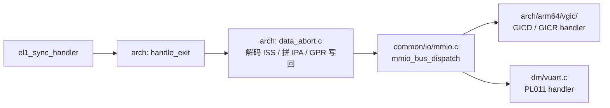
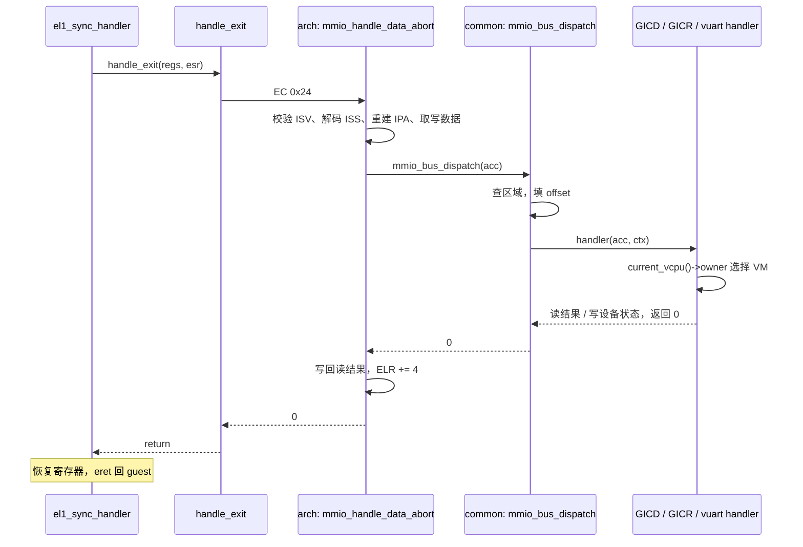

# handle_exit 退出分发逻辑

本文说明 guest 同步退出后，EL2 如何识别原因、模拟操作并续跑。它与物理 IRQ 分发是
两条不同路径，汇编入口见 [world switch](vcpu-run-world-switch.md)。

## 1. 重构后的分工

| 源码 | 职责 |
| --- | --- |
| `hypervisor/arch/arm64/vmexit/vmexit.c` | `handle_exit`、HVC 与 sysreg trap 分发 |
| `hypervisor/arch/arm64/vmexit/vpsci.c` | guest PSCI 服务端 |
| `hypervisor/arch/arm64/vmexit/data_abort.c` / `data_abort.h` | ARM Data Abort 解码与寄存器写回 |
| `hypervisor/common/io/mmio.c` | MMIO 区域注册、查找、handler 调用 |
| `hypervisor/include/mmio.h` | 架构无关的 `mmio_access` 和总线接口 |

原 `arch/arm64/vmexit/mmio.c` 已拆成 **arch 解码 + common 总线**。设备 handler
只处理设备语义，不读 ESR/FAR/HPFAR，也不操作 guest 的寄存器编号。



## 2. 顶层：ESR_EL2 的 EC 字段

```c
void handle_exit(struct arch_regs *regs, u64 esr)
{
    u32 ec = (u32)(esr >> 26) & 0x3FU;
    /* 按下表分发 */
}
```

`struct arch_regs` 定义在 `arch/arm64/include/arch/vm.h`，由异常入口保存。
`ESR_EL2[31:26]` 是 Exception Class：

| EC | 含义 | 当前处理 |
| --- | --- | --- |
| `0x16` | AArch64 HVC | `handle_hvc(regs)` |
| `0x18` | MSR/MRS trap | `handle_sysreg_trap(regs, esr)` |
| `0x24` | 来自低 EL 的 Data Abort | `mmio_handle_data_abort(regs, esr)` |
| 其它 | 未处理的同步异常 | 打印 CPU/EC/ESR/ELR，`cpu_arch_halt()` |

Data Abort 返回非 0 时故意 fall through 到诊断与停车路径。这里不是通用缺页分配器：
无 handler 或不支持的访存不会得到新内存映射。

## 3. HVC：PSCI 与调试钩子

`x0` 是功能号，返回值也放在 `x0`。`handle_hvc` 按高字节 `0x84` / `0xC4` 将
当前支持的 32/64 位 PSCI 范围交给 `psci_handle()`；这不是完整的 SMCCC 服务路由器。

| 请求 | 当前行为 |
| --- | --- |
| PSCI VERSION / FEATURES | 由 `vpsci.c` 返回版本或支持状态 |
| PSCI CPU_ON（32/64 位） | 解析 VM 内 affinity、准备目标 vCPU，调用 `cpu_arch_power_on`，有界等待 online |
| PSCI CPU_OFF / SYSTEM_OFF / SYSTEM_RESET | 设置所属 VM 的 `off`、kick 其余在线 pCPU 并停车 |
| `HC_GUEST_DONE` | 打印测试结果，`hv_restore()` 返回本核最近的 `vcpu_arch_run` 调用点 |
| 其它 HVC | 返回 `SMCCC_NOT_SUPPORTED` |

`CPU_OFF` 停整个 VM 是**仍未修复的缺陷**；`SYSTEM_RESET` 当前不会真正重启。
不要把路径迁移到 `vpsci.c` 理解为电源语义已经修好。

当前分发器没有 `HC_INJECT_TEST` 分支；旧的注入 HVC 不能作为现有 API 使用。
`HC_GUEST_DONE` 只是裸机测试钩子，不是 M12 的 VM 生命周期 ABI。

HVC 异常的 `ELR_EL2` 已指向下一条指令，**不要再手动 `+4`**。

## 4. sysreg trap：虚拟 CPU 接口

`ICH_HCR_EL2.TC` 用于拦截 guest 的 SGI 生成寄存器。QEMU 还会连带 trap 一组
CPU-interface 寄存器，因此 `handle_sysreg_trap()` 处理：

- `ICC_SGI*R_EL1` 写：交给 `vgic_sgi_trap()`，按所属 VM 路由虚拟 IPI。
- `ICC_PMR_EL1`：读写 `ICH_VMCR_EL2.VPMR`。
- `ICC_CTLR_EL1`：模拟 EOImode / CBPR 对应的 VMCR 字段，其余 RAZ/WI。
- `ICC_RPR_EL1`：当前简化为读回 0，不是完整的 running-priority 模型。

这里操作 guest 的**虚拟**接口，不能把 guest 写转发到 EL2 的物理 `ICC_*` 接口。
未识别的 sysreg 会打印诊断并继续（未处理读返回初始值 0），不走未知 EC 的 fail-stop。
处理结束后 `regs->elr_el2 += 4`，避免重复执行同一条 MSR/MRS。

## 5. Data Abort：替 guest 完成一次 MMIO

当前被挖洞的设备是 GICD/GICR 和 PL011 vuart，**没有 EL2 virtio 后端**。
Stage-2 hole 触发 EC `0x24`，`data_abort.c` 执行以下步骤。

### 5.1 从 ARM syndrome 构造访问

- 拒绝 `ISV=0`：当前不取 guest 指令做软件译码。
- 从 ISS 取 `SAS`（1/2/4/8 字节）、`SRT`（GPR 编号）、`WNR`（读写方向）。
- 重建 IPA：`((hpfar & 0xFFFFFFFFFFF0ULL) << 8) | (far & 0xFFFULL)`。
- 写操作取 `regs->x[srt]`；`srt == 31` 作为零寄存器，写值为 0。

```c
struct mmio_access acc;
acc.addr     = mmio_faulting_ipa();
acc.offset   = 0;                       /* 由总线填入 */
acc.size     = mmio_sas_to_bytes(ISS_SAS(iss));
acc.is_write = (ISS_WNR(iss) != 0U);
acc.data     = 0;
if (acc.is_write)
    acc.data = (srt == 31U) ? 0ULL : regs->x[srt];
```

### 5.2 总线分发

`mmio_bus_dispatch(&acc)` 在线性扫描的 8 项静态表中按 `acc.addr` 查区域，填
`acc.offset = acc.addr - region.base`，再调用 `handler(acc, ctx)`。

`vm_init()` 经 `vm_arch_devices_init()` 注册 GICD/GICR，再经 `vuart_bus_init()`
注册 PL011。**只注册一套地址**，各 handler 用 `current_vcpu()->owner` 选择 VM 状态。

### 5.3 写回与返回

总线或设备报错就返回 -1，由 `handle_exit` 诊断并停车。成功时，读操作将 `acc.data`
写回目标 GPR（`srt == 31` 丢弃结果），然后 `regs->elr_el2 += 4`。

与 HVC 不同，Data Abort 返回地址指向故障指令本身；不推进就会无限重放。
`el1_sync_handler` 用更新后的寄存器帧直接 `eret` 回 guest。



## 6. 仍存在的限制

- 总线只检查表容量和地址命中，不检查注册区间重叠、整个访问是否跨区间边界。
- Data Abort 处理不是完整 AArch64 load/store 模拟器；当前未实现 SSE/SF 等完整语义，
  不能从“支持 1/2/4/8 字节”推断任意 guest 访存指令都可模拟。
- 未命中 MMIO、ISV=0、未知 EC 会停当前 pCPU；未知 HVC 则返回错误，未识别 sysreg
  打印后继续。三者不能笼统描述成“一律 park”。

这些是现有实现边界，不是本次文档同步新增的支持。Stage-2 地址布局见
[stage2.md](stage2.md)，跨核中断交付见 [vgic-injection.md](vgic-injection.md)。
