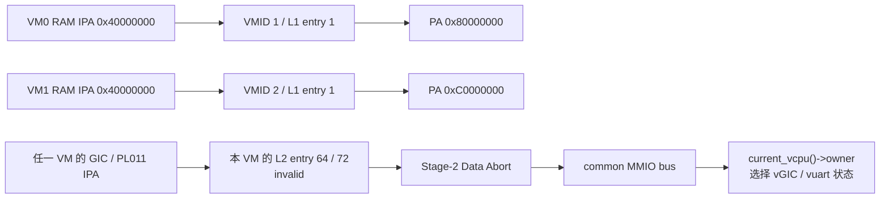
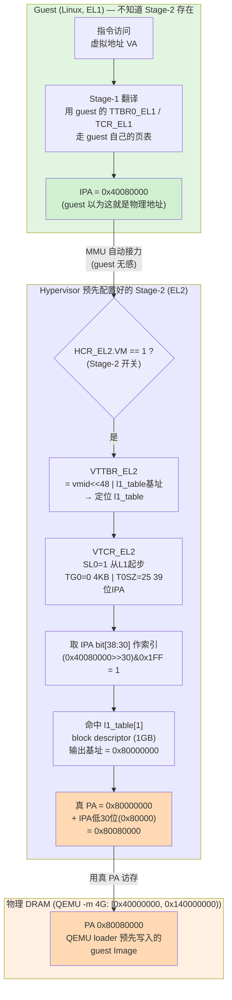

# Stage-2 页表与 IPA 范围解析

本文对应当前 M10 多 VM 实现与 arch 边界重构。源码为
`hypervisor/arch/arm64/mmu/stage2.c`，由 `arch/arm64/guest/vm.c` 的钩子调用。
实际页表是 `l1_table[NR_VMS][512]` / `l2_dev[NR_VMS][512]`；下文推导中的
`l1_table[n]` / `l2_dev[n]` 简写均指**某一个 VM 的表项**。

常见疑问：

1. `l1_table[0]` 覆盖的 IPA 范围 `0x00000000 – 0x3FFFFFFF` 是怎么来的？
2. L0/L1/L2/L3 是什么？
3. 每一级页表的粒度（512GB / 1GB / 2MB / 4KB）是如何推导出来的？

---

## 1. 多级页表与 L0/L1/L2/L3

L0/L1/L2/L3 就是**页表等级（translation table levels）**——多级页表里的层级编号。

### 为什么需要多级

一个中间物理地址（IPA）要翻译成物理地址（PA），理论上可以用一张巨大的平坦表（每页一个表项）。但 39 位地址空间、4KB 页 = 2²⁷ ≈ 1.3 亿个表项，一张表占约 1GB 内存，且绝大多数为空，太浪费。

解法是**把地址高位切成若干段，每段索引一级表**，像查字典一样逐层往下走，这就是 L0→L1→L2→L3。

### 翻译过程（“查字典”）

```
VTTBR_EL2 ──→ [L1 表] ──idx──→ [L2 表] ──idx──→ [L3 表] ──idx──→ 物理页
              entry              entry            entry
```

- 每一级用地址里对应的位段当下标，取出一个表项；
- 表项要么是 **table descriptor**（指向下一级表，继续往下走），要么是 **block/page descriptor**（直接给出物理地址，翻译结束）。

---

## 2. 每级粒度的推导（4KB 粒度配置）

粒度链不是定义出来的，而是从“地址位怎么切”一步步推出来的。两个架构选择决定了一切：

### 起点：4KB 页 + 每级 9 位索引

**① 粒度选 4KB** → 页内偏移需要 `log₂(4096) = 12` 位。所以地址最低 **12 位是页内偏移**，剩下高位才用来查表。

**② 每张表正好占 1 个页（4KB）**。一个表项 8 字节（64 位），那么一张表能放：

```
4096 字节 ÷ 8 字节/项 = 512 项 = 2⁹ 项
```

512 项 → 索引一张表需要 **9 位**。即**每一级表用 9 位索引**。

### 由此推出每级粒度

“某级一个表项覆盖多大地址” = `2^(它下面还剩多少位)`，从底往上数：

```
L3 entry: 下面只剩 12 位偏移              → 2¹²  = 4 KB
L2 entry: 下面 = L3索引(9) + 偏移(12) = 21位 → 2²¹  = 2 MB
L1 entry: 下面 = 9 + 9 + 12 = 30位          → 2³⁰  = 1 GB
L0 entry: 下面 = 9 + 9 + 9 + 12 = 39位      → 2³⁹  = 512 GB
```

换个角度：**每上一级，粒度 ×512**（多管了 9 位索引）：

```
4KB ×512 = 2MB ×512 = 1GB ×512 = 512GB
 L3        L2         L1         L0
```

### 地址位的完整切法

```
位:  47        39 38      30 29      21 20      12 11        0
     ┌───────────┬──────────┬──────────┬──────────┬──────────┐
     │  L0 idx   │  L1 idx  │  L2 idx  │  L3 idx  │  页内偏移 │
     │   9 位    │   9 位   │   9 位   │   9 位   │   12 位   │
     └───────────┴──────────┴──────────┴──────────┴──────────┘
        512GB       1GB        2MB        4KB
       (每项)      (每项)     (每项)     (每项)
```

一个表项覆盖的范围 = 它右边所有位能表示的地址数。L1 表项右边还有 30 位，`2³⁰ = 1GB`，所以 L1 粒度就是 1GB。

### 粒度随 granule 变化

这套 512 / 9位 是 **4KB 粒度专属的**。换粒度则数字全变：

| 粒度 | 偏移位 | 表项数 / 索引位 | L3 | L2 | L1 |
|------|-------|---------------|----|----|----|
| **4KB** | 12 | 512 / 9位 | 4KB | 2MB | 1GB |
| 16KB | 14 | 2048 / 11位 | 16KB | 32MB | 64GB |
| 64KB | 16 | 8192 / 13位 | 64KB | 512MB | (无 L1) |

`stage2.c` 中 `VTCR_TG0 = 0` 即选了 **4KB 粒度**，走第一行。

**一句话总结：** 粒度链 = 偏移位（4KB → 12）+ 每级索引位（一表一页 → 9）累加出的 2 的幂。不是有人规定“L1 = 1GB”，而是 `2^(9+9+12) = 1GB` 自然算出来的。

---

## 3. `0x00000000 – 0x3FFFFFFF` 的由来

这个范围不是“算”出来的，而是**由 L1 页表项的固定步长机械决定的**——它就是 L1 页表第 0 个表项（`l1_table[0]`）所覆盖的 IPA 范围。

### 配置回顾（`stage2.c`，VTCR_EL2）

- `TG0 = 0`：4KB 粒度
- `T0SZ = 25`：39 位 IPA
- `SL0 = 1`：**Start Level = L1**，翻译从 L1 起步（跳过 L0）

在这套配置下，L1 每个表项天然覆盖 **1 GB = 0x40000000 字节**：

```
l1_table[0]  → IPA [0x00000000, 0x40000000)  = 0x00000000 – 0x3FFFFFFF   (第 1 个 GB)
l1_table[1]  → IPA [0x40000000, 0x80000000)  = 0x40000000 – 0x7FFFFFFF   (第 2 个 GB)
l1_table[2]  → IPA [0x80000000, 0xC0000000)  ...
```

所以 `0x3FFFFFFF` 就是**第 0 项的末地址 = 1GB − 1 = 0x40000000 − 1**。它不是为对齐某个设备选的边界，而是 L1 entry[0] 的天然边界。

### 当前用了哪些级别

`SL0=1` 让翻译从 L1 开始，但不要求所有访问在 L1 结束。现在 entry[0] 是
**table descriptor**，设备访问继续查 L2；entry[1] 才是 RAM 的 **block descriptor**。

| 级别 | 粒度（4KB 配置） | 当前用途 |
| --- | --- | --- |
| L0 | 512 GB | 不用（SL0=1 跳过） |
| L1 | 1 GB | entry[0] 指向 L2，entry[1] 直接映射 RAM |
| L2 | 2 MB | 低 1 GB 的 Device block，GIC 与 PL011 所在 entry 为 invalid |
| L3 | 4 KB | 不用 |

---

## 4. 设备表与 RAM block

### entry[0]：L2 Device 表，包含两个 hole

`stage2_init(struct vm *m)` 取本 VM 的 `l1` / `l2`，先填 512 个 2 MB identity
Device-nGnRE + XN block，再将两项置零：

| L2 index | IPA 区间（右端不含） | 当前行为 |
| --- | --- | --- |
| 64 | `[0x08000000, 0x08200000)` | GICD/GICR hole → vGIC MMIO 模拟 |
| 72 | `[0x09000000, 0x09200000)` | PL011 hole → `dm/vuart.c` |
| 其它 | 低 1 GB 的其余 2 MB block | 仍按 IPA == PA 映射 Device |

`l1[0] = (u64)(uintptr_t)l2 | S2_TABLE` 指向这张表。**earlycon 也访问 vuart，
不是直通物理 PL011。** hole 覆盖整个 2 MB，而 handler 只接设备窗口，洞中未注册
地址会走 MMIO 未命中后的 fail-stop。

### entry[1]：guest RAM（Normal WB）

```c
l1[1] = (ram_pa & 0xFFFFC0000000UL) |
        S2_BLOCK | S2_MEMATTR_NORM | S2_S2AP_RW | S2_SH_ISH | S2_AF;
```

两台 Linux VM 都看到 IPA `[0x40000000, 0x80000000)` 的 1 GB 映射，但 backing 不同：

| VM | VMID | pCPU | RAM block PA（右端不含） |
| --- | --- | --- | --- |
| VM0 | 1 | 0–1 | `[0x80000000, 0xC0000000)` |
| VM1 | 2 | 2–3 | `[0xC0000000, 0x100000000)` |

DTS / `mem_size` 宣告的可用 RAM 仍为 **256 MB**；当前 Stage-2 映射粒度是 1 GB，
没有按 `mem_size` 收紧到 256 MB。各 VM 的两个 vCPU 共享该 VM 的表和 VMID，
`stage2_init()` 将相同 VTTBR 值写入它们的 `arch.vttbr_el2`。



**恒等**只表示 IPA == PA，**非恒等**表示二者不同；设备 PA 固定并不要求它的 IPA
相同，恒等映射是一种配置选择，而非硬件强制。当前 GIC 与 PL011 根本没有直接 PA
映射，不能再拿它们当作“恒等直通”的现状示例。

> Linux backing 必须 1 GB 对齐。掩码不是合法化任意地址的取整操作；SVM 测试配置
> 把 entry 所在 PA 交给同一个掩码得到 block 基址，不能照搬成动态内存分配规则。
> 低地址设备区域仍广泛映射，也没有 SMMU；当前不是面向不可信 guest 的完整设备隔离方案。

---

## 5. hole 与 MMIO 的衔接

GIC hole 和 M10 的 PL011 hole 均已落地。链路为：

`Data Abort → vmexit/data_abort.c → common/io/mmio.c → vGIC / vuart handler`。

L1→L2 的粒度推导与历史前后对照见 [stage2-l1-to-l2.md](stage2-l1-to-l2.md)。
页表在首次进入前直接建成带 L2 的形态，没有运行时拆分函数。

---

## 6. hypervisor 自身的 PA 在哪分配？内存是怎么管理的？

> 疑问：`ram_pa` 弄清楚了，那 **hypervisor 自己**的物理地址在哪里分配的？有没有做内存管理？

### 6.1 hyp 镜像的 PA：链接脚本硬编码，无运行时分配

hypervisor 自身的 PA **不是分配出来的，而是在链接脚本里写死的**。
`hypervisor/arch/arm64/board/qemu_virt/linker.lds` 的 `SECTIONS` 起点：

```ld
. = 0x40080000;
```

这就是 hypervisor 镜像的链接/加载基址，也是 `_start` 入口。`make run` 让 QEMU
加载 `hypervisor.elf`，其加载 PA 为 `0x40080000`（`virt` 的默认 kernel load 地址），
链接脚本从这里往上顺序铺开各段：

```
0x40080000  .text    (_start, vectors, 代码)
            .rodata
            .data
            .bss     (__bss_start … __bss_end，head.S 启动时清零)
            +0x4000  16 KiB 启动栈 → __stack_top   (SP_EL2 设到这里)
```

整个 hyp 占用的 PA = `0x40080000` 到 `__stack_top` 的一段**连续区域**，大小由链接时
各段实际大小决定（链接器算出），运行时不变。注意 EL2 自身**没有开 Stage-1 MMU**——
hypervisor 直接跑在物理地址上。

### 6.2 有没有内存管理？——没有，且是有意为之

搜遍 `hypervisor/`：**没有任何 allocator**——没有 `malloc`/`kmalloc`、没有页分配器
（buddy/slab）、没有 heap、没有 `sbrk`。内存“管理”是**静态、编译期固定**的，分三类：

| 类别 | 分配方式 | 例子 |
|------|----------|------|
| **hyp 自身镜像** | 链接脚本固定基址 + 16 KB boot 栈；secondary 栈静态留在 BSS | `linker.lds`、`boot/head.S` 的 `secondary_stacks` |
| **运行时结构体 / 页表** | 静态存储期，编译期确定容量，无运行时分配 | per-VM `l1_table` / `l2_dev`（4 KB 对齐）、`g_vgicd` / `g_vgicr`、`vm[]`、`percpu[]`、`mmio_regions[]` |
| **guest RAM** | 板级 PA 窗口，经 `vm_configs.c` 填入配置表 | Linux VM0 `0x80000000`、VM1 `0xC0000000`；每 VM 宣告 256 MB，实际映射 1 GB block |

每 VM 的 `l1_table[1]` 将相同 IPA `0x40000000` 映射到各自 backing，就是第 4 节
的非恒等映射。

### 6.3 为什么这样设计 / 代价

VM 数量和布局编译期已知，静态数组已经支撑了 M9 SMP 与 M10 双 VM，不需要因为
“多核”本身就引入 allocator。共享的 vGIC / vuart 状态仍然需要锁，静态分配不消除并发。

代价是容量固定、RAM 映射粗；不能动态创建任意大小的 VM 或按需回收页。未来 VM
生命周期或板级内存布局提出新要求时再设计分配与映射接口，不能把未实现的 allocator
写成当前功能。

---

## 7. guest 是怎么访问这段内存的？用到哪些寄存器？

> 疑问：`l1_table[1]` 把 IPA 搬到 PA 已经清楚了，但 **guest 实际跑起来时，一次访存到底
> 走了哪些寄存器、几个步骤**？

核心结论先说：**guest 完全不知道有 Stage-2**。它像在裸机上一样用自己的页表做
VA→“物理地址”翻译，但它产出的“物理地址”其实是 **IPA**，会被 MMU 偷偷再过一遍
hypervisor 配置的 Stage-2 表，才得到真 PA。这就是 ARMv8 的**两阶段翻译
（2-stage translation）**。

### 7.1 涉及的寄存器（谁拥有、谁设置）

| 寄存器 | 谁设置 | 作用 |
|--------|--------|------|
| **`TTBR0_EL1` / `TCR_EL1`** | **guest (Linux EL1)** 自己设 | **Stage-1**：guest 的 **VA → IPA**（guest 以为这是物理地址，到此为止） |
| **`HCR_EL2.VM`** | `vcpu_arch_run` 从 `v->arch.hcr_el2` 加载 | Stage-2 总开关，进入 guest 前启用 |
| **`VTTBR_EL2`** | `stage2_activate`，由 `vcpu_arch_load` 调用 | `(vmid<<48) \| 本 VM 的 L1 表基址` |
| **`VTCR_EL2`** | 同上 | `T0SZ=25`（39 位 IPA）、`SL0=1`（L1 起步）、`TG0=0`（4 KB）、`PS=2`（40 位 PA） |

> 注意：Stage-1（`TTBR0_EL1`）是 guest 的事，hypervisor 完全不碰；hypervisor 只负责
> Stage-2（`VTTBR_EL2`/`VTCR_EL2`），且在 `stage2_activate()` 里一次性写好后，每次访存
> 都是**硬件自动**走表，不需要 hyp 介入（命中映射时不会 trap）。

### 7.2 两阶段流程（以 guest 取指 IPA `0x40080000` 为例）

1. **Stage-1（guest 自管）**：CPU 用 guest 的 `TTBR0_EL1`/`TCR_EL1` 走 guest 页表，
   把 VA 翻成 **IPA = 0x40080000**。guest 以为这就是物理地址，翻译结束。
2. **Stage-2（对 guest 透明，硬件自动接力）**：因为 `HCR_EL2.VM=1`，MMU 不直接拿这个
   IPA 访存，而是用它再查 Stage-2——
   - 用 `VTTBR_EL2` 找到 `l1_table` 基址；
   - `VTCR_EL2.SL0=1` → 从 **L1** 起步；取 IPA bit[38:30] 作索引
     = `(0x40080000 >> 30) & 0x1FF` = **1** → 命中 **`l1_table[1]`**；
   - `l1_table[1]` 是 **block descriptor**（1GB block），翻译就此结束，输出基址
     = `0x80000000`；
   - 真 PA = block 基址 + IPA 低 30 位偏移 = `0x80000000 + 0x80000` = **PA 0x80080000**。
3. **真访存**：以 VM0 为例，CPU 拿 PA `0x80080000` 访问 DRAM——正是 QEMU 在 `-m 4G` 的 DRAM 里、用
   `-device loader,addr=0x80080000` 预先写好 Image 的地方，取到指令。✓

后续命中时还有 **TLB**：Stage-1+Stage-2 合并后的结果缓存进 TLB，下次同地址直接出 PA，
不再走表。

### 7.3 Mermaid 图解



### 7.4 一句话串起来

guest 用 **`TTBR0_EL1`** 做 VA→IPA（它以为到此为止），硬件再用 hypervisor 设的
**`VTTBR_EL2`**（指向 `l1_table`）+ **`VTCR_EL2`**（`SL0=1` / 4KB）做 IPA→PA：取 IPA
bit[38:30]=1 命中 `l1_table[1]` 这个 1GB block，加偏移得真 PA `0x80080000`，最终落在
`-m 4G` 的真实 DRAM 里。VM1 的相同 IPA 则映射到 `0xC0080000`；4 GB 配置使其
整个 backing block 也在 DRAM 内。两阶段对 guest 透明，RAM 重定位发生在 Stage-2。

---

## 8. `HCR_EL2` 在哪里设置？（Stage-2 总开关 VM bit）

> 疑问：第 7 节说 Stage-2 由 `HCR_EL2.VM=1` 这个总开关启用，那 **`HCR_EL2` 到底在哪
> 设置的**？

设置分**两步**——一处“算出值并存起来”，另一处“真正写进硬件寄存器”。这是典型的
**配置与生效分离**。

### 8.1 值在哪里算：`hypervisor/arch/arm64/guest/vm.c`

`vcpu_arch_reset()` 为 boot vCPU 设置 `v->arch.hcr_el2`；guest CPU_ON 路径在
`vmexit/vpsci.c` 将同 VM 的 boot vCPU 配置复制给 secondary。
该字段相对 vCPU 的汇编偏移仍为 `0x110`，定义已移到 `<arch/vm.h>`。

```c
v->arch.hcr_el2 = (1ULL << 0) | (1ULL << 3) | (1ULL << 4) | (1ULL << 5) |
                  (1ULL << 31);
```

各 bit 含义：

| bit | 名称 | 作用 |
|-----|------|------|
| 0  | **VM**  | **启用 Stage-2 翻译**（第 7 节那个总开关） |
| 3  | FMO | 物理 FIQ 路由到 EL2 |
| 4  | IMO | 物理 IRQ 路由到 EL2（vGIC 注入依赖它） |
| 5  | AMO | 物理 SError 路由到 EL2 |
| 31 | RW  | EL1 运行在 AArch64 |
| 29 | HCD | **未置位（清零）** → 允许 guest 发 HVC（PSCI 走这条） |

此处只写**内存里的结构体字段**，还没碰真硬件。

### 8.2 真正写进硬件：`hypervisor/arch/arm64/vmexit/vmexit_asm.S`

`vcpu_arch_run()` 在汇编里把软件副本加载进真正的 `HCR_EL2` 系统寄存器：

```asm
/* 2. Configure HCR_EL2 for this vCPU */
ldr     x1, [x0, #VCPU_HCR_EL2]    // 从 vcpu 结构读出 offset 0x110 的 hcr_el2
msr     hcr_el2, x1                // 写入硬件 HCR_EL2 —— 到这一句才真正生效
```

`msr hcr_el2, x1` 执行后，Stage-2（VM bit）、IRQ 路由（IMO）等才对即将运行的 guest
起作用。

### 8.3 为什么分两步

初始化配置保存在每个 vCPU 的 arch 状态里，只有 arch 实现负责写硬件；通用 VM
代码不再知道 HCR 的位定义。正常 IRQ / 同步退出直接 `eret` 回同一个 vCPU，不重跑
`vcpu_arch_run()`，也不代表已经完成 M11 的调度上下文切换。

### 8.4 别和 `ICH_HCR_EL2` 混淆

代码里还有一组 `ICH_HCR_EL2`（`vgic.c` / `vgic.h`），那是 **GICv3 虚拟 CPU 接口**的控制
寄存器（bit0 = EN，启用虚拟 CPU interface），和 `HCR_EL2` **完全是两个寄存器**，只是
名字像：

- **`HCR_EL2`** = Hypervisor Configuration Register —— 整个 EL2 行为的总配置，含 Stage-2 开关。
- **`ICH_HCR_EL2`** = Interrupt Controller Hyp Control —— 只管 vGIC 的 list register / 虚拟中断注入。
