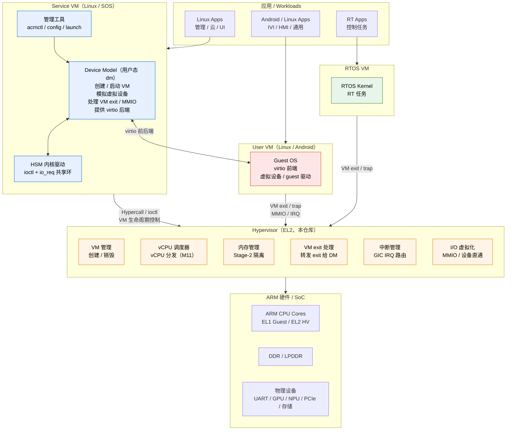
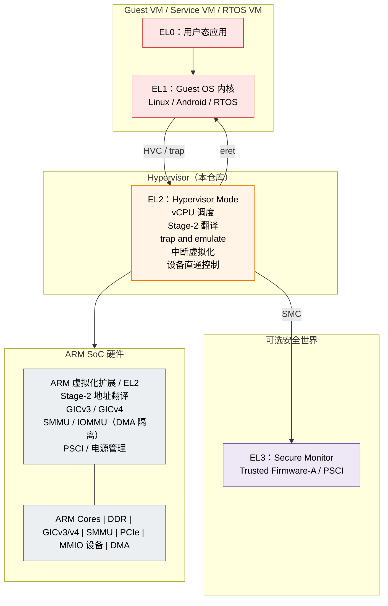

# 目标架构 / Target Architecture（ACRN 模型，M12–M15）

> **这不是当前实现。** 本文画的是路线图终点的形态——Service VM + 用户态 Device Model
> 的完整 ACRN 模型，对应 M12（Hypercall ABI + VM 生命周期）、M13（HSM 内核驱动 +
> io_req 环）、M14（Device Model + virtio 后端）、M15（RK3588 移植）。截至 M10，
> 下面图里的 Device Model、HSM、virtio 后端、SMMU 隔离**都还不存在**。
>
> **当前实现**见 [current-architecture.md](current-architecture.md)：M10 静态分区与
> 已完成的 arch 边界重构，**不包含 M11 调度器**。里程碑与编号映射见
> [CLAUDE.md](../../../CLAUDE.md#milestone-roadmap)。
>
> 本文的两张图原先是 `CLAUDE.md` 里的 ASCII 大图，2026-09-14 迁出并改用 Mermaid 重画
> （`CLAUDE.md` 要求架构文档配 Mermaid 图）。x86 基座的对位版本见
> [../x86/architecture-x86.md](../x86/architecture-x86.md) §1、§2。

---

## 1. 顶层系统图

三类 VM 横向并列，特权与职责自上而下分层。Service VM 是唯一持有 Device Model 的
特权域，User VM 的虚拟设备全部由它在用户态后端提供；RTOS VM 走直通、不依赖 DM。

**读图要点**

- **Service VM 的双层结构是 M13/M14 的核心**：`HSM` 是内核态驱动（仿 `acrn_hsm`），
  通过 io_req 共享环把 User VM 的 MMIO exit 递到用户态；`DM` 是用户态程序，真正
  完成模拟。EL2 只负责把 exit **转发**出去，不含 virtio 后端逻辑——这是
  「不写两遍后端」那条决策（见 [ADR-0016](../../adr/0016-acrn-model-roadmap-decisions.md) 第 3 条）。
- **RTOS VM 不连 DM**：它走直通路径，这也是 SMMU/DMA 隔离最终会落在哪的原因。
- **图中功能不等于已有目录**：当前 VM 编排在 `common/vm/`，MMIO 总线在
  `common/io/`；ARM exit 解码在 `arch/arm64/vmexit/`，Stage-2 / 中断实现在
  `arch/arm64/{mmu,irq,vgic}/`。调度器和向 Service VM 转发 exit 的链路尚未实现。
  当前 EL2 `dm/` 包含 vuart、console 和 hv_shell；未来用户态 DM 不等于这个目录。

---

## 2. 特权层次图

ARM64 的四级异常等级是一条线性阶梯，虚拟化扩展位于 EL2。

**读图要点**

- **EL2 与 EL1 寄存器组分离不等于 vCPU 状态已隔离**：当前静态绑核让 EL1 状态留在
  所属 pCPU；M11 同核切换两个 vCPU 时，仍需保存 EL1 系统寄存器、FP/SIMD、timer
  和 vGIC 等状态。对照见 [../x86/architecture-x86.md](../x86/architecture-x86.md) §2。
- **guest PSCI 与平台 PSCI 分开**：`arch/arm64/vmexit/vpsci.c` 处理 guest 的 HVC，
  `arch/arm64/cpu/psci.c` 通过 SMC 调用平台 PSCI。QEMU 提供平台实现，不需要单独
  加载 TF-A；RK3588（M15）需对接实际固件，而不是把 guest 请求直接透传。
- **SMMU 目前是空格子**：所有 User VM 设备都由 DM 模拟，不需要 DMA 隔离；等 M15 真机
  直通时才排期（见 roadmap 的 Deferred 行）。

---

## 与当前实现的差距

| 图中元素 | 现状（M10） | 计划 |
| --- | --- | --- |
| Service VM / 特权域概念 | 无，两个 VM 对等 | M12 |
| Hypercall ABI（区别于 PSCI） | PSCI over HVC + `HC_GUEST_DONE` 测试钩子，无管理 ABI | M12 |
| HSM 内核驱动 + io_req 环 | 无 | M13 |
| Device Model（用户态） | 无；EL2 `dm/` 为 vuart + console + hv_shell | M14 |
| virtio 前后端 | 无，guest 用 vuart + initramfs | M14 |
| vCPU 调度器 | 无，1:1 静态绑核 | M11 |
| SMMU / DMA 隔离 | 无 | Deferred |
| 运行时 FDT 解析 | 静态板级配置（ADR-0008） | M15 |

---

## 延伸阅读

- [current-architecture.md](current-architecture.md) — **当前实现**的模块、对象与时序图。
- [2026-06-21-architecture-zoom-out.md](2026-06-21-architecture-zoom-out.md) — 单 VM 时代
  的历史快照，不作为当前代码导航。
- [../x86/architecture-x86.md](../x86/architecture-x86.md) — 同样两张图的 x86-64 VT-x 基座
  重画，附术语对照表（EL2↔VMX root、Stage-2↔EPT、vGICv3↔vLAPIC、PSCI↔ACPI）。
- [[../../adr/0014-multi-vm-static-partition-el2-console]] — M10 的多 VM 静态分区、
  per-VM Stage-2/vGIC、EL2 独占控制台。
- [CLAUDE.md](../../../CLAUDE.md#milestone-roadmap) — M0–M15 路线图；路线图不依赖仓库外的本地 skill。
- [ADR-0016](../../adr/0016-acrn-model-roadmap-decisions.md) — ACRN 模型的路线图排序决策。
- [ADR-0015](../../adr/0015-arch-boundary-core-vs-arch.md) — 已落地的 core/arch 边界。
