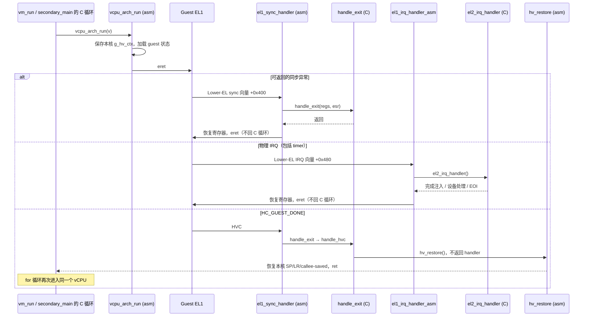

# vcpu_arch_run 与 EL2↔EL1 世界切换（world switch）

当前入口名是 **`vcpu_arch_run`**，旧文档里的 `vcpu_run` 已随 arch 边界重构改名。
本文解释现有的静态绑核路径，不是 M11 的完整 vCPU 上下文切换方案。

源码：

- `hypervisor/common/vm/vm.c`：boot CPU 的 `vm_run()`。
- `hypervisor/arch/arm64/cpu/secondary.c`：其它 pCPU 的 `secondary_main()`。
- `hypervisor/arch/arm64/guest/vm.c`：首次进入前的 `vcpu_arch_load()`。
- `hypervisor/arch/arm64/vmexit/vmexit_asm.S`：进入、同步异常、返回 C 现场。
- `hypervisor/arch/arm64/irq/irq_handler_asm.S`：物理 IRQ 的保存与恢复。
- `hypervisor/arch/arm64/include/arch/vm.h`：arch 结构体与汇编偏移。

## 1. 进入前：先 load，再 run

通用接口声明在 `include/vm.h`。每个 pCPU 首先设置 `percpu[id].cur_vcpu` 与本核指针
（arm64 为 `TPIDR_EL2 = &percpu[id]`），然后：

```c
/* 省略 CPU 启动、UART 等步骤；这是每个已准备好 vCPU 的进入顺序。 */
vcpu_arch_load(v);
for (;;)
    vcpu_arch_run(v);
```

`vcpu_arch_load(v)` 由 `arch/arm64/guest/vm.c` 实现，顺序为：

1. `VMPIDR_EL2 = v->vcpu_idx`，向 guest 呈现 VM 内 CPU 编号。
2. `stage2_activate(v)` 写 `VTCR_EL2` / `VTTBR_EL2`，含 `dsb ish` / `isb`。
3. `vgic_restore(v)` 恢复虚拟 CPU 接口和 LR。

当前每个 pCPU 固定运行一个 vCPU，load 只在首次进入前执行，**不是每次 IRQ 后执行**。
不能把这个一次性初始化序列当成可直接复用的调度器切换协议。

## 2. vcpu_arch_run 的四步

入参 `x0 = struct vcpu *`。通用 `struct vcpu` 的首字段是 `struct arch_regs regs`，
其首字段又是 `x[31]`，所以 `[x0 + 0]` 就是 guest x0。后续 arch 状态在 `v->arch` 中。

### 第 1 步：保存本核 hypervisor 的 C 调用现场

```asm
hv_ctx_slot                       /* x9 = &g_hv_ctx[本 pCPU id] */
stp x19, x20, [x9, #0x00]          /* 继续保存 x21..x29 */
str x30, [x9, #HV_LR]
mov x10, sp
str x10, [x9, #HV_SP]
```

保存的是 callee-saved x19–x29、返回地址 x30 和 SP。它们足以在 `hv_restore()` 时
按 AAPCS64 返回 C 调用点；caller-saved 由调用方负责。

`g_hv_ctx` 是汇编 BSS 中的 **`NR_CPUS` 个 slot**，不能共用一个槽，否则双 VM 同时退出
会恢复到另一个 pCPU 的栈。`hv_ctx_slot` 用 `(TPIDR_EL2 - percpu) / PERCPU_SIZE`
计算物理核编号，与 C 的 `current_vcpu_id()` 必须一致。

### 第 2 步：加载 HCR_EL2

```asm
ldr x1, [x0, #VCPU_HCR_EL2]
msr hcr_el2, x1
isb
```

加载 `v->arch.hcr_el2`，启用 Stage-2（VM）、物理中断路由（IMO/FMO/AMO）、AArch64
EL1（RW）等。页表基址和 vGIC 已在前面的 load 阶段准备好。

### 第 3 步：加载异常返回状态

- `v->regs.elr_el2 → ELR_EL2`：guest PC。
- `v->regs.spsr_el2 → SPSR_EL2`：guest PSTATE。
- `v->regs.sp_el1 → SP_EL1`：guest 栈。

这**不是全部 guest 系统状态**。当前没有完整保存 EL1 系统寄存器块，也没有 FP/SIMD
保存；静态 1:1 绑定让未切走的状态一直留在所属 pCPU，M11 必须补齐。

### 第 4 步：加载 GPR，然后 eret

恢复 x1–x30 后最后加载 x0，避免过早覆盖 vCPU 指针。`eret` 用 `ELR_EL2` /
`SPSR_EL2` 返回 EL1，从 guest PC 执行。

## 3. 同步退出与 IRQ 都直接返回 guest

两种异常入口都经 `TPIDR_EL2 → percpu.cur_vcpu` 找到本核 vCPU，保存 GPR、SP_EL1、
ELR_EL2、SPSR_EL2，再调用 C handler。没有 `g_vm.vcpu` 的全局硬编码。

| 路径 | 处理与返回 | 回 C 运行循环？ |
| --- | --- | --- |
| MMIO、可返回的 PSCI、sysreg trap、未知 HVC | `el1_sync_handler → handle_exit → 恢复 → eret` | 否 |
| timer、PL011、普通 kick IRQ | `el1_irq_handler_asm → el2_irq_handler → 恢复 → eret` | 否 |
| 调试 HVC `HC_GUEST_DONE` | `handle_hvc → hv_restore → ret` | 是，回本核最近的 `vcpu_arch_run` 调用点 |
| 电源关闭、未处理的同步异常 | `cpu_arch_halt()` 停车 | 否 |

**纠正旧说明：定时器 IRQ 不会让 `vcpu_arch_run()` 返回 C。** 连续 tick 由 IRQ 汇编
末尾的 `eret` 续跑 guest；不是靠 `vm_run()` 的 `for` 循环每 tick 重入。



`HC_GUEST_DONE` 用于裸机 SVM 回归，真实 Linux 不使用它。它不是 VM 销毁操作，也不会
让 `vm_run()` 整体返回。双 VM 各自仍有固定的 pCPU 和运行循环，没有抢占或迁移。

## 4. 为什么 eret 之前不能解开 EL2 IRQ 屏蔽

`vectors.S` 的 current-EL IRQ 入口仍指向 `panic_vector`。若在 `eret` 前执行
`daifclr`，pending IRQ 可能在那一条指令的窗口被当作 **EL2 当前级 IRQ** 接走并 panic。

保持 EL2 的 IRQ mask，直接 `eret` 即可：`HCR_EL2.IMO=1` 会把 guest 运行期间的物理
IRQ 路由到 Lower-EL IRQ 向量 `+0x480`。guest 的虚拟 IRQ 是否可见则另受 guest PSTATE
和虚拟 GIC 接口控制，不能把这两类屏蔽混为一谈。

这个约束同时适用于 `vcpu_arch_run`、同步退出和 IRQ 退出的 `eret` 前路径。
历史调试过程见 [启动排错](../../debug/m3-boot-debug-walkthrough.md)。

## 5. 修改布局时的验证

- `arch_regs` 必须是 vCPU 的首字段；`VCPU_*` / `HV_*` 随 arch 类型放在同一个头文件。
- `PERCPU_CUR_VCPU` / `PERCPU_SIZE` 仍在通用 `include/percpu.h`，由 `_Static_assert`
  固定，供 arm64 入口汇编读取。
- 改头文件后清理旧构建，再运行 `make test` 的 host/target offset 检查和 QEMU 场景。
- M11 需要重新设计 vGIC 保存与远程发布的关系，不能直接在这个循环里插入现有
  `vgic_save()`。见 [vGIC 注入](vgic-injection.md) 与
  [M11 边界对齐说明](../../superpowers/specs/2026-10-04-m11-arch-boundary-alignment.md)。
