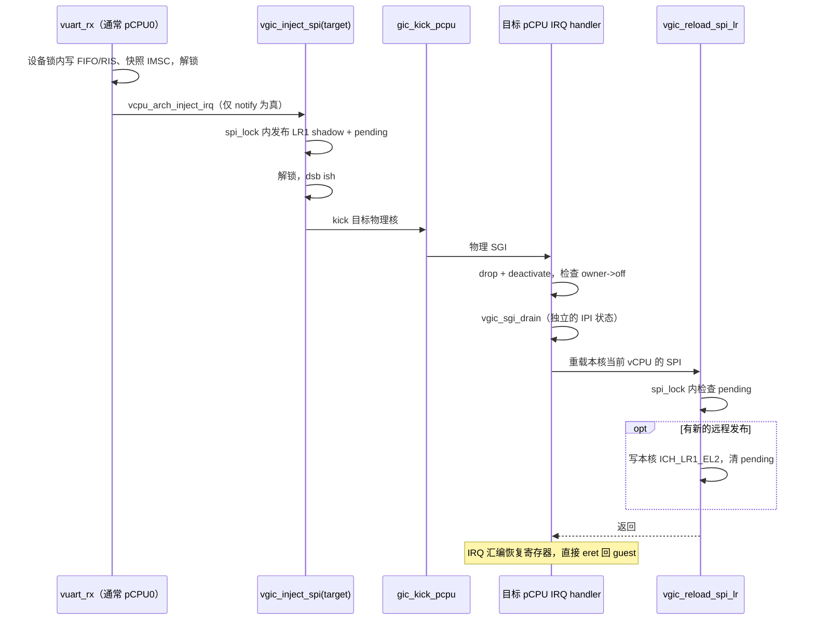
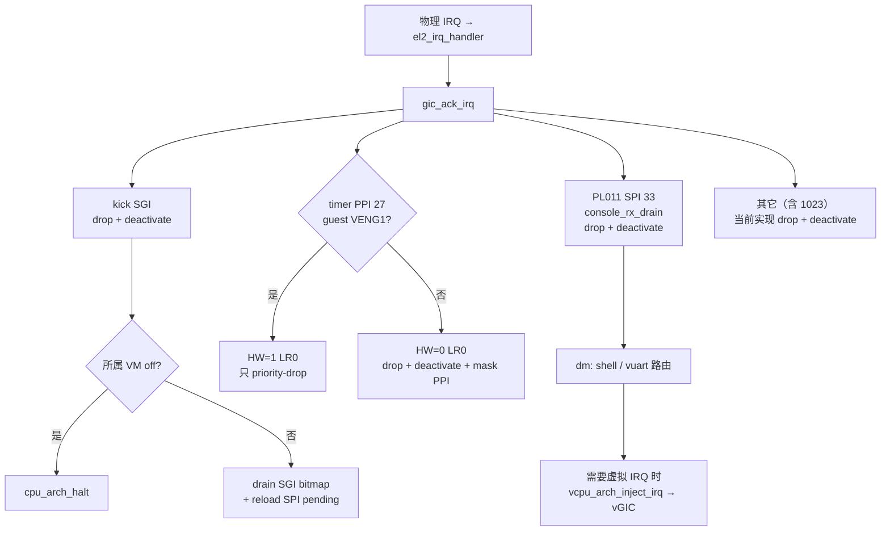

# vGIC 中断注入与跨核交付

注入是把虚拟中断写进本 pCPU 的 `ICH_LR<n>_EL2`，由硬件虚拟 CPU 接口呈现给 guest。
但**远程目标不能直接写本核 LR**：需要先发布目标 vCPU 的影子状态，再通知其所属 pCPU。

源码入口：

- `hypervisor/arch/arm64/vgic/vgic.c`：四种注入、SPI 远程交付、save/restore。
- `hypervisor/arch/arm64/vgic/vgic_sgi.c`：guest IPI 解析与 pending bitmap。
- `hypervisor/arch/arm64/irq/irq_handler.c`：物理 IRQ 分发。
- `hypervisor/arch/arm64/guest/vm.c`：通用 `vcpu_arch_inject_irq()` 的 arm64 实现。
- `hypervisor/dm/console.c` / `vuart.c`：控制台 RX 仲裁与虚拟设备状态。

## 1. LR 与状态归属

一条 LR 描述符的关键字段（定义在 `vgic/vgic.h`）：

| 字段 | 位 | 含义 |
| --- | --- | --- |
| State | [63:62] | `0b01` = Pending |
| HW | [61] | 0 = 软件注入；1 = 链接物理 INTID |
| Group1 | [60] | Group 1 |
| Priority | [55:48] | 虚拟优先级 |
| pINTID | [44:32] | HW=1 时关联的物理 INTID |
| vINTID | [31:0] | guest 看到的 INTID |

影子位于 **`vcpu->arch.ich_lr[4]`**，与 `spi_lock` / `spi_shadow_pending` 一起定义在
`arch/arm64/include/arch/vm.h`。影子不是硬件 LR 的持续镜像：guest 消费中断会改变
live LR，内存不自动回写。远程 SPI 发布期间则可能是内存比 live LR 更新。

当前固定分配 LR0=timer、LR1=vuart SPI、LR2=SGI，LR3 未用于注入；没有通用 LR 分配器。

## 2. 四种注入

| 函数 | LR | HW | 当前用途 |
| --- | --- | --- | --- |
| `vgic_inject_sw(v, vintid, prio)` | LR0 | 0 | secondary 启动早期的 timer 回退路径 |
| `vgic_inject_hw(v, vintid, pintid, prio)` | LR0 | 1 | guest vGIC 已启用后的 timer PPI 27 |
| `vgic_inject_spi(target, intid)` | LR1 | 0 | vuart RX，支持本核或远程目标，固定优先级 0xA0 |
| `vgic_inject_sgi(v, vintid)` | LR2 | 0 | 在目标核注入 guest IPI，固定优先级 0xA0 |

sw/hw/sgi 路径更新影子并写**当前核**的 live LR，调用方必须保证目标在本核。
SPI 路径自行判断 `target == current_vcpu()`，远程时只更新影子并 kick。

arch 外唯一的注入调用方目前是 vuart：

`vuart_rx → vcpu_arch_inject_irq(&vm->vcpu[0], config->vuart_irq) → vgic_inject_spi`。

通用钩子声明在 `include/vm.h`，当前 arm64 实现**只支持这条 shared peripheral IRQ
用途**，不是通用 SGI/PPI 注入 API。每个 VM 的控制台 IRQ 固定送它的 vCPU0。

## 3. timer：为什么 HW 转发只 drop，不 deactivate

电平触发的 PPI 27 在 guest 处理定时器前可能一直拉高。若 EL2 过早 deactivate，
它会立即重新 pending，使 guest 得不到处理机会。

稳态路径用 `vgic_inject_hw(..., 27, 27, 0xA0)`，EL2 **只做 priority-drop**，保持
物理 Active。guest 对虚拟 IRQ 的 deactivate 经 LR 的 HW 链接释放物理中断。
这是 [ADR-0001](../../adr/0001-vtimer-hardware-forwarding.md) 的核心约束。

例外是 secondary 启动早期 `ICH_VMCR_EL2.VENG1 == 0`：guest 还不能接收 Group 1
虚拟 IRQ，不能让 HW 链接永远卡在 Active。因此改用 LR0 软件 pending，同时 drop、
deactivate 并屏蔽物理 PPI。guest 之后写虚拟 PPI-27 enable 时，
`vgicr_write_sgi → gic_ppi_set_enable()` 重新启用物理 PPI。

## 4. SPI：锁、发布与跨核通知

物理 PL011 由 EL2 独占。`console_rx_drain()` 排物理 FIFO，并按 shell / 焦点 VM
把字节送给 `hv_shell_rx()` 或 `vuart_rx()`；物理 UART IRQ 随后 drop + deactivate。
虚拟 UART IRQ 为 **HW=0**，guest 完成它不应再次释放物理 IRQ。

`vuart_rx()` 的设备锁保护 FIFO、RIS 和 IMSC 快照；**先释放设备锁，再调用注入钩子**。
IMSC 判断在快照时生效，当前没有“以后 unmask 就补送已有 RX”的逻辑。

SPI 的 payload、pending 和本核完成动作由同一把 `target->arch.spi_lock` 保护：

- **本地**：锁内更新 LR1 shadow / pending，写 live LR1，再清 pending。
- **远程**：锁内更新 shadow / pending，解锁后 `dsb ish`，再
  `gic_kick_pcpu(pcpu_base + vcpu_idx)`。
- **目标核**：kick 分支调用 `vgic_reload_spi_lr(current_vcpu())`，锁内仅在 pending
  为真时写 live LR1 并清除标志。

普通 IPI 也会进入 kick 分支，因此 pending gate 必须保留；否则已经消费的旧 shadow
会被一次无关 kick 重放。

## 5. IRQ 分发与模块边界

`irq/gic_v3.c` 只拥有物理控制器；`irq_handler.c` 做分发；`vgic/` 拥有虚拟中断状态；
`dm/console.c` 拥有 RX 仲裁。旧文档里的 EL2 virtio used-buffer 注入路径已经不存在，
virtio 后端计划在 M14 的用户态 Device Model 实现。

## 6. save / restore 不是现成的调度协议

- `vgic_restore()` 由 `vcpu_arch_load()` 在首次进入 guest 前调用；静态绑核期间不会
  在每次 IRQ / MMIO 后 restore。
- **`vgic_save()` 当前没有调用方**。它读取 live LR 覆盖 shadow，可能抹掉另一个核
  刚发布但尚未交付的 SPI；仅加锁也不能解决“live 比 shadow 旧”的状态语义。
- M11 必须设计完整的离核状态与远程注入协议，并补齐完整 CPU 上下文；不能简单把
  现有 save/restore 包在时间片循环外就宣称支持调度。

`make test-qemu-vspi` 覆盖 RX、IPI 压力及无关 kick 不重放旧 SPI；完整回归为
`make test`。调试开关的实际覆盖范围见 [vgic-debug-logging.md](vgic-debug-logging.md)。
