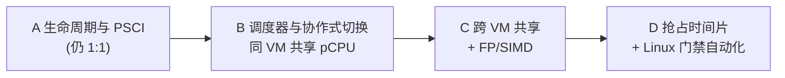

# M11 — vCPU 调度器 Milestone Plan（骨架）

> **Status:** Skeleton（2026-10-30；随 [设计](../specs/2026-10-30-m11-vcpu-scheduler-design.md)
> 一并过关卡①）。本文只锁切片顺序、依赖与每片 DoD/合并标准；**每片开工前用
> `superpowers:writing-plans` 写各自的详细 plan**（repo 惯例），届时才含任务级
> 文件/代码/验证步骤。
> **分支模型（loop 协议）:** 每片 `feature/m11-<片名>` 从 `develop` 拉出，关卡②通过后
> `--no-ff` 合回并删分支。
> **每片固定验收项（关卡②）:** `make test` 聚合全绿 + `make host-test` 全绿（有 host
> 用例的片）+ `make test-x86-stub` 链接过（新钩子已补 stub）+ 手工双 VM Linux gate
> （到 `~ #`、Ctrl-T、`/proc/interrupts` 计数在走）+ 零 warning + Linear 同步。
> **纪律提醒:** Makefile 不跟踪头文件依赖，改头文件后 `make clean`；host 纯逻辑模块
> RED commit → GREEN commit 顺序可见（B 片起）；学习类故意失败实验只在工作树做，不落
> 红 commit。

## 切片顺序与依赖

线性依赖，无并行片；B 是关键路径（若关卡①判 B 过大，按 spec 第 5 节预案拆 B1/B2，
顺序不变）。

## 片 A — 生命周期与 PSCI 语义（依赖：前置 B 已完成）

**交付**: `enum vcpu_state` 进 `struct vcpu`；per-vCPU 亲和配置取代结构性 1:1；`vm.off`
删除；PSCI 五函数按 vCPU 语义重写（接口面不变）；全 pCPU 启动 + `cpu_arch_idle`；
`ctxsw` detector 用例以受控红状态落库（独立目标，不进聚合）。

**DoD**:
- [ ] `psci` 用例扩展断言通过（CPU_OFF 后兄弟 vCPU 存活；ON_PENDING 可见）。
- [ ] 现有 7 场景 + 4 静态检查全绿（启动流重排的回归网）。
- [ ] 手工 Linux gate 含 `echo 0 > …/cpu1/online` 断言。
- [ ] `ctxsw` 红证据（工作树验收操作）+ 失败模式记入当日报告。

**合并标准（关卡②）**: 上述全绿 + `check_offsets` 补齐 + 新钩子（idle/kick）x86 stub 就位
+ 无对 `vm.off` 的残留引用（grep 零命中，`vm_list` 改从运行状态推导）。

## 片 B — 调度器与协作式切换，同 VM 共享（依赖：A）

**交付**: `common/sched/`（`sched_q.c` 纯逻辑核 + `sched.c` 粘合 + `switch_to` 唯一公开
入口）；`secondary_main` 改问调度器；WFI trap → block/yield；`vcpu_arch_put` + EL1 批量
保存/恢复（先推导→detector→对照 bao/xvisor）；vGIC 运行期保存协议重设计 +
`ICH_VTR_EL2` 探测；per-vCPU vtimer；`ctxsw` 转绿进聚合。

**DoD**:
- [ ] `tests/host/sched_q_test.c` RED→GREEN commit 顺序可见。
- [ ] 同 VM 2 vCPU on 1 pCPU 协作轮转，`ctxsw`（场景 8/8）全绿，含挂起中断跨让出存活。
- [ ] `docs/debug/` 新增半清单失败模式 + 对照差异各一篇。
- [ ] ADR×2 落档：两层状态划分；协作先行与 WFI 让出点。

**合并标准（关卡②）**: 聚合 8 场景全绿 + host 全绿 + 手工双 VM Linux gate（默认拓扑仍
2+2-on-4 不变）+ per-exception 开销不变（汇编路径零改动，评审确认）。

## 片 C — 跨 VM 共享与 FP/SIMD（依赖：B）

**交付**: 跨 VM `VTTBR`/VMID + `tlbi vmalle1` 纪律；默认拓扑切 2×2-on-2；FP/SIMD 急切
保存（`.S` 或专用编译单元；`-mgeneral-regs-only` 不变量不解除）。

**DoD**:
- [ ] 新双 VM 共享隔离场景（同 IPA 各盖各值，切换后读回）全绿。
- [ ] `ctxsw` FP 盖章段通过；双 VM 并发 FP 负载结果正确。
- [ ] 手工 2×2-on-2 Linux gate：两 shell、Ctrl-T、timer/IPI 计数在走。
- [ ] ADR×1 落档：急切先于惰性 FP（显式推迟 `CPTR_EL2.TFP`）。

**合并标准（关卡②）**: 聚合全绿（含新场景）+ 隔离断言红不了（测试专家对抗性构造一次
跨 VM 泄漏尝试并记录）+ TLB 免失效优化登记为带条件的推迟项。

## 片 D — 抢占时间片与 Linux 门禁自动化（依赖：C）

**交付**: EL2 物理定时器 tick + `needs_resched` 返回点切换（不在中断上下文切换）；
`make test-linux`（聚合外）+ ADR-0009 显式重访；镜像来源决策落地。

**DoD**:
- [ ] 抢占下聚合全绿；两 VM 前向进度并发可观察（非仅无损坏）。
- [ ] `make test-linux` 一条命令绿到双 shell；ADR-0009 修订落档。
- [ ] 里程碑收尾：known gaps 盘点、`CLAUDE.md` 里程碑表更新、
  `docs/reference/arm/current-architecture.md` 更新、Linear 同步。

**合并标准（关卡②）**: 里程碑验收场景（2×2-on-2 双 VM + 并发 FP 到 shell）绿 + 三份
ADR 在档 + 源文档三篇无未标注冲突。

## 里程碑级跟踪

- 粗估：A 2–3 loop 日、B 5–8（可拆 B1/B2）、C 3–5、D 3–4；总量约 3–4 周。
- Linear：M11 开工时 H-27 置 In Progress 并挂本 plan 链接；H-167（vmexit 计数器）保持
  M11 范围外，收尾时复核归属。
- 每片完成后在本文对应节勾选 DoD 并补 commit 哈希（沿用前置 A/B plan 的收尾惯例）。
