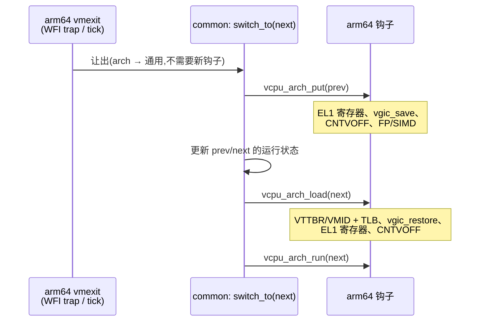

# M11 与 arch boundary 的对齐

> [M11 spec](2026-08-10-m11-vcpu-context-switch-design.md) 写于 2026-08-10,早于 arch
> boundary 重构([ADR-0015](../../adr/0015-arch-boundary-core-vs-arch.md),2026-09-29)。
> 那份 spec 作为历史记录不改;**M11 开工前先读本文**,它的模块位置和"直接调用"写法
> 以本文为准。

## 模块落点:通用层 vs arm64

M11 spec 的"Modules built or modified"一节按 arm64 单架构来写。在新边界下拆成两层:

| M11 spec 模块 | 通用层(arch 以外) | arm64(`arch/arm64/`) |
|---|---|---|
| `struct vcpu` 扩充 | 运行状态枚举(`OFF`/`RUNNING`/`BLOCKED`)放进通用 `struct vcpu`(`include/vm.h`) | EL1 系统寄存器块、per-vCPU `CNTVOFF`、FP/SIMD 块放进 `struct vcpu_arch`(`include/arch/vm.h`),偏移宏和 `tests/check_offsets*.c` 跟着改 |
| 上下文切换模块 | 唯一公开入口 `switch_to(next)` 和调度逻辑放在 `common/`(文件名到 S3 再定) | 寄存器清单只出现在钩子实现里(`guest/`) |
| vuart 加锁 | `dm/vuart.c`,用通用 `spinlock.h` API | — |
| vGIC MMIO 加锁 | — | `vgic/vgic_v3_mmio.c` 的 `g_vgicd[]` |
| PSCI 每 vCPU 下电 | 下电本身是通用的运行状态转换 | `vmexit/vpsci.c` 只做 PSCI 语义解码,再调用通用的状态转换 |
| `vgic_save()` 的调用点 | — | 在 put 钩子内部调用,通用层看不到 vGIC |
| vtimer `CNTVOFF` | — | `timer/vtimer.c` 和 `cpu/secondary.c` 两处常量写入改为在 load 钩子里写 |
| 异常入口汇编 | — | `vmexit/vmexit_asm.S`,不变(M11 spec 决策 9) |

M11 spec 里的"Resist exposing save/restore as a public pair"在新边界下仍然成立:`switch_to()`
是唯一的公开入口,load/put 钩子只由它调用。

## 钩子可移植性表

规则(ADR-0015 复查时定下):**M11 每新增一个钩子,都要在这张表里加一行**,回答
x86 和 RISC-V 能不能实现它。答不上来,说明钩子里混进了 arm64 语义,要改名或者
改形状。下表是候选,名字到对应切片再最终确定:

| 钩子 | 切片 | 语义 | x86 (VMX) | RISC-V (H 扩展) | 状态 |
|---|---|---|---|---|---|
| `vcpu_arch_load(v)` | 已有 | 把 `v` 装到本 pCPU | `VMPTRLD` + 恢复 VMCS 以外的状态 | 恢复 `vs*` CSR、写 `hgatp` | 已有;S3/S4/S5/S6 往里加内容,签名不变 |
| `vcpu_arch_put(v)` | S3 | 把 `v` 从本 pCPU 卸下并保存状态 | 保存 VMCS 以外的状态(MSR、FPU) | 保存 `vs*` CSR | 候选;不用 `save_el1_state` 这类带 EL 的名字 |
| 让出 / 阻塞 | S3 | WFI trap 时让出 pCPU | HLT exit | `hstatus.VTW` trap 的 WFI | 方向是 arch → 通用,不需要新钩子 |
| 每 vCPU 下电 | S2 | `CPU_OFF` 只停当前 vCPU | INIT 信号语义 | SBI HSM `hart_stop` | 方向是 arch → 通用,不需要新钩子 |
| 抢占定时器 | S7 | 给本 pCPU 设下一次调度 tick | VMX preemption timer / LAPIC timer | `stimecmp` | 待 S7 定名(如 `cpu_arch_timer_arm`) |

`CNTVOFF`(x86 对应 TSC offset,RISC-V 对应 `htimedelta`)、VMID/TLB 纪律(x86 对应
VPID/EPTP,RISC-V 对应 `hgatp.VMID`)、FP/SIMD 都放在 load/put 钩子内部,不新增钩子。

## 交给 M11 的边界遗留项

ADR-0015"已知语义耦合"表里标为"交给 M11"的两项(`struct vm.off`;`VCPUS_PER_VM`
静态绑定和 `secondary_main` 的映射)以那张表为准,这里只记落到哪个切片:`vm.off`
在 S2 被每 vCPU 运行状态取代(`vm_list` 的 STATE 列随之改从运行状态推导);静态
映射在 S3 起失效,改由调度器决定。

## M11 spec 路径与写法对照

| M11 spec 写法 | 现在的位置或规则 |
|---|---|
| PSCI | guest PSCI 模拟在 `arch/arm64/vmexit/vpsci.c`;物理 PSCI 在 `arch/arm64/cpu/psci.c` |
| `spinlock.h` 的前提注释 | `include/spinlock.h`(通用 API);arch 原子操作在 `arch/arm64/include/arch/spinlock.h` |
| vGIC、`vgic_save()` | `arch/arm64/vgic/vgic.c` |
| `g_vgicd[]` | `arch/arm64/vgic/vgic_v3_mmio.c` |
| vtimer 的两处 `CNTVOFF_EL2 = 0` | `arch/arm64/timer/vtimer.c`、`arch/arm64/cpu/secondary.c` |
| 偏移宏、`check_offsets` | `arch/arm64/include/arch/vm.h`;`tests/check_offsets.c` 和 `tests/check_offsets_target.c` |
| `svm5` + `run_svm5_test.sh` + 第六个 `HV_GUEST` profile | 按 CLAUDE.md 现行规则:新场景是 `tests/svm/cases/<case>.c` + `tests/svm/expect/<case>.txt` + 一个 Makefile 目标,用共用的 `tests/run_svm_test.sh`;**不新建 `tests/svmN/` 目录,也不新写 runner**。是否需要新的 `HV_GUEST` profile(比如两个 vCPU 共享一个 pCPU 的构建)到 S1 再定 |
