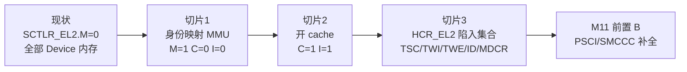

# M11 前置 A：EL2 加固设计

> **状态:** 待执行。**定位:** M11 前置 A（非里程碑,不改变任何 guest 可见行为之外的功能承诺——
> 本阶段本身就是在给 EL2 加能力,但对两个 Linux VM 的可观察行为应保持不变）。
> **时间盒:** 2 周(见 [[../../adr/0017-el2-hardening-before-scheduler-and-passthrough-milestone]]
> 2026-10-22 修订)。到期无论做到哪一步,未完成部分记为已知缺口,强制切到 M11 前置 B。
> **来源:** ADR-0017 的决策条目 1(M11 前置 A 部分)。
> **参考实现:** bao-hypervisor `src/arch/armv8/armv8-a/aarch64/boot.S` +
> `inc/arch/sysregs.h`(EL2 自身 Stage-1 MMU 使能序列,真实硬件上验证过);
> xvisor `arch/arm/cpu/arm64/{cpu_proc.S,include/cpu_defines.h}`(独立实现,
> 用于交叉核对 `TCR_EL2`/`SCTLR_EL2` 位定义,两者在 `TCR_EL2` 的 RES1
> (bit23|bit31)和 `SCTLR_EL2` 的 M/A/C/I 位(bit0/1/2/12)上完全一致)。

## Problem Statement

`hypervisor/arch/` 下 grep 验证过(ADR-0017 核实):EL2 自己从未配置 `SCTLR_EL2`、
`TTBR0_EL2`、`TCR_EL2`、`MAIR_EL2`。`SCTLR_EL2.M` 恒为复位值 0,意味着 EL2 的每一次
取指、每一次数据访问都被当作 Device 内存(strongly-ordered,不可缓存,不可重排)。
这解释了仓库里两个现有的强制约束:

- 自旋锁(`arch/arm64/include/arch/spinlock.h`)用 `ldxr`/`stxr` 做独占访问——在 Device
  内存上,独占操作的正确性在 QEMU 的松散模型下能过,但 ARM ARM 不保证在真机上可靠。
- `-mstrict-align` 是编译期的硬性要求,因为 Device 内存不允许非对齐访问。

两者都是"当前能跑,但前提错了"的债:越往后留,依赖这个错误前提的代码越多——M11 的
调度器要新增每核运行队列和跨核 kick,M16 的直通要新增共享 DMA 缓冲区,全部构建在
Normal 内存的假设上会比现在改动小得多。

## Solution

EL2 开自己的 Stage-1 MMU 与 cache,把 hypervisor 自身的内存改为 Normal 类型。按 ADR-0017
的决定,拆成风险递减的三个切片,而不是一次性全开:

1. **只开 MMU,身份映射,不开 cache**(`SCTLR_EL2.M=1`,`C=0`,`I=0`)。证明页表本身
   正确——翻译异常或页表构造错误在这一步必须表现为"启动即挂",而不是和缓存一致性问题
   混在一起排查。
2. **开 cache**(`C=1`,`I=1`)。在切片 1 已经验证页表正确之后,这一步只剩 cache
   使能本身的风险,出问题范围更小。
3. **`HCR_EL2` 加陷入集合**:`TSC`(陷入 guest 的 `smc`)、`TWI`/`TWE`(陷入 `wfi`/`wfe`)、
   ID 寄存器过滤、`MDCR_EL2` 的 PMU/debug 陷入。这组改动和内存类型无关,但同属 ADR-0017
   "EL2 加固"的范围,且复用同一个时间盒,所以放在同一个前置阶段的第三个切片。

## User Stories

1. 作为 hypervisor 开发者,我希望 EL2 自己的内存是 Normal 类型,这样自旋锁的 `ldxr`/
   `stxr` 独占操作在真机上才有架构保证,不只是"QEMU 上能跑"。
2. 作为开发者,我希望 MMU 使能和 cache 使能是两个独立、可独立 bisect 的提交,这样出现
   "启动即挂"时能立刻定位是页表错误还是 cache 一致性问题。
3. 作为开发者,我希望身份映射(VA == PA),这样这一步不引入"换地址空间"这个额外的风险维度——
   bao 的两段式(临时扁平映射 → 最终 VAS)在那里是因为它要支持非身份的最终布局;本仓库
   不需要,直接身份映射就是最终映射。
4. 作为开发者,我希望页表覆盖的范围只是 EL2 实际会触碰的地址(hv 自身镜像 + GICD/GICR +
   PL011),不覆盖 guest RAM 或 Stage-2 相关地址,这样 EL2 Stage-1 的改动和 Stage-2
   (`VTTBR_EL2`/guest IPA)完全解耦——Stage-2 的页表遍历本来就直接走物理地址,不经过
   EL2 Stage-1。
5. 作为开发者,我希望这一步不做权限收紧(W^X、guard page),这样映射逻辑保持最简单的
   "身份映射、按 1GB block 粗粒度划分 Device/Normal 两类",后续加固是独立的、有自己
   验收标准的工作,不会混进这次的 diff。
6. 作为开发者,我希望每个 pCPU(boot core 和 PSCI 唤醒的 secondary)都在进入自己的主循环
   之前完成这组寄存器编程,这样 4 个 pCPU 的 EL2 执行环境一致,不会出现"CPU0 有 MMU、
   CPU1 没有"的不对称状态。
7. 作为开发者,我希望页表本身只构造一次(全局静态,4 个 pCPU 共享同一张身份映射表),
   这样不会出现"每个 pCPU 各自建表却覆盖同样的地址"这种重复劳动和潜在不一致。
8. 作为开发者,我希望 `TCR_EL2`/`MAIR_EL2` 的位定义不是凭记忆写的,而是对照至少两份
   独立的真实可启动实现(bao 在真机上跑,xvisor 独立实现)交叉核对过的,这样硬件正确性
   不依赖单一来源。
9. 作为 reviewer,我希望 QEMU 验收标准和真机验收标准分开写清楚,这样"过了 `make test`"
   不会被误当成"真机上也验证过独占访问的内存序语义"。
10. 作为 M11 的实现者,我希望这一步结束时 `-mstrict-align` 的必要性被重新评估并记录结论
    (去掉或保留,哪怕结论是"暂时保留,原因是 X"),这样它不会继续被当作"因为 Device
    内存"的死文档。
11. 作为开发者,我希望切片 3(`HCR_EL2` 陷入集合)有一个能在 QEMU 里跑的用例证明
    `TSC` 生效——SVM guest 发 `smc` 指令,预期陷入 EL2 并拿到 `SMCCC_NOT_SUPPORTED`,
    而不是直达 EL3——这样"陷入集合加上了"不是只凭读代码判断。

## Implementation Decisions

### 切片 1 — 身份映射 MMU(`M=1, C=0, I=0`)

**新文件** `hypervisor/arch/arm64/mmu/el2_mmu.c` + `el2_mmu.h`,风格对齐
`hypervisor/arch/arm64/mmu/stage2.c`(静态页表数组、4 KB 对齐属性、一个 `_init`
构造表的函数 + 一个每核都要调的激活函数):

- `void el2_mmu_init(void)` — 构造静态 L1 表(512 项,4 KB 对齐,单张表,所有 pCPU
  共享)。只需要两个 1 GB block descriptor:
  - `l1[0]`(覆盖 `0x00000000`–`0x3FFFFFFF`,含 `BOARD_GIC_DIST_BASE`=`0x08000000`、
    `BOARD_GIC_RDIST_BASE`=`0x080A0000`、`BOARD_UART_BASE`=`0x09000000`):
    身份映射,`AttrIndx`=Device-nGnRE,`XN`=1(不可执行),`AF`=1,`SH`=Outer Shareable。
  - `l1[1]`(覆盖 `0x40000000`–`0x7FFFFFFF`,含 hv 自身镜像加载地址
    `0x40080000`——`BOARD_DRAM_BASE` 到 `BOARD_LINUX_RAM_PA`(`0x80000000`)之间
    除 hv 镜像外没有别的东西用到,见 `board.h` 注释):身份映射,`AttrIndx`=Normal
    WB-RA-WA(inner+outer),`AF`=1,`SH`=Inner Shareable,`XN`=0(.text 需要可执行)。
    不区分代码/数据/栈的权限——按 User Story 5,W^X 是后续工作。
  - **不映射** guest RAM(`BOARD_LINUX_RAM_PA`=`0x80000000` 及以上)、VM1 的
    `0xC0000000` 块:EL2 自己的代码从不直接访问这些地址,Stage-2 遍历走物理地址,不经过
    这张表。
- `void el2_mmu_enable(void)` — 每个 pCPU 各自调用一次(寄存器是 per-PE 的,表是共享的):
  1. `msr mair_el2, MAIR_EL2_VALUE`
  2. `msr tcr_el2, TCR_EL2_VALUE`
  3. `msr ttbr0_el2, &l1_table`(物理地址,身份映射后 VA==PA 所以这里不需要换算)
  4. `isb`
  5. `tlbi alle2`;`dsb nsh`;`isb`(写 TTBR/MAIR/TCR 之后,使能 MMU 之前,清掉可能残留的
     缓存的无效翻译——参照 bao `boot.S` 的 `tlbi alle2is` 序列)
  6. `mrs x, sctlr_el2` → 置位 `M`(bit0)→ **不**置位 `C`/`I` → `msr sctlr_el2, x`
  7. `isb`(使能 MMU 之后必须有一条 `isb`,否则后续取指令的翻译状态未定义)

  因为是身份映射,`msr sctlr_el2` 这条指令本身和它之后的下一条指令都落在 `l1[1]` 的
  同一个身份映射块内,不需要 bao 式的"切到最终 VAS 再跳转"——执行流无缝continue。

- **寄存器取值**(单位:bit,全部对照 bao/xvisor 交叉核对过,见本文件头部"参考实现"):
  - `MAIR_EL2`:index 0 = Device-nGnRE(`0x04`),index 1 = Normal WB-RA-WA(`0xFF`)。
  - `TCR_EL2`:`T0SZ`=25(bits[5:0],39-bit 输入地址,和 `stage2.c` 的 `VTCR_T0SZ`
    取同一个值,保持本仓库一致的地址空间假设)、`IRGN0`=WB-RA-WA(bits[9:8]=01)、
    `ORGN0`=WB-RA-WA(bits[11:10]=01)、`SH0`=Inner Shareable(bits[13:12]=11)、
    `TG0`=4 KB(bits[15:14]=00)、`PS`=40-bit(bits[18:16]=010,和 `stage2.c` 的
    `VTCR_PS` 一致)、`RES1`=bit23 和 bit31(**注意和 `VTCR_EL2` 不同**——`VTCR_EL2`
    只有 bit31 是 RES1,`TCR_EL2` 多一个 bit23;这是两份参考实现都给出 `0x80800000`
    初值交叉确认的,写代码时要用不同的宏,不能从 `VTCR_EL2_VALUE` 直接照抄 RES1)。
  - `SCTLR_EL2`:`M`=bit0,`A`(对齐检查)=bit1,`C`=bit2,`I`=bit12——这一切片只置位
    `M`,`A`/`C`/`I` 保持复位值 0(`A`=0 即不强制对齐检查;`-mstrict-align` 继续通过
    编译期保证对齐,这一切片不依赖硬件对齐检查)。

- **调用点:**
  - `hypervisor/arch/arm64/cpu/cpu.c` 的 `cpu_arch_init()` 顶部:先 `el2_mmu_init()`
    (只有 boot CPU 调这个函数一次)再 `el2_mmu_enable()`,再进 `gic_init()`/
    `vtimer_init()`。顺序要求:MMU 必须在任何其它 EL2 初始化之前开,这样之后的
    `printk`(走 PL011 MMIO,身份映射 Device 内存,行为不变)、GIC 初始化(同理)都已经
    是在 MMU 开启之后跑的——如果页表有错,这里就会立刻表现为挂死或 data abort,不会
    拖到后面才暴露。
  - `hypervisor/arch/arm64/cpu/secondary.c` 的 `secondary_main()` 顶部,在触碰
    GICR MMIO 之前:只调 `el2_mmu_enable()`(表已经由 boot CPU 建好,`el2_mmu_init()`
    不必再调——之所以不做成"每次都调一下也无所谓"的幂等调用,是因为这是硬件状态编程
    过程,少一次函数调用也是少一条不必要的路径;如果未来真的需要每核独立的表,这个
    决定要重新评估)。

### 切片 2 — 开 cache(`C=1, I=1`)

- 在切片 1 验证通过(QEMU 双 VM 跑通,见 Testing Decisions)之后,单独一个提交:
  `el2_mmu_enable()` 里 `sctlr_el2` 的写入值加上 `C`(bit2)、`I`(bit12)。
- 加 cache 维护:置位前 `ic iallu`(指令缓存失效,防止之前残留的指令缓存行在开启 I-cache
  后被误用)+ `tlbi alle2` + `dsb nsh` + `isb`(参照 xvisor `proc_setup` 的
  `ic iallu` / `tlbi alle2is` / `dsb sy` 序列,xvisor 是独立实现,这组维护指令在两份
  参考里都出现,不是单一来源的习惯)。
- 不需要新增数据缓存维护(`dc` 指令):本仓库在这一步之前从未往这些地址写入过"假设
  non-cacheable、之后又假设 cacheable"的数据,没有历史脏数据需要清理;真机上是否需要
  额外的 cache 维护留给 M15 板级验证。

### 切片 3 — `HCR_EL2` 陷入集合

- `hypervisor/arch/arm64/guest/vm.c` 的 `vcpu_arch_reset()`:`hcr_el2` 初值追加:
  - `TSC`(bit19):陷入 guest EL1 的 `smc`。
  - `TWI`(bit13)、`TWE`(bit14):陷入 guest 的 `wfi`/`wfe`。这一步只陷入、不利用——
    M11 调度器才会用它做让出 CPU 的触发点;本切片的处理器直接把 `elr_el2 += 4` 放行,
    保持现有的"vCPU 独占物理核"行为不变(FR: 不改变可观察行为)。
  - ID 寄存器过滤:置位 `TID3`(bit18,陷入 `ID_AA64*_EL1` 组寄存器读取)——不在这一步
    暴露假的 ID 寄存器值(那是功能,不在本切片范围),只是先把陷入打开,处理器里原样
    转发真实值(`mrs` 读物理寄存器后写回 `regs->x[rt]`),行为不变,只是加了一条路径。
- `hypervisor/arch/arm64/vmexit/vmexit.c`:
  - `smc` 走 EC=0x17(HVC 是 EC=0x16,两者有独立的异常类)。新增 `handle_smc()`:
    和 `handle_hvc()` 里的 `default` 分支行为一致——`regs->x[0] = SMCCC_NOT_SUPPORTED`,
    `elr_el2 += 4`。guest 原本能直达 EL3 的 `smc`(没有 `TSC` 时)现在落到 EL2,拿到
    一个确定的"不支持"而不是真的触达固件——这正是 ADR-0017 指出的安全缺口要堵的东西。
  - `TWI`/`TWE` 走 EC=0x01(WFx trap)。新增 `handle_wfx()`:原样放行(`elr_el2 += 4`,
    不真的让 vCPU 睡眠——M11 之前没有调度器,放行等价于"立刻继续",行为不变)。
  - ID 寄存器组走 EC=0x18(trapped MSR/MRS,和已有的 GIC CPU-interface 陷入同一个
    异常类,按 `op0/op1/CRn/CRm/op2` 区分,复用 `handle_sysreg_trap` 已有的 ISS 解码
    框架,加一个分支:`CRn==0`(`ID_*` 组的编码特征)→ 读物理寄存器原样转发)。
- `hypervisor/arch/arm64/cpu/cpu.c` 的 `cpu_arch_init()`:追加
  `MDCR_EL2` 设置——`TDE`(bit8,陷入调试异常到 EL2)、`TPM`(bit6)/`TPMCR`
  (bit5)(陷入 PMU 寄存器访问到 EL2)。本仓库还没有调试器或 PMU 使用场景,这一步只是
  打开陷入、不做虚拟化——guest 访问这些寄存器会落到一个新的 EC,处理器行为是
  "打印一行未知陷入日志 + 返回 0",和现有 `default` 陷入处理的保守风格一致。

## Testing Decisions

- **好测试的标准**:切片 1/2 是纯粹的"换内存类型",正确性定义是"现有行为不变"——
  不新增 SVM 用例,现有 `tests/svm/` 系列的期望输出就是回归基准。切片 3 新增行为
  (`smc` 的返回值),需要一个新用例断言它。
- **测试 seam 一:`make test`(沿用)。** 每个切片结束 `make clean && make` 零警告,
  `make test` 全绿(basic/vtimer/dual-VM/shell/vSPI,外加 `check-offsets`)。这是
  切片 1/2 的主要验证手段——QEMU 的内存模型不会在 Device 内存上让 `ldxr`/`stxr` 出错,
  所以 QEMU 里"过了 `make test`"只证明"开了 MMU/cache 之后不崩、现有行为不变",
  **不能**证明"真机上独占访问从此可靠"。这部分按仓库规则标成静态验证,留给 M15。
- **测试 seam 二:Linux 双 VM 启动(沿用,人工观察)。** 每个切片都要跑:
  `LINUX_IMAGE=… LINUX_INITRD=… make run`,两个 VM 都到 `~ #`;
  `/sys/devices/system/cpu/online` 两边都是 `0-1`;Ctrl-T 切换正常;
  `/proc/interrupts` 两边 timer/IPI 计数都在走。按项目规则,没做到这一步只能记
  static-only。
- **测试 seam 三(切片 1 新增,一次性):故意把身份映射搞错一次,确认会挂死。** 临时把
  `l1[1]` 的输出地址错位(比如减掉一个页),跑 `make run`,确认 hv 在尝试执行自己的
  下一条指令时立刻挂死(而不是莫名其妙地继续跑或产生更诡异的行为)——这是在验证"这组
  改动的失败模式是启动即挂,不是潜伏的数据损坏",验证完撤销这个故意的错误,不提交。
- **测试 seam 四(切片 3 新增):`tests/svm/` 加一个发 `smc` 的分支或新建
  `tests/svm_smc/`(视当时 `svm_main.c` 的结构决定,实现时再定),期望输出里断言
  `x0 == SMCCC_NOT_SUPPORTED`(`0xFFFFFFFF`,ADR-0017 的 `handle_hvc` 已经在用
  这个常量)。这是本阶段唯一的新测试场景。
- **构建检查:** 每片零 warning(`-Werror`)。改头文件后 `make clean`(Makefile 不跟踪
  头文件依赖,`m5` 计划里踩过这个坑,这里同样适用)。
- **先例:** `hypervisor/arch/arm64/mmu/stage2.c` 的静态表 + `_init`/`_activate`
  两段式结构;`tests/run_svm_test.sh` 的期望行匹配模式。

## Out of Scope

- **W^X、guard page、栈保护页等权限收紧。** ADR-0017 原文把这些列为"开 Stage-1 之后
  才有实现基础"的后续工作,不在本阶段。
- **Guest RAM 或 Stage-2 相关地址的 EL2 Stage-1 映射。** Stage-2 遍历走物理地址,
  不需要。
- **真机上的独占访问/cache 一致性验证。** QEMU 做不到,留给 M15。
- **`wfi`/`wfe` 的调度语义(让出 CPU、睡眠队列)。** `TWI`/`TWE` 只陷入、原样放行;
  真正利用这个陷入点是 M11 调度器的工作。
- **虚拟化 ID 寄存器的返回值(暴露裁剪过的特性位给 guest)。** `TID3` 只打开陷入,
  原样转发真实值;伪造特定寄存器值是未来按需做的功能,不在本阶段。
- **PMU/调试器的虚拟化。** `MDCR_EL2` 只打开陷入,不提供任何虚拟 PMU 或调试支持。
- **PSCI/SMCCC 函数补全。** 那是 M11 前置 B,独立的时间盒。

## Further Notes

- 本阶段不改变任何 ADR 已接受的架构边界(多架构 arch/common 边界、物理 GIC/vGIC 分层)——
  `el2_mmu.{c,h}` 放在 `arch/arm64/mmu/` 下,和 `stage2.{c,h}` 并列,不跨越边界。
- `el2_mmu_init()`/`el2_mmu_enable()` 不通过 `<对象>_arch_<动词>` 钩子暴露给 arch 以外:
  调用点(`cpu_arch_init()`、`secondary_main()`)本身已经在 `arch/arm64/` 内部,不需要
  再加一层钩子。
- 完成后更新 `CLAUDE.md` 的里程碑表:M11 前置 A 状态行从"next"改为"done"或"part-done
  (已知缺口: …)",取决于 2 周到期时三个切片实际完成了几个——按 CLAUDE.md"里程碑前置:
  限时与范围锁"规则,到期即止,不顺延。
