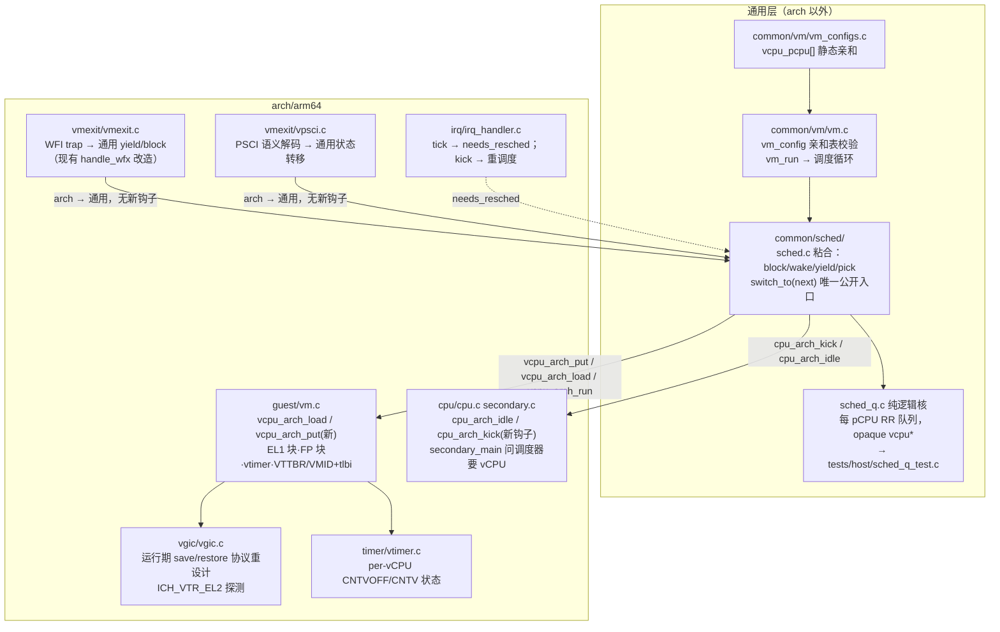
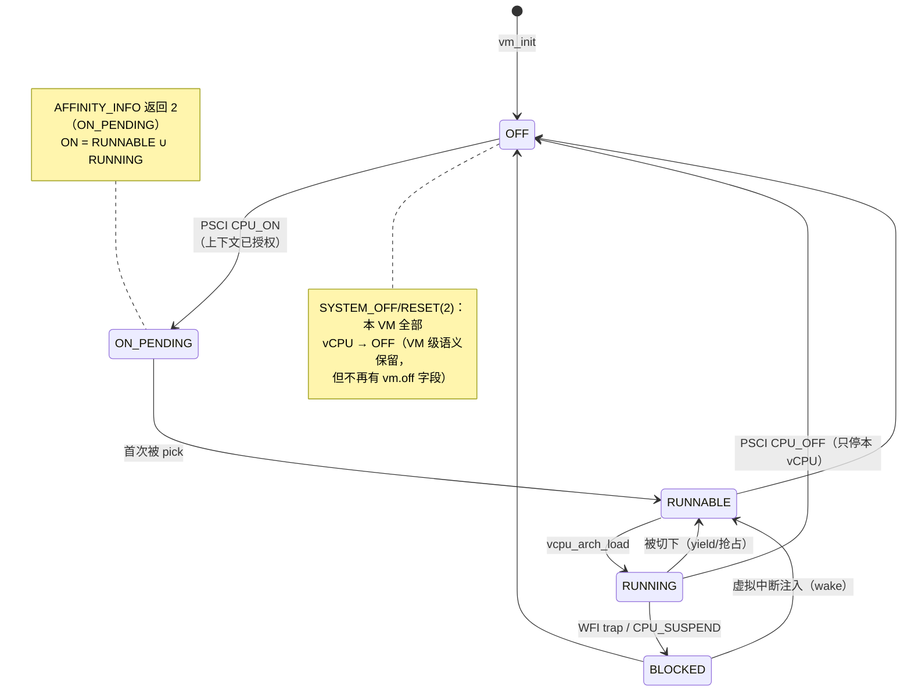
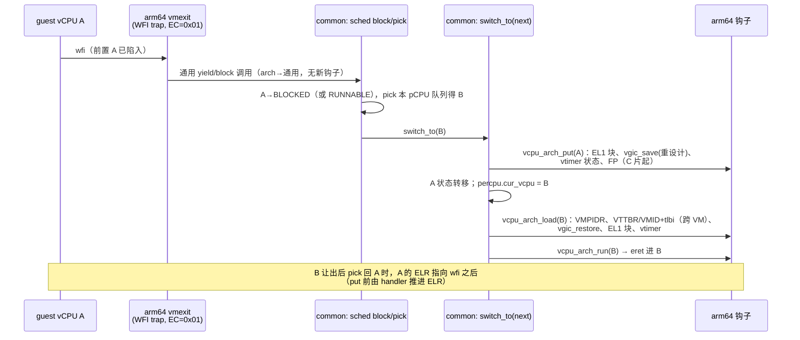

# M11 — vCPU 调度器与上下文切换设计（合并版）

> **Status:** Proposed（2026-10-30，架构师"M11 spec 对齐评审"产物；经关卡①批准后即为 M11
> 的唯一可执行 spec）。**定位:** M11 里程碑本体——前置 A（EL2 加固）、前置 B（PSCI/SMCCC
> 补全）已于 2026-10-28 按时间盒完成，无已知缺口（ADR-0017）。
> **来源与优先级:** 本文合并三份源文档——[2026-08-10 vCPU context-switch design]
> (2026-08-10-m11-vcpu-context-switch-design.md)、[2026-08-10 M11 决策记录]
> (2026-08-10-m11-decision-record.md)、[2026-10-04 arch-boundary 对齐]
> (2026-10-04-m11-arch-boundary-alignment.md)——并吸收此后落地的代码事实（前置 A/B、
> 2026-09-07 竞争修复、host 单测 harness）。冲突消解顺序：**已接受 ADR（0015/0016/0017）
> > 10-04 对齐 > 08-10 决策记录 > 08-10 设计**；逐条清单见第 3 节。三份源文档保持原样，
> 作为历史记录不修改（08-10 决策记录自身的"快照不随实现改"规则不变）。
> **参照分工（loop 宪章）:** xvisor + bao = 本里程碑机制参照（EL1 保存集、TLB/VMID、
> vtimer、FP）；ACRN = partitioned/pinned 调度基线形态。Q12 纪律沿用：实现者先自行推导、
> 第一版跑通后对照 bao/xvisor 找差异；卡壳超过一天即读，不受苦。
> **执行纪律:** nasa-glm-loop 关卡①② + 分级 TDD（host 单测 RED→GREEN commit 顺序可见，
> 从本里程碑纯逻辑模块起生效）；每切片手工双 VM Linux 启动 gate（沿用前置 A/B 惯例）。

## 1. Problem Statement（差距盘点，2026-10-30 对照代码核实）

M10 是静态 1:1 绑定（VM0 占 pCPU0/1、VM1 占 pCPU2/3），**vCPU 上下文切换不存在**：

- `struct vcpu_arch`（`arch/arm64/include/arch/vm.h`）只有 `hcr_el2`/`vttbr_el2`/
  `ich_hcr/ich_vmcr/ich_lr[4]`/SPI 影子字段，**零 EL1 系统寄存器**（08-10 设计的审计
  清单仍然成立：SCTLR/TTBR0/1/TCR/MAIR/VBAR/CPACR/TPIDR* 等全无保存点）。
- `vgic_save()`（`arch/arm64/vgic/vgic.c:148`）**仍是零调用者**，且其注释明确警告：
  运行期调度下"加锁也救不了活寄存器读覆盖远端已发布影子"——协议要重设计，不是加调用。
- `CNTVOFF_EL2 = 0` 仍是两处常量写入（`timer/vtimer.c:17`、`cpu/secondary.c:87`），
  非每 vCPU 状态；两个 vCPU 共享一个 pCPU 时会互相踩 `CNTV_CTL/CVAL_EL0`（见 8.2）。
- **静态 1:1 是三处结构性假设**，不只是配置：(a) `vm_init()` 的 `pcpu_base ==
  vmi*VCPUS_PER_VM` 启动检查（`common/vm/vm.c:32`）；(b) `secondary_main()` 由 pCPU id
  推出 (VM, vCPU)（`cpu/secondary.c:102`）；(c) `include/vm.h:37` 的
  `_Static_assert(NR_VMS * VCPUS_PER_VM <= NR_CPUS)` 与 PSCI CPU_ON 的
  `percpu[pcpu].online` ALREADY_ON 判断。ADR-0015"已知语义耦合"表把 (a)(b) 与
  `struct vm.off` 三项都标为**交给 M11**。
- `CPU_OFF/SYSTEM_OFF/SYSTEM_RESET(2)` 共用 `psci_power_down()`：VM 级 `vm->off` +
  踢停同 VM 全部 pCPU（`vmexit/vpsci.c:93`），`vm_list` 的 STATE 列读 `m->off`。
- 08-10 设计的 **S0 已不存在**：vuart 锁、`vgic_mmio_lock[NR_VMS]`、`spi_lock` 及
  `include/spinlock.h` 前提注释已于 2026-09-07 随 vgic-spi 同步化工作独立落地
  （[2026-09-07 spec](2026-09-07-vgic-spi-synchronization-design.md)）。
- 前置 A/B 已经替 M11 打好的地基：TWI/TWE 陷入已开（`handle_wfx` 现为放行）、TSC/TID3
  陷入已开、EL2 Stage-1 MMU + cache 已开、PSCI/SMCCC **接口面已冻结**（CPU_SUSPEND 为
  retention 形状、AFFINITY_INFO 只缺 ON_PENDING、`MIGRATE` 永久 NOT_SUPPORTED）。

## 2. 范围

**In scope**（ADR-0017 第 2 条 + 08-10 设计的并集）：

1. 每 vCPU 运行状态机（通用 `struct vcpu`），取代 `vm.off`；PSCI 按 vCPU 语义重写
   （CPU_OFF/CPU_ON 含 ON_PENDING/AFFINITY_INFO；CPU_SUSPEND 改走阻塞路径）。
2. 每结点静态 1:N 绑定（per-vCPU pCPU 亲和，来自 `vm_configs`）+ 每 pCPU runqueue +
   简单 round-robin pick。**无迁移、无负载均衡**（08-10 决策 Q4、ADR-0016 partitioned
   基线）。
3. `switch_to(next)` 单一公开入口 + 两层状态划分（汇编只存每次异常必需集；EL1 批量
   保存/恢复在 C，仅在真正切换时调用）——异常入口汇编不扩（08-10 决策 9/10）。
4. vGIC 运行期保存/恢复**协议重设计**（`vgic_save` 第一个真实调用点）+ 按
   `ICH_VTR_EL2` 探测 LR 数量。
5. 虚拟 timer 每 vCPU化：`CNTVOFF_EL2` + `CNTV_CTL/CVAL_EL0` 切换 + PPI 27 投递纪律
   （ADR-0017 新增，08-10 只有 CNTVOFF）。
6. 跨 VM 切换：`VTTBR_EL2`/VMID 切换 + TLB 失效纪律（仓库第一批 `tlbi vmalle1`）。
7. FP/SIMD 急切保存/恢复（V0–V31、FPSR、FPCR）；惰性 `CPTR_EL2.TFP` 明确推迟。
8. 协作式让出（WFI trap）先行，抢占式时间片（EL2 物理定时器）其后。
9. 自动化 Linux 启动门禁 `make test-linux`（放聚合 `make test` 之外），并显式重访
   ADR-0009。

**Out of scope**：vCPU 迁移与负载均衡；惰性 FP；round-robin 之外的调度策略；VMID 运行期
分配器（静态 per-VM VMID 即够，动态 VM 生命周期是 M12）；hypercall ABI/HSM/DM/virtio
（M12–M14）；FDT（M15）；SMMU/直通（M16）；AArch32 guest 与 debug/trace 寄存器组；
H-167 vmexit 计数器（除非某切片调试顺手需要且不扩散）；RK3588 真机验证（cache/独占访问
语义留 M15）。

## 3. 冲突消解决策清单（X vs Y → Z）

| # | 冲突 | 消解 | 依据 |
|---|---|---|---|
| D1 | 08-10 S0"先修 vuart/`g_vgicd` 竞争" vs 代码现状 | **S0 删除**：2026-09-07 已独立完成（vuart 锁、`vgic_mmio_lock`、`spi_lock`、注释订正），有 spec 与 bounded stress 验收 | 代码事实 + [2026-09-07 spec] |
| D2 | 08-10"Modules built or modified"按 arm64 单层写 vs ADR-0015 两层边界 | 两层拆分：运行状态进通用 `struct vcpu`（`include/vm.h`）；EL1 块/CNTVOFF/FP 块进 `struct vcpu_arch`；切换模块在 `common/`；寄存器清单只出现在钩子实现里 | 10-04 对齐表（CLAUDE.md 指定优先） |
| D3 | 08-10"`svm5` + 第六个 `HV_GUEST` profile + 新脚本" vs 现行测试规则 | 新场景一律 `tests/svm/cases/<case>.c` + `tests/svm/expect/<case>.txt` + 共用 `tests/run_svm_test.sh` 的 Makefile 目标；是否加共享 pCPU 的构建 profile 到切片①再定 | 10-04 对齐"路径与写法对照" |
| D4 | 08-10 S5（仅 per-vCPU `CNTVOFF`，排在跨 VM 之后） vs ADR-0017（虚拟 timer 完整保存/恢复进 M11） | 按 ADR-0017 扩为完整 vtimer 切换，且**必须随第一个共享 pCPU 的切片落地**——同 VM 两个 vCPU 共享 pCPU 就会互踩 `CNTV_CTL/CVAL`，跨 VM 不是前提 | ADR-0017 第 2 条 + 硬件事实 |
| D5 | 08-10"2×2-on-2 之外的超配不做" vs ADR-0017"vCPU 数量大于 pCPU 数量在范围内" | 超配进范围（1:N 绑定本身允许）；迁移仍排除 | ADR-0017 > 08-10 设计 |
| D6 | 08-10 假设的静态 1:1 代码结构 vs ADR-0015"映射不再是结构性的" | `vm_config` 增加 per-vCPU pCPU 亲和，取代 `pcpu_base+idx` 推导；`secondary_main` 改问通用调度器；编译期断言换成启动期逐项校验 | ADR-0015"已知语义耦合"表 + 10-04 对齐 |
| D7 | 08-10 Q2（CPU_OFF = 状态机第一切片）vs ADR-0015（`vm.off` 交给 M11）vs 前置 B（接口面冻结） | `vm.off` 删除，被每 vCPU 状态取代；PSCI 函数集合不变（前置 B 冻结），只改语义；`vm_list` STATE 列改从运行状态推导；CPU_SUSPEND 保持 retention 形状但实现改为"阻塞当前 vCPU"（前置 B 的前向指针） | 三者叠加，无实质冲突 |
| D8 | 08-10 Q7 ⚑（Linux 门禁自动化降级到最后）vs loop 现实（前置 A/B 每切片已手工跑双 VM Linux） | **手工双 VM Linux gate 成为每切片关卡②的固定项**（实际效果已反转降级）；自动化仍留最后切片并显式重访 ADR-0009；镜像来源是开放问题（9.1） | loop 协议 + 前置 A/B 先例 |
| D9 | 08-10 Q9 ⚑（故意半实现寄存器清单）+ Q12 ⚑（先推导后读参考）vs loop"落库历史保持全绿" | 学习实验作为**工作树内验收操作**执行后还原（host harness 先例），观察到的失败模式记 `docs/debug/`；不产生红 commit | harness 设计"TDD 纪律对 harness 自身的适用" |
| D10 | 08-10"单一测试接缝（guest 可观察）" vs host 单测层 | 双接缝分工：host 层只测 arch-neutral 纯逻辑（runqueue/状态转移），**不测寄存器清单**（08-10"清单即 bug"的否决理由对 host 层同样成立）；寄存器与硬件路径仍靠 detector guest + QEMU gate | [host harness 设计] 约束 |
| D11 | 08-10 八切片 vs loop 切片粒度（2–4 片、每片一支分支两道关卡） | 重组为 4 片（第 5 节），片内保持"一次一个变量"的提交/验收顺序；映射关系逐片注明 | loop 协议；08-10"一次一个变量"原则保留 |
| D12 | 08-10 切换模块命名/落点未定 vs 10-04 对齐"`switch_to` 与调度逻辑放 `common/`，文件名到 S3 再定" | 提案 `common/sched/`（`sched.c` 粘合层 + `sched_q.c` 纯逻辑核）+ `include/sched.h`；最终命名在首个调度切片①批准 | 10-04 对齐 |
| D13 | `vgic_save()` 08-10 只说"补第一个调用点" vs 代码注释"协议必须重设计" | 切片 B 的设计含影子 vs 活 LR 的协议重设计（约束见 8.1），不允许直接加调用 | `vgic.c` 注释 + 2026-09-07 协议 |
| D14 | 08-10 ADR 计划（两层划分/协作先行/急切 FP） | 三份 ADR 仍在其实现切片产出（B 片两份、C 片一份）；本合并本身不新增 ADR（见评审报告） | 08-10 决策记录 Q10/Q11/Q5 |
| D15 | 08-10 测试节"S2 自动化只能退到 SVM 级" | 维持：A 片 `psci` 用例加 vCPU 粒度断言；Linux 级 `echo 0 > …/cpu1/online` 断言进每片手工 gate，D 片自动化 | 08-10 决策记录 Q7 已知代价 |

## 4. 模块落点与运行状态

**运行状态机**（通用 `struct vcpu` 新增 `enum vcpu_state`；PSCI 可见语义映射在旁注）：

**协作式切换时序**（WFI 让出；抢占路径只把触发源换成 tick 置 `needs_resched`）：

两层状态划分（08-10 决策 10 的最终形态）：汇编入口仍只存 EL2 异常本身会碰的
GPR/`SP_EL1`/`ELR_EL2`/`SPSR_EL2`（每次异常，`vmexit_asm.S` 不变）；EL1 批量保存/恢复
是 `vcpu_arch_put/load` 的内部实现（每次切换，C 函数）。EL1 清单**不在本文给出终版**
（Q9/Q12 纪律）：切片 B 先自行推导 → `ctxsw` 用例验证 → 对照 bao/xvisor diff → 差异与
失败模式记 `docs/debug/`。`check_offsets` 随 `struct vcpu` 增长补条目（新字段一律追加在
汇编可见前缀之后，`arch/arm64/include/arch/vm.h` 现有规则）。

## 5. 切片分解（4 片；08-10 的 S0–S8 映射见括号）

| 片 | 吸收 | 一句话交付 |
|---|---|---|
| **A 生命周期与 PSCI 语义** | S1 探测器 + S2 状态机 | 每 vCPU 运行状态落地，PSCI 按 vCPU 重写，`vm.off` 消失；仍 1:1 绑定 |
| **B 调度器与协作式切换（同 VM）** | S3 + S5(vtimer) | runqueue + `switch_to` + 完整 EL1/vGIC/vtimer 切换；同 VM 2 vCPU 共享 1 pCPU，detector 转绿 |
| **C 跨 VM 共享与 FP/SIMD** | S4 + S6 | `VTTBR`/VMID/TLB 纪律 + 默认拓扑切 2×2-on-2；随后 FP 急切保存 |
| **D 抢占与 Linux 门禁** | S7 + S8 | 时间片抢占；`make test-linux` 自动化 + ADR-0009 重访，里程碑验收 |

### 片 A — 生命周期与 PSCI 语义（仍 1:1）

- **交付**：`enum vcpu_state` 进通用 `struct vcpu`；`vm_config` 增 per-vCPU pCPU 亲和
  （`vcpu_pcpu[]` 形态切片①定），`vm_init` 启动检查与 `include/vm.h` 编译断言相应替换
  （亲和项必须 `< NR_CPUS`；允许 1:N）；`vm.off` 删除，`vpsci.c` 重写：CPU_OFF 只停本
  vCPU（本 pCPU 无其它 runnable vCPU 时进 idle，不再 `cpu_arch_halt`）、SYSTEM_OFF(2)
  停全 VM、CPU_ON 授权上下文 + `ON_PENDING` + kick、AFFINITY_INFO 读运行状态、
  CPU_SUSPEND 改"阻塞当前 vCPU"（接口面不变，前置 B 冻结）；`vm_list` STATE 列从运行
  状态推导；启动流程改为 hypervisor 拉起全部 pCPU、空队列进 idle（`cpu_arch_idle`）。
- **host 测试**：状态转移若抽出纯函数（enum→enum + 事件表）则进 `tests/host/`；
  `sched_q` 尚不存在。预计新增 ≤1 个 host 测试文件。
- **QEMU**：`psci` 用例扩展（vCPU0 `CPU_OFF` 后 vCPU1 仍存活；AFFINITY_INFO 的
  ON_PENDING 路径）→ 现 7 场景全绿是回归网。**新场景**：`ctxsw` detector 用例（盖章
  EL1 系统寄存器 → CPU_ON 拉 vCPU1 → 让出 → 校验并点名失败寄存器）+ 独立 Makefile 目标
  `test-qemu-ctxsw`（**不进**聚合 `make test`，预期红：无调度器时 vCPU1 永不运行，用例
  输出点名失败——这是受控红，非挂死）；红证据按 harness 先例作为工作树验收操作留档。
- **DoD**：上述行为 + 7 场景全绿 + 手工双 VM Linux gate（含
  `echo 0 > /sys/devices/system/cpu/cpu1/online` 后 CPU0 存活断言）+ `check_offsets`
  补条目 + x86 stub 补新钩子空实现。

### 片 B — 调度器与协作式切换（同 VM 共享）

- **交付**：`common/sched/`（`sched_q.c` 纯逻辑核：每 pCPU RR 队列，opaque `struct vcpu *`，
  **不含** `vm.h`/`percpu.h`/`printk.h`，满足 host harness 的 arch-neutral 约束；
  `sched.c` 粘合层含 `sched_init/block/wake/yield/pick` 与 `switch_to(next)` 唯一公开
  入口）；`secondary_main` 改从调度器取首个 vCPU；`handle_wfx` 的 WFI 分支从放行改为
  通用 block/yield（WFE 维持放行）；`vcpu_arch_put` 新钩子 + EL1 批量保存/恢复 C 实现；
  vGIC 运行期保存/恢复协议重设计（`vgic_save` 第一个调用点）+ `ICH_VTR_EL2.ListRegs`
  探测替换 `ich_lr[4]` 硬编码；per-vCPU vtimer（`CNTVOFF` + `CNTV_CTL/CVAL` 影子 +
  PPI 27 投递纪律，两处常量写入收进 load 钩子）；`ctxsw` 用例（2 vCPU on 1 pCPU 构建）
  转绿并折入聚合 `make test`。
- **host 测试**：`tests/host/sched_q_test.c`——入队/出队/轮转/空队/重复入队/唤醒重排；
  **RED commit → GREEN commit 顺序可见**（loop 纪律从本片生效）。
- **QEMU**：`ctxsw` 转绿进聚合（场景 7→8）；`vtimer`/`dual` 等既有场景必须保持绿
  （默认拓扑仍 2+2-on-4，本片不动它）。
- **DoD**：同 VM 2 vCPU 在 1 pCPU 上协作轮转、detector 全寄存器断言通过、挂起虚拟中断
  跨让出不丢（08-10 用户故事 19 的断言进 `ctxsw` 期望文件）+ 手工双 VM Linux gate +
  **两份 ADR**（两层状态划分；协作先行与 WFI 让出点）。
- **风险缓冲**：本片最大（约 5–8 个 loop 日）。若切片①评审认为过大，允许拆为
  B1（sched_q + 调度循环 + WFI 让出，detector 先只断言 GPR/ELR 级）与 B2（EL1 全量 +
  vGIC/vtimer 协议）两个分支——拆分决定在关卡①做出，不开工后不追改。

### 片 C — 跨 VM 共享与 FP/SIMD

- **交付**：`vcpu_arch_load` 内做跨 VM `VTTBR_EL2`/VMID 切换 + `tlbi vmalle1`（保守：
  换 VM 必失效；VMID 打 tag 免失效作为记录在案的推迟优化，条件见 8.3）；默认双 VM 拓扑
  从 2+2-on-4 切到 **2×2-on-2**（VM0/VM1 各一 vCPU 共享 pCPU0/1；裁定 9.2——**仅 Linux
  演示拓扑，SVM 测试 profile 不翻**）；
  FP/SIMD 急切保存（`vcpu_arch` 追加 FP 块约 528 B；保存/恢复放独立 `.S` 或免
  `-mgeneral-regs-only` 的编译单元——EL2 自身不变量不解除，08-10 Q5 澄清维持）；
  `ctxsw` 用例追加 FP 盖章段。
- **host 测试**：无新增纯逻辑（拓扑是配置数据）。
- **QEMU**：**新场景**——双 VM 共享 pCPU 的隔离断言（两个 VM 在同一 IPA 盖不同值，
  交错切换后各自读回自己的值；用例命名与 SVM_BIN/SVM_BIN2 组合方式切片①定）。
- **DoD**：双 VM 时间片共享下单 VM 隔离成立 + 双 VM 各自 FP 负载结果正确 + 手工
  2×2-on-2 Linux gate（两 shell + Ctrl-T）+ **一份 ADR**（急切先于惰性 FP）。

### 片 D — 抢占与 Linux 门禁

- **交付**：EL2 物理定时器 tick（新钩子，对齐文档提议名 `cpu_arch_timer_arm`，切片①
  定名）驱动的时间片 round-robin；`needs_resched` 置位 → `vcpu_arch_run` 返回调度循环
  处切换（**不在中断上下文里切换**）；`make test-linux` 自动化目标（聚合之外，08-10
  用户故事 32/33：25 秒启动不拖慢分钟级循环）+ ADR-0009 显式重访；镜像来源按裁定 9.1
  实现（脚本化获取 + 固定哈希，`LINUX_RUN.sh` 留作本地覆盖）。
- **host 测试**：tick 抢占无新纯逻辑；`sched_q` 如需"时间片到期重排"语义则补 RED→GREEN。
- **QEMU**：里程碑验收场景 = 自动化双 VM 2×2-on-2 Linux 启动到 shell + 并发 FP 负载
  （08-10 头条声明的可执行化）。
- **DoD**：抢占下 `make test` 全绿 + `make test-linux` 绿 + ADR-0009 修订落档 +
  `CLAUDE.md` 里程碑表更新 + 里程碑收尾（known gaps 盘点、Linear 同步）。

## 6. 测试决策汇总

- **分级**：host（`make host-test`，纯逻辑秒级）→ QEMU 聚合（`make test`，现 7 场景 +
  4 静态检查，B 片起 8 场景）→ 手工双 VM Linux（每切片关卡②固定项）→ 自动化 Linux
  （D 片起）。
- **好测试标准不变**（08-10）：能抓住"没人列过的寄存器"的只有 guest 自己——detector
  用例是寄存器正确性的唯一自动接缝；host 层只测逻辑不测清单（D10）。
- **故意失败实验**（Q9 ⚑）：B 片实现期，工作树内先落半份清单 → 跑 `ctxsw` 观察失败
  模式 → 记 `docs/debug/` → 还原；再补全、再对照 bao/xvisor 记差异。全程不留红 commit
  （D9）。
- **check_offsets / arch-boundary / x86-stub**：每个新增钩子（第 7 节）必须同步
  `arch/x86/stub/hooks.c`，否则 `make test-x86-stub` 链接失败（ADR-0015 机制，自动执法）。

## 7. 钩子可移植性（ADR-0015 要求：新钩子必须回答"x86 能否实现"）

新增钩子提案（最终名与签名在对应切片①批准，并回填 10-04 对齐文档的可移植性表）：

| 钩子 | 片 | 语义 | x86 (VMX) | RISC-V (H 扩展) |
|---|---|---|---|---|
| `vcpu_arch_put(v)` | B | 把 `v` 从本 pCPU 卸下并保存架构状态 | 存 VMCS 外状态（MSR、FPU） | 存 `vs*` CSR |
| `cpu_arch_idle()` | A | 本 pCPU 空转等中断（IRQ 未屏蔽） | `hlt` 循环 | `wfi` 循环 |
| `cpu_arch_kick(pcpu)` | A | 让远端 pCPU 重新调度 | 发 IPI（LAPIC/SEND） | 软件中断 IPI |
| 抢占 tick（名待定） | D | 给本 pCPU 设下一次调度 tick | VMX preemption timer / LAPIC timer | `stimecmp` |

让出/阻塞（WFI trap）、每 vCPU 下电是 arch→通用方向，不新增钩子；`CNTVOFF`/VMID/TLB/
FP 全部藏在 put/load 内部（10-04 对齐既定规则）。

## 8. 风险与对策（详见当日评审报告 RISKS）

1. **vGIC 运行期保存协议**（8.1）：活 LR 读会覆盖远端刚发布的影子（`spi_shadow_pending`
   协议）。B 片设计必须先答"put 时影子与活 LR 谁赢、wake 时如何合并"，断言"挂起中断跨
   切换存活"进 `ctxsw`。
2. **虚拟 timer 共享**（8.2）：pre-ECV 无法陷入 `CNTV_*`；EL2 直存直取（xvisor/bao
   交叉核对）+ per-vCPU `CNTVOFF`；QEMU TCG 行为差异记入切片笔记——这是最可能触发
   Q12 逃生舱（卡壳一天即读参考）的部分。
3. **启动/电源流重排的回归面**（8.3）：A 片改启动顺序与 PSCI 语义，7 个既有场景是回归
   网；TLB 处置上保守换"换 VM 即 `tlbi vmalle1`"，免失效优化挂条件"在 QEMU 与真机各
   验证一次 VMID 隔离"后才能谈。

## 9. 开放问题 → 已裁定（2026-10-30，架构师依用户授权"项目有利决策由架构师定"径行裁定）

1. **Linux 镜像来源**（08-10 遗留阻塞子问题）：**裁定：不入库，脚本化获取 + 固定哈希**
   （`LINUX_RUN.sh` 环境变量保留为本地覆盖，`make test-linux` 前置校验）。大二进制不进
   git 历史，脚本+哈希可复现性等价，满足 ADR-0016 的"可复现验证"而非"自包含仓库"。
2. **默认演示拓扑是否切 2×2-on-2**：**裁定：C 片起默认 Linux 演示拓扑切 2×2-on-2；
   SVM 测试 profile（dual/shell/vspi 的 1:1 配置）不随之翻**。里程碑主张即演示形态；
   SVM profile 不动保住 7 场景回归语义，共享拓扑由新场景自带 profile（一次一个变量）。
3. **CPU_SUSPEND power_down 语义**：**裁定：M11 维持 retention（映射 BLOCKED），
   entry_point/context_id 继续忽略，真实下电推迟 M12**。DTB 无 idle-states 节点、
   Linux 不会调用，无消费者不扩状态机（ponytail）。

## 10. 源文档处置

三份源文档不修改、不标注 superseded（08-10 决策记录自身规定它是时间点快照；对齐说明的
表格继续作为钩子可移植性的活表回填）。本文批准后，M11 执行以本文为准；本文与已接受 ADR
冲突时以 ADR 为准，且冲突本身视为本文的 bug。
