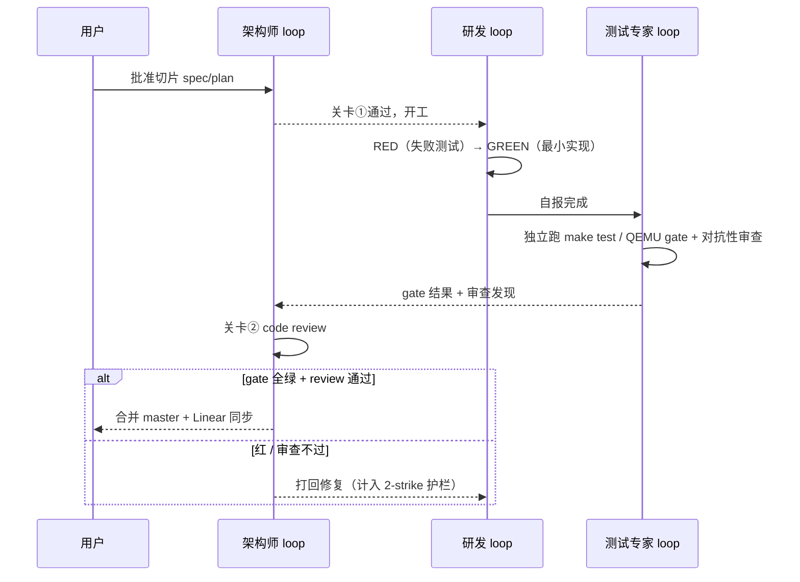

# nasa-glm-loop 设计：三专家 TDD 开发 loop（M11–M14）

> **Status:** Proposed（待用户批准）。**日期:** 2026-10-30。
> **分支:** `nasa-glm-loop-hyp`（worktree `../nasa-glm-loop-hyp`，基于 master `10b4df9`，已创建）。
> 本文档与 CLAUDE.md 冲突时以 CLAUDE.md 为准。

## 目标与结束条件

以"三专家 loop + superpowers 工作流 + 分级 TDD"持续开发，直到 **M11（vCPU 调度器）→
M12（hypercall ABI / VM 生命周期）→ M13（HSM 内核驱动）→ M14（用户态 DM + virtio 后端）
在 QEMU 上全部 gate 通过**。

- M15（RK3588 真机）与 M16（SMMU/直通）不在本 loop 范围；M14 收尾时单独向用户提出排期。
- 收尾动作：final gap 评审（对照 `../xvisor`、`../acrn-hypervisor`、`../bao-hypervisor`），
  剩余项记为 known gaps。

## 宪法（优先级高于 loop 一切偏好）

1. CLAUDE.md 全部治理规则，尤其：**里程碑前置限时与范围锁**（前置必须时间盒 + 清单锁，
   到期强制进下一里程碑）；ponytail 最小完整改动；新文档中文；架构文档用 Mermaid。
2. 已接受 ADR 与架构边界优先，不能以精简为由削弱。
3. 范围只能通过 ADR 或用户明确指令改变；loop 不得自我扩权。"直到功能完善"不构成扩权理由。

## 三专家

| 角色 | 职责 | 强制关卡 |
|---|---|---|
| 架构师 | ponytail 原则执法；spec/plan 评审；切片 code review；ADR 把关；arch-neutral 执法 | ① 切片开工前 spec 批准 ② 切片合并前 review 阻塞 |
| 研发 | 按批准的 plan 以分级 TDD 实现 | 无独立否决权，服从关卡 |
| 测试专家 | 独立跑 `make test` / QEMU gate（不信任研发自报）；对抗性审查（边界、并发、寄存器状态） | gate 红即阻塞合并 |

三专家以 subagent 实现，主会话做调度、汇总与日报。backlog 主轴 = 现有 Linear 路线图；
参考树（xvisor/ACRN/bao）只作实现查阅。

### 护栏

- 单切片 subagent 派发上限约 5 次。
- 连续 2 次修复后 gate 仍红 → 停止该切片，写入当日报告等用户裁决。
- 每日无小时配额：当日计划切片完成或触发护栏即停，写日报等用户反馈（次日用户说"开始"才继续）。

## 分级 TDD

- **Host 单测层（严格 RED-GREEN-REFACTOR）**：`tests/host/` + `make host-test`，零第三方依赖的
  纯 C assert runner。被测纯逻辑模块（位图、runqueue、解析、ABI 常量）必须 **arch-neutral**
  （不含 ARM64 内联汇编 / 架构寄存器头），host gcc 编译同一份源文件。commit 纪律：
  **RED commit（仅失败测试）→ GREEN commit（最小实现）** 在 git 历史顺序可见。
- **QEMU gate 层（硬件验收）**：`make test` 全套 + 各里程碑 spec 定义的场景；gate 失败即 red。
  QEMU 驱动用本机 FIFO 工作流（关 VM1 不关 VM0）。
- Host harness 本身是 loop 的第一个切片，设计需架构师评审。

## 切片生命周期

## 分支与产物

- 切片在 worktree `../nasa-glm-loop-hyp` 上开发；架构师批准后主工作区 `master` fast-forward
  合入（本 loop 是 master 的唯一写入者，切片间 loop 分支与 master 保持一致）。
- 日报：`docs/reports/YYYY-MM-DD-*.md`（中文），随当日最后合并进 master。内容：当日切片、
  commit 列表、gate 结果原文摘录、架构师评审结论、已知缺口、次日计划。
- 切片合入后同步 Linear issue 状态。

## 三环模型映射（Loop engineering）

- **Agentic coding loop（分钟级）**：切片内 RED → GREEN → gate 迭代，直到满足 spec。
- **Developer feedback loop（天级）**：每日日报 → 用户 check → 次日纠偏；用户是唯一范围/优先级变更源。
- **External feedback loop（慢）**：QEMU gate / 测试套件 = 内建 evals；RK3588 真机 = M14 之后的排期项。

## 启动序列（Day 1，用户已批准的顺序）

1. worktree 基线：`make test` 全绿（worktree 已创建）。
2. m11-pre-b 收尾：ADR-0017 已知缺口盘点、plan 状态更新、Linear 同步。
3. host 单测 harness：spec 撰写 → 架构师评审（当日目标：评审通过；实现可进 Day 2）。
4. gap sweep：对照 xvisor/ACRN/bao，时间盒 = 当日剩余时间，到期即止；产物 = Linear backlog
   issue + `docs/reference/arm/feature-gap-2026-10.md`（未覆盖区域明确列出，不装作覆盖了）。

## 进 M11 的前置动作

架构师先做 **M11 spec 对齐评审**：合并 2026-08-10 vCPU context-switch 设计与 2026-10-04
arch-boundary alignment 为一份可执行 spec + plan（沿用 `docs/superpowers/` 惯例）；结论若触及
排序/边界则写 ADR。评审通过才开 M11 切片。
