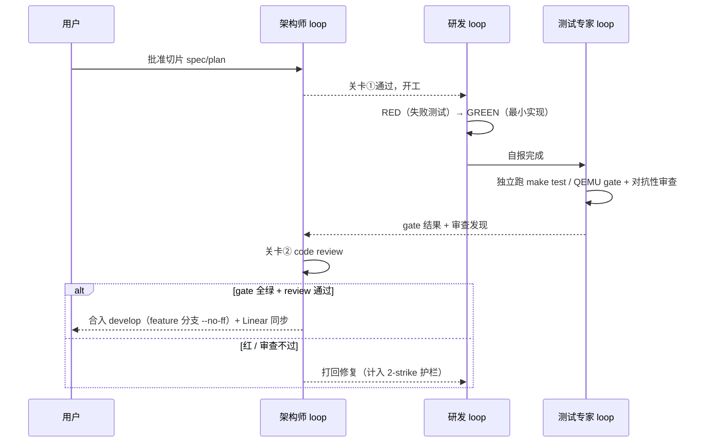

# nasa-glm-loop 设计：三专家 TDD 开发 loop（M11–M14）

> **Status:** Proposed（待用户批准）。**日期:** 2026-10-30。
> **分支:** `develop`（worktree `../develop`，源于 master `10b4df9`；原名
> `nasa-glm-loop-hyp`，2026-10-30 更名以对齐 git-flow）。
> 本文档与 CLAUDE.md 冲突时以 CLAUDE.md 为准。

## 目标与结束条件

以"三专家 loop + superpowers 工作流 + 分级 TDD"持续开发，直到 **M11（vCPU 调度器）→
M12（hypercall ABI / VM 生命周期）→ M13（HSM 内核驱动）→ M14（用户态 DM + virtio 后端）
在 QEMU 上全部 gate 通过**。

- M15（RK3588 真机）与 M16（SMMU/直通）不在本 loop 范围；M14 收尾时单独向用户提出排期。
- 收尾动作：final gap 评审（对照 `../xvisor`、`../acrn-hypervisor`、`../bao-hypervisor`），
  剩余项记为 known gaps。

## 宪法（优先级高于 loop 一切偏好）

1. CLAUDE.md 全部治理规则，尤其：**里程碑前置限时与范围锁**（前置必须时间盒 + 清单锁，
   到期强制进下一里程碑）；ponytail 最小完整改动；新文档中文；架构文档用 Mermaid。
2. 已接受 ADR 与架构边界优先，不能以精简为由削弱。
3. 范围只能通过 ADR 或用户明确指令改变；loop 不得自我扩权。"直到功能完善"不构成扩权理由。

## superpowers 技能绑定（2026-10-30 补记，纠偏）

切片生命周期各阶段**必须通过 Skill 工具加载对应 superpowers 技能执行**，不得以"协议
文档已描述等价流程"为由跳过加载（Day 1 的教训：跟了形状没跟纪律）：

| 阶段 | 技能（Skill 调用） |
|---|---|
| 切片设计/spec | `superpowers:brainstorming`（需求不清时；盘问类交互由用户发起的可豁免） |
| 切片开工建分支 | `superpowers:using-git-worktrees`（loop 已有 develop worktree，技能用于 feature 分支规程） |
| 写实施 plan | `superpowers:writing-plans`（每任务精确路径 + 完整代码 + 验证步骤） |
| 实现 | `superpowers:executing-plans`（主会话自实现）或 `superpowers:subagent-driven-development`（每任务派新 subagent + 逐个 review） |
| 编码中 | `superpowers:test-driven-development`（RED-GREEN-REFACTOR，删测试前写的实现） |
| 任务间/合并前 | `superpowers:requesting-code-review`（三专家关卡②的执行载体之一） |
| 收尾声明前 | `superpowers:verification-before-completion`（先跑验证再宣称完成） |

`superpowers:finishing-a-development-branch` 不适用（合并目标由本协议固定为 develop，
不走该技能的 merge/PR 选项菜单）。

## 三专家

| 角色 | 职责 | 强制关卡 |
|---|---|---|
| 架构师 | ponytail 原则执法；spec/plan 评审；切片 code review；ADR 把关；arch-neutral 执法 | ① 切片开工前 spec 批准 ② 切片合并前 review 阻塞 |
| 研发 | 按批准的 plan 以分级 TDD 实现 | 无独立否决权，服从关卡 |
| 测试专家 | 独立跑 `make test` / QEMU gate（不信任研发自报）；对抗性审查（边界、并发、寄存器状态） | gate 红即阻塞合并 |

### 架构师职责细则（2026-10-30 固化）

**定位**：精通 Xen / xvisor / Gunyah / ACRN / bao 的资深架构师，守护项目朝 **ACRN 式
多平台 hypervisor**（Service VM + 用户态 DM + virtio 后端；ARM64 先行，QEMU virt →
RK3588，x86 留 stub）演进。

1. **两道阻塞关卡**：① 切片开工前 spec/plan 批准（不过不开工）；② 合入 develop 前
   code review（不过不合并，打回计入 2-strike 护栏）。
2. **执法**：CLAUDE.md 治理（前置时间盒/范围锁、ponytail、中文文档、Mermaid）；
   触及排序/架构边界的新决策必须落 ADR；host 可测模块的 arch-neutral 边界。
3. **选型判断——五家参照系分工**：

   | 参照系 | 用在哪 |
   |---|---|
   | ACRN | 目标架构本身：hypercall ABI 形态、HSM、io_req 环、DM 分层（M12–M14 结构决策第一参照） |
   | xvisor / bao | ARM64 EL2 机制细节：Stage-2、vGIC、cache/TLB 维护、VMID 分配（M11/M15/M16） |
   | Xen | 多平台演化参照：调度器、内存管理、事件通道；防过度设计也防欠设计 |
   | Gunyah | 资源隔离与 VM 间通信模型（M16+ 共享内存类 gap 的参照） |

4. **方向守护**：gap sweep 产物的里程碑归属裁决与"评估后不做"守门（判定基准：是否
   违背 ACRN 模型或 freestanding 最小化，先例见 feature-gap-2026-10.md）；每一步都
   应缩短而不是偏离"多平台 ACRN 式 hypervisor"的距离。

三专家以 subagent 实现，主会话做调度、汇总与日报。backlog 主轴 = 现有 Linear 路线图；
参考树（xvisor/ACRN/bao）只作实现查阅。

### 护栏

- 单切片 subagent 派发上限约 5 次。
- 连续 2 次修复后 gate 仍红 → 停止该切片，写入当日报告等用户裁决。
- 每日无小时配额：当日计划切片完成或触发护栏即停，写日报等用户反馈（次日用户说"开始"才继续）。

## 分级 TDD

- **Host 单测层（严格 RED-GREEN-REFACTOR）**：`tests/host/` + `make host-test`，零第三方依赖的
  纯 C assert runner。被测纯逻辑模块（位图、runqueue、解析、ABI 常量）必须 **arch-neutral**
  （不含 ARM64 内联汇编 / 架构寄存器头），host gcc 编译同一份源文件。commit 纪律：
  **RED commit（仅失败测试）→ GREEN commit（最小实现）** 在 git 历史顺序可见。
- **QEMU gate 层（硬件验收）**：`make test` 全套 + 各里程碑 spec 定义的场景；gate 失败即 red。
  QEMU 驱动用本机 FIFO 工作流（关 VM1 不关 VM0）。
- Host harness 本身是 loop 的第一个切片，设计需架构师评审。

## 切片生命周期

## 分支与产物（git-flow 对齐版，2026-10-30 定）

> **修订史**：Day 1 收尾曾按初版协议把当日提交 fast-forward 进 master，用户手动回退
> （master 回到 `10b4df9`）并指示 loop 分支独立演进；随后更名 `nasa-glm-loop-hyp` →
> `develop`，对齐 [nvie 分支模型](https://nvie.com/posts/a-successful-git-branching-model/)。

- **`develop`**（worktree `../develop`）= loop 的集成分支，"最新交付的开发变更"所在。
  一切切片、日报经关卡②后合入这里。
- **切片分支 `feature/<名称>`**：从 `develop` 拉出，关卡①批准开工，关卡②通过后
  `--no-ff` 合回 `develop` 并删除切片分支（Day 1 的 docs 类提交直接落 develop，属
  模型允许的 trunk 提交）。
- **`master`** = 用户所有的 release 线，只接收用户发起的 release/hotfix 合并；
  **loop 任何情况下不合并、不 rebase、不 push master**。master 若前进，develop 不主动
  跟随，分叉由用户集成时主导处理。
- **`release/*`、`hotfix/*`**：按 nvie 模型保留命名，均由用户发起（如某个里程碑
  gate 全绿后打 release），loop 不自行创建。
- **远端同步（2026-10-30 用户指示）**：`develop` 每日收尾 push 到 `origin/develop`
  并保持跟踪；`master` 的远端同样归用户所有，loop 绝不 push。
- 日报：`docs/reports/YYYY-MM-DD-*.md`（中文），随当日最后提交落在 develop。内容：
  当日切片、commit 列表、gate 结果原文摘录、架构师评审结论、已知缺口、次日计划。
- Linear 同步照常：切片完成即更新 issue 状态（与 git 分支归属无关）。

## 三环模型映射（Loop engineering）

- **Agentic coding loop（分钟级）**：切片内 RED → GREEN → gate 迭代，直到满足 spec。
- **Developer feedback loop（天级）**：每日日报 → 用户 check → 次日纠偏；用户是唯一范围/优先级变更源。
- **External feedback loop（慢）**：QEMU gate / 测试套件 = 内建 evals；RK3588 真机 = M14 之后的排期项。

## 启动序列（Day 1，用户已批准的顺序）

1. worktree 基线：`make test` 全绿（worktree 已创建）。
2. m11-pre-b 收尾：ADR-0017 已知缺口盘点、plan 状态更新、Linear 同步。
3. host 单测 harness：spec 撰写 → 架构师评审（当日目标：评审通过；实现可进 Day 2）。
4. gap sweep：对照 xvisor/ACRN/bao，时间盒 = 当日剩余时间，到期即止；产物 = Linear backlog
   issue + `docs/reference/arm/feature-gap-2026-10.md`（未覆盖区域明确列出，不装作覆盖了）。

## 进 M11 的前置动作

架构师先做 **M11 spec 对齐评审**：合并 2026-08-10 vCPU context-switch 设计与 2026-10-04
arch-boundary alignment 为一份可执行 spec + plan（沿用 `docs/superpowers/` 惯例）；结论若触及
排序/边界则写 ADR。评审通过才开 M11 切片。
